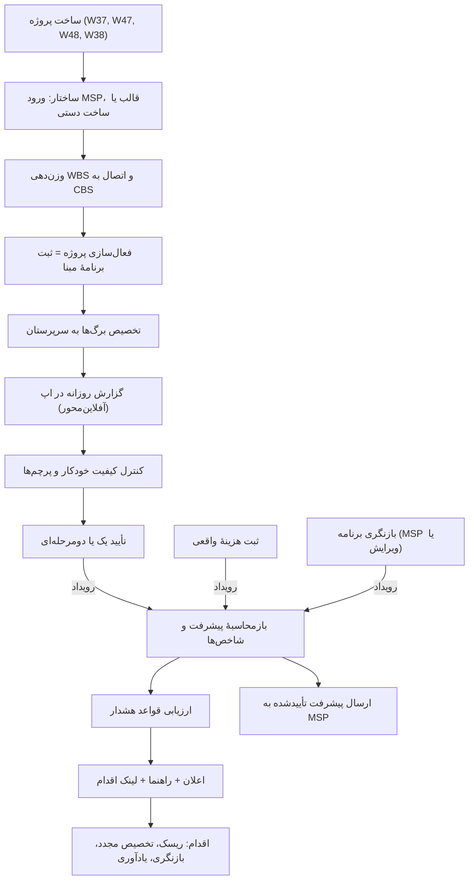

# پروژه‌یار — نمای کلی، مفاهیم دامنه و مثال مرجع

> **نسخه:** ۱ · **تاریخ:** 1405/08/11 · **مخاطب:** Claude Code و هر توسعه‌دهنده‌ای که روی پروژه‌یار کار می‌کند

---

## ۰. این مجموعه سند و نحوهٔ استفاده از آن

این پوشه مرجع پیاده‌سازی پروژه‌یار است. هدفش این است که پیش از نوشتن کد، هدف هر ویژگی، مفاهیم دامنه، پیش‌نیازها و ارتباط ویژگی‌ها با هم روشن باشد، تا هیچ تصمیمی وسط پیاده‌سازی گرفته نشود که کار قبلی را تغییر دهد.

### ترتیب خواندن

| فایل | محتوا | وضعیت |
|---|---|---|
| `00-overview.md` | محصول، نقش‌ها، چرخهٔ اصلی، مفاهیم دامنه، مثال مرجع | نسخهٔ ۱ |
| `01-foundation-decisions.md` | تصمیم‌های بنیادی D01–D12 و قراردادهای C01–C05 | تأییدشده |
| `02-domain-model.md` | موجودیت‌ها، روابط، قیود، ماشین‌های حالت، تصمیم‌های باز | نسخهٔ ۱ |
| `03-interaction-matrices.md` | ماتریس‌های وابستگی دادهای، محاسباتی و رفتاری | نسخهٔ ۱ |
| `features/*.md` | یک فایل برای هر ویژگی | نسخهٔ ۱ (۱۸ فایل) |
| `04-alert-engine.md` | کاتالوگ کامل قواعد هشدار | نسخهٔ ۱ |
| `05-roadmap.md` | ترتیب ساخت | نسخهٔ ۱ |

### قواعد کار برای Claude Code

1. پیش از کار روی هر ویژگی، فایل همان ویژگی و بخش «ارتباطات» ویژگی‌های همسایه‌اش را بخوان.
2. **هیچ تصمیم دامنه‌ای را بی‌صدا نگیر.** اگر سند برای موقعیتی پاسخ ندارد یا دو بخش سند با هم تعارض دارند، کار آن بخش را متوقف کن، پرسش را در بخش «تصمیم‌های باز» همان فایل ثبت کن و از کاربر بپرس.
3. ویژگی‌ای که تصمیم باز حل‌نشده دارد، آمادهٔ ساخت نیست.
4. نام موجودیت‌ها و فیلدها در این سند **مفهومی** است. بخشی از پروژه از قبل پیاده شده؛ اگر در کد موجود موجودیتی با همین هدف هست، آن را نگاشت و تکمیل کن و موجودیت تکراری نساز. اختلاف کد موجود با سند را گزارش کن و هیچ‌کدام را بی‌صدا عوض نکن.
5. همهٔ محاسبات باید **مثال مرجع** بخش ۶ را دقیقاً بازتولید کنند. این مثال پایهٔ تست‌های واحد محاسبات است.
6. هیچ محاسبهٔ کسب‌وکاری در کنترلر، رابط وب یا اپ انجام نمی‌شود؛ فقط در ماژول محاسبات بک‌اند (D07).

### برچسب‌ها و شناسه‌ها

- `[تأییدشده]`: با تصمیم کاربر یا منبع معتبر تثبیت شده است.
- `[فرض]`: پیشنهاد معقول که هنوز تأیید نشده؛ پیش از ساخت ویژگی مربوط باید تأیید شود. (در نسخهٔ 1405/08/11 همهٔ فرض‌ها تأیید و به `[تأییدشده]` تبدیل شد؛ این برچسب برای موارد آینده می‌ماند.)
- `[پیشنهاد: OD-xx]`: تصمیم باز با پیشنهاد در انتظار تأیید کاربر؛ فهرست کامل در `02-domain-model.md` بخش ۱۴.
- `[پیش‌فرض فنی]`: Claude Code می‌تواند تغییر دهد؛ در PR ذکر شود.
- شناسه‌ها: تصمیم‌ها `D01`…، قراردادها `C01`…، تصمیم‌های باز `OD-01`…، قواعد هشدار `AL-…`، کدهای دسترسی مثل `wbs.edit`.

### رابطه با بوم طراحی

بوم طراحی (`https://claude.ai/artifact/B61fPQebYfAakaSiWvXA9g`) مرجع **رابط کاربری** است: چیدمان، متن‌ها و جریان صفحه‌ها. شناسهٔ صفحه‌ها (`W01`…`W49` برای وب، `M01`…`M14` برای اپ) در این سند برای ارجاع به کار می‌رود. هر صفحه یک فایل HTML در مسیر `project/` آرتیفکت است (مثلاً `project/W11-Wbs.dc.html`).

**اعداد بوم نمونه‌اند** و در چند جا با هم ناسازگارند؛ مثلاً در W14 و W22 هزینهٔ واقعی ۵۵۰ و ارزش کسب‌شده ۵۵۳ میلیارد ریال با CPI=0.97 جور درنمی‌آید (با این دو عدد CPI حدود ۱٫۰۱ است). مرجع عددی، مثال مرجع همین سند است. هرجا رفتار نوشته‌شده در این سند با بوم فرق دارد، این سند معتبر است.

---

## ۱. محصول در یک نگاه

**پروژه‌یار** یک پلتفرم کنترل پروژه برای پروژه‌های عمرانی است که **کنار MS Project** کار می‌کند، نه به‌جای آن.

**مشکل.** در یک شرکت پیمانکاری بزرگ معمولاً برنامهٔ زمانی را کارشناس کنترل پروژه در MS Project نگه می‌دارد. پیشرفت از کارگاه با پیام‌رسان، اکسل یا کاغذ و با تأخیر می‌رسد، و هزینه‌ها جای دیگری ثبت می‌شوند. در نتیجه مدیر پروژه و مدیرعامل تصویر به‌موقع و قابل اعتمادی از اینکه «کجای کار هستیم، چقدر عقبیم و چرا» ندارند. ابزارهای داخلی موجود یا در حد کارتابل ثبت گزارش‌اند، یا WBS می‌سازند اما آن را به هزینه (CBS) وصل نمی‌کنند و بر اساس آن هشدار و راهنمایی نمی‌دهند.

**راه‌حل در سه حلقه:**

1. **ساختار:** WBS وزن‌دار و CBS متصل به آن، از فایل MSP، قالب سازمانی یا ساخت دستی.
2. **داده:** گزارش پیشرفت روزانه از اپ اندروید (آفلاین‌محور) با کنترل کیفیت خودکار (عکس، GPS، جهش غیرعادی) و گردش‌کار تأیید.
3. **کنترل:** محاسبهٔ پیشرفت فیزیکی و ریالی، شاخص‌های ارزش کسب‌شده، انحراف از برنامه، و **موتور هشدار** که برای هر مشکل راهنما و اقدام پیشنهادی می‌دهد. پیشرفت تأییدشده به MSP برمی‌گردد.

**مشتری هدف:** شرکت‌های پیمانکاری اصلی در پروژه‌های عمرانی بزرگ (ساختمانی، راه و پل، تأسیسات).

**آنچه پروژه‌یار نیست:**

- زمان‌بند نیست؛ مسیر بحرانی و تاریخ‌ها را محاسبه نمی‌کند (D05).
- نرم‌افزار حسابداری نیست؛ هزینهٔ واقعی را در یک دفتر هزینه نگه می‌دارد و بعداً از حسابداری هم دریافت می‌کند (D02).
- در نسخهٔ اول، صورت‌وضعیت به کارفرما، متره و تعدیل ندارد (D01).
- سامانهٔ مکاتبات و مدیریت اسناد نیست.

**سطوح محصول:**

| سطح | فناوری | کاربران اصلی |
|---|---|---|
| بک‌اند | NestJS | — |
| پنل وب | React | مدیر سازمان، مدیر پروژه، برنامه‌ریز، ناظر، واحد مالی، ناظر کارفرما |
| اپ اندروید | Flutter | سرپرست کارگاه |

---

## ۲. نقش‌ها

نقش هر کاربر **در هر پروژه جداگانه** تعیین می‌شود و یک کاربر می‌تواند در یک پروژه بیش از یک نقش داشته باشد (W16، W27). فقط «مدیر سازمان» نقش سطح سازمان است.

| نقش | کد | در دنیای واقعی | در پروژه‌یار |
|---|---|---|---|
| مدیر سازمان | `org_admin` | مدیر سیستم یا دفتر مرکزی شرکت | کاربران، نقش‌ها، قالب‌ها، تنظیمات سازمان؛ دسترسی کامل و غیرقابل‌تغییر |
| مدیر پروژه | `project_manager` | مسئول نهایی زمان، هزینه و کیفیت پروژه | تأیید مرحلهٔ دوم، تأییدکنندهٔ جایگزین پیش‌فرض، مالک ریسک‌های مهم، دریافت هشدارهای بحرانی |
| برنامه‌ریز | `planner` | کارشناس برنامه‌ریزی و کنترل پروژه؛ نگه‌دارندهٔ فایل MSP | ورود و همگام‌سازی MSP، ویرایش WBS و CBS، اتصال‌ها، بازنگری‌ها، گزارش‌های مدیریتی |
| ناظر | `reviewer` | مهندس **داخلی پیمانکار** که کار یک حوزه (مثلاً تأسیسات) را کنترل می‌کند | تأیید مرحلهٔ اول گزارش‌های حوزهٔ خودش |
| سرپرست کارگاه | `supervisor` | سرپرست اجرای بخشی از کار در کارگاه | ثبت گزارش روزانه و مشکل کارگاه در اپ؛ پنل وب ندارد |
| ناظر کارفرما | `client_reviewer` | نمایندهٔ کارفرما یا مشاور ناظر | مشاهدهٔ پیشرفت و گزارش‌ها، بدون مبالغ `[تأییدشده]` |
| واحد مالی | `finance` | حسابداری پروژه | ثبت و مشاهدهٔ هزینهٔ واقعی و مبالغ `[تأییدشده]` |

**اصلاح 1405/08/22 (تصمیم کاربر):** شش نقش پروژه‌ای سیستمی‌اند (ستون‌های `access-control.md` ۵.۴) و کد سرپرست `supervisor` است. کاربری که در هیچ پروژه نقشی جز سرپرست ندارد و مدیر سازمان نیست، به پنل وب وارد نمی‌شود.

> **هشدار نام‌گذاری:** در عرف پروژه‌های ایران «ناظر» معمولاً به مشاور ناظرِ کارفرما گفته می‌شود. در پروژه‌یار «ناظر» مهندس داخلی پیمانکار است که گزارش‌های سرپرستان را بررسی می‌کند. نمایندهٔ کارفرما نقش جداگانهٔ «ناظر کارفرما» است. در کد برای ناظر داخلی از `reviewer` استفاده کن تا این دو با هم اشتباه نشوند.

---

## ۳. چرخهٔ اصلی محصول



ستون فقرات همهٔ ویژگی‌ها این ترتیب است: **رویداد ← محاسبه ← هشدار ← اعلان** (D07). هر ویژگی که دادهٔ مؤثر بر محاسبات تولید می‌کند، فقط رویداد منتشر می‌کند و خودش چیزی را دوباره حساب نمی‌کند.

---

## ۴. مفاهیم دامنه

این بخش برای توسعه‌دهنده‌ای نوشته شده که پیش‌زمینهٔ پروژه‌های عمرانی ندارد. فرمول‌های دقیق در فایل‌های ویژگی می‌آیند.

### ۴.۱ WBS — ساختار شکست کار

درختی که کل کار پروژه را به اجزای کوچک‌تر می‌شکند.

- **برگ:** کوچک‌ترین واحد کار که برایش پیشرفت گزارش می‌شود، سرپرست دارد و به هزینه وصل می‌شود؛ مثل «بتن‌ریزی فونداسیون بلوک A».
- **والد:** فقط گروه‌بندی است؛ پیشرفتش از فرزندانش محاسبه می‌شود و مستقیماً گزارش نمی‌گیرد.
- **کد:** جایگاه آیتم در درخت را نشان می‌دهد (مثل `1.2.3`). کد فقط برای نمایش است و شناسهٔ آیتم نیست (C01).
- **نقطهٔ عطف (Milestone):** رویدادی با مدت صفر، مثل «تحویل موقت».

```
1   مجتمع مسکونی (کل پروژه)
1.1   عملیات خاکی
1.1.1   خاکبرداری            ← برگ
1.2   سازه
1.2.1   فونداسیون
1.2.1.1   آرماتوربندی فونداسیون  ← برگ
```

### ۴.۲ وزن

سهم هر آیتم از پیشرفت **والدش**. جمع وزن فرزندان هر والد دقیقاً ۱۰۰ است.

- **وزن در والد:** همان عددی که ذخیره می‌شود.
- **وزن در پروژه:** حاصل‌ضرب وزن‌ها در مسیر از ریشه؛ ذخیره نمی‌شود. اگر «سازه» ۴۵٪ پروژه و «سقف» ۲۰٪ سازه باشد، سقف ۹٪ کل پروژه است.
- وزن را می‌توان دستی تعیین کرد یا از بودجه یا مدت آیتم‌ها تولید کرد (D04).

### ۴.۳ روش اندازه‌گیری پیشرفت برگ (D03)

- **مقداری:** کار مقدار شمردنی دارد. ۱۸۰ مترمکعب از ۲۰۰ مترمکعب بتن یعنی ۹۰٪.
- **درصدی:** سرپرست مستقیماً درصد را اعلام می‌کند؛ برای کارهایی که مقدار شمردنی ندارند.
- **گام‌های وزنی:** کار به چند گام با وزن ثابت تقسیم می‌شود؛ مثلاً ستون: قالب‌بندی ۲۰، آرماتوربندی ۲۰، بتن‌ریزی ۶۰. وقتی قالب و آرماتور تمام شده باشد، پیشرفت ۴۰٪ است.
- **پیشرفت زمانی (D03-الف):** برای هزینه‌های غیرمستقیم مثل کادر کارگاه و بیمه. پیشرفت با گذر زمان خودکار جلو می‌رود، گزارش کارگاه نمی‌گیرد و در پیشرفت فیزیکی وزن صفر دارد.

### ۴.۴ پیشرفت برنامه‌ای، پیشرفت واقعی و انحراف

- **پیشرفت برنامه‌ای:** جایی که طبق برنامه باید تا تاریخ داده رسیده باشیم.
- **پیشرفت واقعی:** محاسبه‌شده فقط از گزارش‌های **تأییدشده**.
- **انحراف** = واقعی − برنامه‌ای، به **واحد درصد** (نه درصد نسبی). واقعی ۶۵ و برنامه‌ای ۷۰ یعنی انحراف −۵.

| وضعیت | شرط (d = انحراف) | رنگ |
|---|---|---|
| بحرانی | d ≤ −15 | قرمز |
| هشدار | −15 < d ≤ −5 | نارنجی |
| طبق برنامه | −5 < d ≤ 0 | سرمه‌ای |
| جلوتر از برنامه | d > 0 | سبز |

آستانه‌های ۵ و ۱۵ در تنظیمات پروژه قابل تغییرند (W29). طبقه‌بندی همیشه با مقدار گرد‌نشده انجام می‌شود. `[تأییدشده]` برای بازه‌ها؛ `[تأییدشده]` برای اینکه دقیقاً −۵ «هشدار» و دقیقاً ۰ «طبق برنامه» است.

### ۴.۵ تاریخ داده (Data Date)

تاریخی که همهٔ اعداد «تا پایان آن روز» گزارش می‌شوند. به‌طور پیش‌فرض امروز است؛ برای نمودارهای تاریخی و دوره‌های بسته‌شده، تاریخ‌های گذشته.

### ۴.۶ برنامهٔ مبنا، بازنگری و جاری (D05)

- **برنامهٔ مبنا (Baseline):** برنامهٔ مصوب لحظهٔ فعال‌سازی پروژه. هرگز تغییر نمی‌کند و معیار سنجش عملکرد است.
- **بازنگری (Revision):** هر تغییر رسمی بعدی در ساختار، وزن، تاریخ یا بودجه یک نسخهٔ شماره‌دار تازه است (R1، R2، …).
- **جاری:** آخرین بازنگری اعمال‌شده.
- در منحنی S هر دو دیده می‌شوند: خط «برنامهٔ اولیه» و خط «بازنگری‌شده».

### ۴.۷ MS Project (MSP)

- **فایل‌ها:** `MPP` (قالب اصلی و دودویی) و `XML` (خروجی قابل خواندن). نسخهٔ اول XML را کامل پشتیبانی می‌کند و MPP با کتابخانهٔ مبدل.
- **UID:** شناسهٔ پایدار هر فعالیت در فایل MSP؛ مبنای تطبیق آیتم‌ها در همگام‌سازی. با جابه‌جایی یا تغییر کد فعالیت تغییر نمی‌کند.
- **Resource Names:** ستون منابع در MSP که هنگام ورود به سرپرست آیتم نگاشت می‌شود (W35).
- **وابستگی:** رابطهٔ ترتیبی بین فعالیت‌ها؛ رایج‌ترین آن «پایان به شروع» (FS) است: B تا تمام نشدن A شروع نمی‌شود.
- **شناوری کل (Total Float):** تعداد روزهایی که یک فعالیت می‌تواند عقب بیفتد بدون اینکه پایان پروژه عقب بیفتد.
- **مسیر بحرانی:** زنجیرهٔ فعالیت‌هایی که شناوری صفر یا منفی دارند؛ هر روز تأخیر آن‌ها پایان پروژه را یک روز عقب می‌اندازد. پروژه‌یار این‌ها را محاسبه نمی‌کند و از MSP می‌گیرد (D05).

### ۴.۸ CBS — ساختار شکست هزینه (D01)

درخت اقلام **هزینهٔ پیمانکار** (نه قیمت پیمان با کارفرما). هر قلم برگ این مشخصات را دارد:

- **نوع هزینه:** مصالح، نیروی انسانی، ماشین‌آلات، حمل، پیمانکار جزء، بالاسری، سایر `[تأییدشده]` (`features/cbs.md` ۴.۲)
- **واحد**، **مقدار برآوردی**، **نرخ واحد**
- **بودجه** = مقدار × نرخ؛ بودجهٔ هر والد = جمع بودجهٔ فرزندان.

مثال: قلم «آرماتور AIII»، نرخ ۹۵ میلیون ریال در تن، مقدار ۱٬۵۲۶ تن.

### ۴.۹ اتصال WBS ↔ CBS و زیربودجه

هر برگ WBS به یک یا چند قلم CBS وصل می‌شود و برای هر اتصال یک **مقدار مصرف** دارد:

- **زیربودجهٔ اتصال** = مقدار مصرف × نرخ واحد قلم CBS
- **بودجهٔ برگ (BAC برگ)** = جمع زیربودجه‌های اتصال‌های آن برگ

مثال: «آرماتوربندی سقف» ۱۴۵ تن از قلم «آرماتور AIII» مصرف می‌کند، پس زیربودجه‌اش ۱۴۵ × ۹۵ میلیون = ۱۳٫۷۷۵ میلیارد ریال است.

برگی که به CBS وصل نیست، بودجه ندارد و برایش شاخص‌های ارزش کسب‌شده محاسبه نمی‌شود (W15 هشدار می‌دهد).

### ۴.۱۰ هزینهٔ واقعی و دفتر هزینه (D02)

هزینه‌ای که واقعاً تحقق یافته است؛ مثل مصالح تحویل‌شده، کار انجام‌شدهٔ نیروی انسانی، یا صورت‌وضعیت تأییدشدهٔ پیمانکار جزء. هر هزینه یک ردیف در دفتر هزینه است که به یک قلم CBS اشاره دارد.

**تاریخ کامل بودن هزینه‌ها:** چون هزینه‌ها معمولاً دیرتر از پیشرفت ثبت می‌شوند، واحد مالی اعلام می‌کند هزینه‌ها تا چه تاریخی کامل‌اند. شاخص‌های هزینه (CPI و …) در همان تاریخ محاسبه می‌شوند و تاریخشان کنارشان نمایش داده می‌شود (OD-19).

### ۴.۱۱ مدیریت ارزش کسب‌شده (EVM)

روش استاندارد سنجش هم‌زمان زمان و هزینه با یک واحد پولی. `[تأییدشده — تعاریف استاندارد PMI]`

| نماد | نام فارسی | تعریف | تفسیر |
|---|---|---|---|
| BAC | بودجه در اتمام | جمع بودجهٔ برگ‌ها | کل بودجهٔ کار |
| PV | ارزش برنامه‌ای | Σ (BAC برگ × پیشرفت برنامه‌ای برگ) | ارزش کاری که **باید** تا امروز انجام می‌شد |
| EV | ارزش کسب‌شده | Σ (BAC برگ × پیشرفت واقعی برگ) | ارزش بودجه‌ای کاری که **واقعاً** انجام شد |
| AC | هزینهٔ واقعی | جمع دفتر هزینه تا تاریخ داده | پولی که واقعاً خرج شد |
| CV | انحراف هزینه | EV − AC | منفی یعنی برای این مقدار کار بیش از بودجه خرج شده |
| SV | انحراف زمان (ریالی) | EV − PV | منفی یعنی عقب‌تر از برنامه |
| CPI | شاخص عملکرد هزینه | EV ÷ AC | کمتر از ۱ یعنی بدتر از بودجه |
| SPI | شاخص عملکرد زمان | EV ÷ PV | کمتر از ۱ یعنی کندتر از برنامه |
| EAC | برآورد در اتمام | BAC ÷ CPI (فرمول پیش‌فرض) | هزینهٔ پیش‌بینی‌شدهٔ کل اگر روند فعلی ادامه یابد `[تأییدشده]` (نهایی در `features/evm.md` ۵) |
| VAC | انحراف در اتمام | BAC − EAC | منفی یعنی پیش‌بینی فراتر رفتن از بودجه |
| TCPI | شاخص عملکرد لازم | (BAC − EV) ÷ (BAC − AC) | کارایی هزینه‌ای لازم برای باقی کار تا در بودجه بمانیم |

### ۴.۱۲ پیشرفت فیزیکی و پیشرفت ریالی

- **پیشرفت فیزیکی:** از وزن‌ها محاسبه می‌شود (D04).
- **پیشرفت ریالی:** EV ÷ BAC.

اگر وزن‌ها دقیقاً از بودجه ساخته شده باشند، این دو برابرند؛ در غیر این صورت کمی فرق دارند. گزینهٔ «هر دو شاخص» در تنظیمات فقط هر دو را کنار هم نمایش می‌دهد.

### ۴.۱۳ منحنی S

نمودار پیشرفت **تجمعی** در طول زمان. شکلش معمولاً شبیه S است: شروع کند، میانهٔ تند و پایان کند. پروژه‌یار چهار خط نشان می‌دهد: برنامهٔ مبنا، برنامهٔ بازنگری‌شده، واقعی، و پیش‌بینی.

### ۴.۱۴ گزارش کارگاه، آیتم و تأیید (D08)

- **گزارش روزانه:** آنچه سرپرست در یک ارسال از اپ می‌فرستد؛ شامل هوا، نفرات، موقعیت GPS و چند **آیتم**.
- **آیتم:** پیشرفت یک برگ WBS، به‌همراه عکس‌ها و توضیح. تأیید در سطح هر آیتم انجام می‌شود، نه کل گزارش.

**پرچم‌های کنترل کیفیت** `[تأییدشده — W29]`:

| پرچم | شرط |
|---|---|
| عکس ناکافی | کمتر از ۲ عکس؛ چنین آیتمی هرگز خودکار تأیید نمی‌شود |
| جهش غیرعادی | تغییر بیش از ۲۰ واحد درصد نسبت به آخرین مقدار تأییدشده؛ آیتم به مرحلهٔ دوم می‌رود |
| خارج از محدودهٔ GPS | فاصله از کارگاه بیش از ۳۰۰ متر |
| ثبت با تأخیر | بیش از ۷۲ ساعت بین ثبت در گوشی و دریافت در سرور |

**قواعد گردش‌کار:**

- **تأیید خودکار:** تغییر کمتر از ۲ واحد درصد، دست‌کم ۲ عکس، و GPS معتبر.
- **مرحلهٔ دوم (مدیر پروژه):** فقط برای تغییر بیش از آستانهٔ بحرانی (۱۵)، جهش غیرعادی، یا GPS خارج از محدوده.
- **مهلت بررسی:** ۲۴ ساعت؛ پس از آن یادآوری یا ارجاع به تأییدکنندهٔ جایگزین.

### ۴.۱۵ صورت‌وضعیت، متره، فهرست‌بها و تعدیل (زمینه؛ بیشترش خارج از نسخهٔ اول)

- **صورت‌وضعیت:** سند دوره‌ای مطالبهٔ مبلغ کار انجام‌شده. دو جهت دارد:
  - از **پیمانکار جزء** به پیمانکار اصلی: برای پیمانکار اصلی **هزینه** است و در نسخهٔ اول در دفتر هزینه ثبت می‌شود.
  - از **پیمانکار اصلی** به کارفرما: **درآمد** است و در نسخهٔ اول پیاده نمی‌شود (D01).
- **متره:** اندازه‌گیری مقادیر کار انجام‌شده برای صورت‌وضعیت.
- **فهرست‌بها:** فهرست قیمت واحد کارها که سازمان برنامه و بودجه منتشر می‌کند و مبنای قیمت بسیاری از پیمان‌های دولتی است.
- **تعدیل:** اصلاح مبالغ پیمان بر اساس شاخص‌های تورمی رسمی، در پیمان‌های مشمول.

### ۴.۱۶ ریسک

رویداد نامطمئنی که اگر رخ دهد روی زمان یا هزینه اثر دارد.

- **امتیاز** = احتمال (۱ تا ۵) × اثر (۱ تا ۵).
- **سطح:** کم ۱–۸، متوسط ۹–۱۴، بالا ۱۵–۱۹، بحرانی ۲۰–۲۵. ریسک ۱۵ به بالا اعلان فوری دارد. `[تأییدشده]`
- **راهبرد پاسخ:** اجتناب، کاهش، انتقال، پذیرش.
- **نشانهٔ هشدار (Trigger):** علامتی که نشان می‌دهد ریسک در حال رخ دادن است؛ مثلاً «تحویل کمتر از ۷۰٪ بار هفتگی ورق».
- مشکل‌هایی که سرپرست در اپ گزارش می‌کند (M13) با برچسب «از کارگاه» وارد دفتر ریسک می‌شوند.

### ۴.۱۷ ذخیرهٔ احتیاطی

مبلغی بیرون از اقلام CBS که برای پاسخ به ریسک‌ها کنار گذاشته می‌شود؛ مثلاً ۵٪ بودجه (W47). بخشی از آن ممکن است به ریسک‌های مشخص اختصاص یابد (W19). ذخیرهٔ احتیاطی بیرون از BAC است؛ مصرف آن از راه بازنگری بودجه به CBS منتقل می‌شود (`features/cbs.md` ۶.۱).

---

## ۵. اصول طراحی محصول

این اصول بر همهٔ ویژگی‌ها حاکم‌اند:

1. **عدد بی‌منبع نداریم.** هر عدد روی صفحه باید تا منبعش قابل ردیابی باشد: آیتم تأییدشده، ردیف دفتر هزینه یا نسخهٔ برنامه. هر عدد مهم قابلیت «از کجا آمد؟» دارد.
2. **فقط دادهٔ تأییدشده در محاسبات.** مقادیر در انتظار جداگانه و با برچسب نمایش داده می‌شوند ولی در هیچ شاخصی شرکت نمی‌کنند.
3. **هر هشدار راهنما و اقدام دارد.** هشداری که نگوید «چه کار کنم و کجا» ناقص است (D09).
4. **آفلاین‌محور در اپ.** هیچ کار سرپرست نباید به اتصال لحظه‌ای وابسته باشد (D10).
5. **مالکیت روشن داده.** MSP مالک زمان‌بندی است. پروژه‌یار مالک پیشرفت واقعی، وزن‌ها، CBS و هزینهٔ واقعی است (D05).
6. **تاریخچه دست‌نخورده.** آیتم‌های تأییدشده و ردیف‌های قطعی هزینه هرگز ویرایش نمی‌شوند؛ اصلاح با رکورد جدید انجام می‌شود (D06، D08، D02).
7. **پیکربندی در سطح پروژه** با پیش‌فرض‌هایی که از سازمان یا قالب می‌آیند.
8. **رابط کاربری:** فارسی و راست‌به‌چپ، ارقام فارسی، کدها با حروف لاتین و فونت مونواسپیس، فونت Vazirmatn و JetBrains Mono، بدون ایموجی. نمودارهای زمانی چپ‌به‌راست؛ گانت و heatmap راست‌به‌چپ.

---

## ۶. مثال مرجع (اعداد طلایی)

این مثال کوچک همهٔ محاسبات اصلی را پوشش می‌دهد. **تست‌های واحد ماژول محاسبات باید دقیقاً همین اعداد را بازتولید کنند.**

- مبالغ برای خوانایی به میلیون ریال آمده‌اند؛ در تست‌ها به ریالِ صحیح است (C02).
- تاریخ داده: `1405/03/31`.

### ۶.۱ ساختار و ورودی‌ها

| کد | عنوان | وزن در والد | وزن در پروژه | روش | مقدار کل | BAC (م.ر) | برنامه‌ای تا تاریخ داده | واقعی تأییدشده |
|---|---|---|---|---|---|---|---|---|
| 1.1 | فونداسیون | 40 | 40 | — | — | 400 | — | — |
| 1.1.1 | خاکبرداری | 30 | 12 | مقداری | 500 m³ | 100 | 100% | 500 m³ = 100% |
| 1.1.2 | بتن‌ریزی فونداسیون | 70 | 28 | مقداری | 200 m³ | 300 | 100% | 180 m³ = 90% |
| 1.2 | اسکلت | 60 | 60 | — | — | 600 | — | — |
| 1.2.1 | ستون‌ها | 50 | 30 | گام‌های وزنی | — | 300 | 50% | قالب ۲۰ و آرماتور ۲۰ تمام، بتن ۶۰ شروع‌نشده = 40% |
| 1.2.2 | سقف | 50 | 30 | درصدی | — | 300 | 0% | 0% |

- BAC کل = 1,000 میلیون ریال.
- هزینهٔ واقعی (AC) تا تاریخ داده = 520 میلیون ریال.

### ۶.۲ پیشرفت فیزیکی (وزن دستی)

| آیتم | برنامه‌ای | واقعی | انحراف | وضعیت |
|---|---|---|---|---|
| 1.1.1 | 100 | 100 | 0 | طبق برنامه (تمام‌شده) |
| 1.1.2 | 100 | 90 | −10 | هشدار |
| 1.1 | 0.3×100 + 0.7×100 = **100** | 0.3×100 + 0.7×90 = **93** | −7 | هشدار |
| 1.2.1 | 50 | 40 | −10 | هشدار |
| 1.2.2 | 0 | 0 | 0 | طبق برنامه (شروع‌نشده) |
| 1.2 | 0.5×50 + 0.5×0 = **25** | 0.5×40 + 0.5×0 = **20** | −5 | **هشدار** (مرز −۵) |
| پروژه | 0.4×100 + 0.6×25 = **55** | 0.4×93 + 0.6×20 = **49.2** | **−5.8** | هشدار |

### ۶.۳ ارزش کسب‌شده

| شاخص | محاسبه | نتیجه |
|---|---|---|
| PV | 100×1 + 300×1 + 300×0.5 + 300×0 | **550** |
| EV | 100×1 + 300×0.9 + 300×0.4 + 300×0 | **490** |
| AC | از دفتر هزینه | **520** |
| CV | 490 − 520 | **−30** |
| SV | 490 − 550 | **−60** |
| CPI | 490 ÷ 520 | **0.9423** (نمایش 0.94) |
| SPI | 490 ÷ 550 | **0.8909** (نمایش 0.89) |
| EAC | BAC × AC ÷ EV = 1000 × 520 ÷ 490 | **1,061.2245** م.ر = 1,061,224,490 ریال |
| VAC | 1000 − 1061.2245 | **−61.2245** |
| TCPI | (1000 − 490) ÷ (1000 − 520) | **1.0625** |
| پیشرفت ریالی | 490 ÷ 1000 | **49.0%** |

> EAC را به‌صورت `BAC × AC ÷ EV` حساب کن (هم‌ارز `BAC ÷ CPI`) تا خطای ممیز شناور وارد مبلغ نشود. گرد کردن مبلغ نهایی: نزدیک‌ترین ریال، نیمه به بالا (C02).

### ۶.۴ همان پروژه با وزن «از هزینه»

با تولید وزن از بودجه (D04)، وزن‌ها برابر سهم بودجهٔ هر آیتم در میان هم‌سطح‌هایش می‌شوند:

| آیتم | وزن در والد |
|---|---|
| 1.1 | 400 ÷ 1000 = 40 |
| 1.2 | 600 ÷ 1000 = 60 |
| 1.1.1 | 100 ÷ 400 = 25 |
| 1.1.2 | 300 ÷ 400 = 75 |
| 1.2.1 | 300 ÷ 600 = 50 |
| 1.2.2 | 300 ÷ 600 = 50 |

پیشرفت واقعی پروژه = 0.4 × (0.25×100 + 0.75×90) + 0.6 × 20 = 0.4 × 92.5 + 12 = **49.0** که دقیقاً برابر پیشرفت ریالی است. این نشان می‌دهد چرا با وزن دستی، پیشرفت فیزیکی (49.2) و ریالی (49.0) کمی با هم فرق دارند.

---

## ۷. واژه‌نامهٔ نام‌گذاری در کد

| مفهوم | نام در کد | توضیح |
|---|---|---|
| سازمان | `Organization` | مستأجر (tenant) |
| پروژه | `Project` | |
| نسخهٔ برنامه | `PlanVersion` | مبنا یا بازنگری؛ شامل ساختار، وزن، تاریخ و بودجه |
| آیتم WBS | `WbsItem` / `WbsItemPlan` | وضعیت جاری / عکس هر نسخه |
| قلم CBS | `CbsItem` / `CbsItemPlan` | |
| اتصال WBS↔CBS | `WbsCbsLink` / `WbsCbsLinkPlan` | |
| ردیف دفتر هزینه | `CostEntry` | |
| گزارش کارگاه | `FieldReport` | |
| آیتم گزارش | `FieldReportItem` | واقعیت پایهٔ پیشرفت |
| بررسی/تأیید | `Review` | |
| پیشرفت محاسبه‌شده | `WbsItemProgress` / `ProjectProgress` | جدول مشتق |
| عکس روزانه | `ProjectDailySnapshot` / `WbsItemDailySnapshot` | جدول مشتق |
| دورهٔ گزارش | `ReportingPeriod` | |
| ریسک | `Risk` / `RiskAction` | |
| قاعدهٔ هشدار | `AlertRule` | در کد تعریف می‌شود |
| هشدار | `Alert` | نمونهٔ باز یک قاعده |
| اعلان | `Notification` | ارسال در یک کانال |
| جلسهٔ همگام‌سازی | `SyncSession` / `SyncChange` | |
| رویداد دامنه | `DomainEvent` | outbox |
