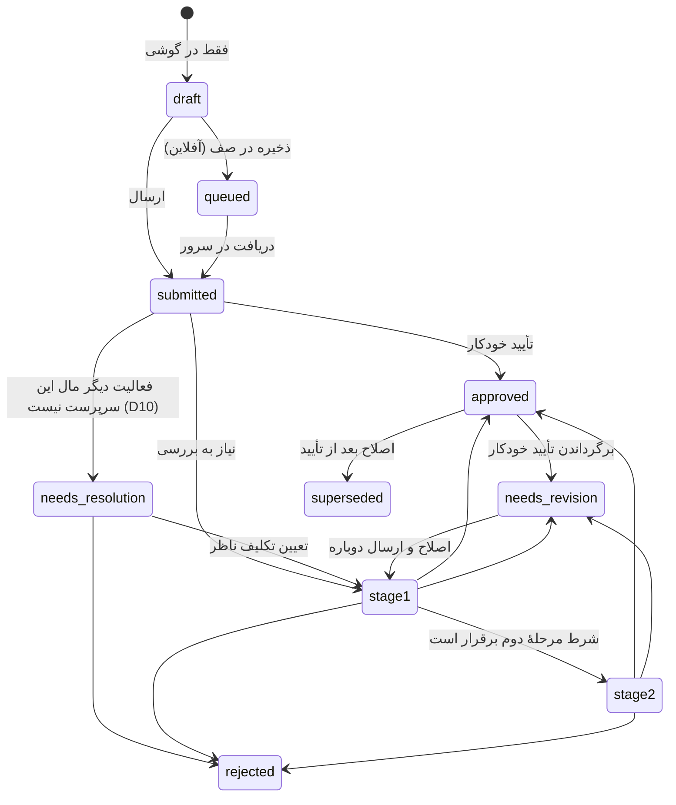

# پروژه‌یار — تصمیم‌های بنیادی

> **وضعیت:** همهٔ تصمیم‌ها **تأییدشده** در 1405/08/11.
> هر تصمیم فقط با یک تصمیم جدید که صریحاً جایگزینش شود تغییر می‌کند (مثلاً «D13 جایگزین D04»). متن تصمیم قبلی پاک نمی‌شود و فقط علامت «جایگزین‌شده» می‌گیرد.

این تصمیم‌ها روی همهٔ ویژگی‌ها اثر دارند. اگر پیاده‌سازی یک ویژگی با یکی از آن‌ها تعارض داشت، ویژگی باید تغییر کند، نه تصمیم؛ مگر اینکه کاربر تصمیم را عوض کند.

هر تصمیم چهار بخش دارد:
- **زمینه:** چرا این تصمیم لازم بود.
- **تصمیم:** چه چیزی تثبیت شد.
- **الزام‌ها:** آنچه کد باید یا نباید انجام دهد.
- **مرتبط:** ویژگی‌هایی که این تصمیم رویشان اثر دارد.

## فهرست

| شناسه | موضوع | خلاصه |
|---|---|---|
| D01 | معنای CBS | فقط بودجهٔ هزینهٔ پیمانکار؛ سمت کارفرما ماژول جداگانهٔ آینده |
| D02 | منبع هزینهٔ واقعی | دفتر هزینه؛ نسخهٔ اول دستی و Excel |
| D03 | اندازه‌گیری پیشرفت برگ | سه روش: مقداری، درصدی، گام‌های وزنی |
| D03-الف | روش چهارم | «پیشرفت زمانی» برای هزینه‌های غیرمستقیم |
| D04 | وزن و تجمیع | فقط وزن در والد ذخیره می‌شود؛ روش‌ها فقط وزن تولید می‌کنند |
| D05 | مالک برنامهٔ زمانی | MSP؛ پروژه‌یار زمان‌بندی محاسبه نمی‌کند؛ مبنا، بازنگری، جاری |
| D06 | تاریخچه | واقعیت‌های تغییرناپذیر، snapshot روزانه، دوره‌های قفل‌شده |
| D07 | خط محاسبه | رویداد ← محاسبه ← هشدار ← اعلان؛ مقادیر ذخیره‌شده |
| D08 | واحد تأیید | آیتم گزارش با ماشین حالت خودش |
| D09 | موتور هشدار | قاعده، هشدار، اعلان |
| D10 | آفلاین و تعارض | UUID سمت گوشی، ارسال idempotent، «نیاز به تعیین تکلیف» |
| D11 | دسترسی | کدهای دسترسی ثابت، بررسی در API |
| D12 | استقرار | یک کد، ابری چندمستأجره و نصب اختصاصی |
| C01–C05 | قراردادها | شناسه، پول، تاریخ، درصد، کدهای خوانا |

---

## D01 — CBS فقط بودجهٔ هزینهٔ پیمانکار است

**زمینه.** پیمانکار در پروژه دو جریان پول دارد:
- **هزینه‌ها:** آنچه خودش می‌پردازد؛ مصالح، نیروی انسانی، ماشین‌آلات، حمل، پیمانکاران جزء، بالاسری.
- **درآمد:** آنچه از کارفرما می‌گیرد؛ معمولاً با صورت‌وضعیت دوره‌ای بر اساس اقلام پیمان و مقادیر اندازه‌گیری‌شده، و در پیمان‌های مشمول، با تعدیل.

بوم طراحی این دو را در CBS مخلوط کرده بود: تاریخچهٔ نرخ با «صورت‌وضعیت ۶» و «تعدیل» در W14، و «هزینه از اقلام CBS و صورت‌وضعیت‌ها» در W22.

**تصمیم.**
- CBS فقط درخت **بودجهٔ هزینهٔ پیمانکار** است.
- صورت‌وضعیتی که **پیمانکار جزء** به پیمانکار اصلی می‌دهد، هزینه است و به‌صورت ردیف دفتر هزینه (D02) زیر اقلام CBS ثبت می‌شود.
- صورت‌وضعیت به **کارفرما**، متره، فهرست‌بها و تعدیل (سمت درآمد) یک ماژول جداگانهٔ آینده‌اند و در نسخهٔ اول پیاده نمی‌شوند.

**الزام‌ها.**
- `CbsItem` هیچ فیلدی برای قیمت پیمان، درآمد یا مبلغ صورت‌وضعیت کارفرما ندارد.
- «تاریخچهٔ نرخ» در W14 یعنی تغییر نرخ واحد **بودجه** در نسخه‌های برنامه. برچسب‌های «صورت‌وضعیت ۶» و «تعدیل» در رابط کاربری با برچسبی مثل «بازنگری بودجه R2» جایگزین می‌شوند.
- زیرعنوان W22 («هزینه‌ها از اقلام CBS و صورت‌وضعیت‌ها محاسبه می‌شود») به «هزینهٔ واقعی از دفتر هزینه» تغییر می‌کند.
- افزایش قیمت خرید، بودجه را تغییر نمی‌دهد. به‌صورت هزینهٔ واقعی بیشتر دیده می‌شود (CPI کمتر از ۱). فقط بازنگری رسمی بودجه نرخ بودجه را تغییر می‌دهد (`features/cbs.md` ۷).
- هیچ بخشی از کد فرض نکند «CBS = پیمان»، تا ماژول آیندهٔ کارفرما بدون بازنویسی اضافه شود.

**مرتبط:** `features/cbs.md`، `features/cost-ledger.md`، `features/evm.md`

---

## D02 — هزینهٔ واقعی از «دفتر هزینه» می‌آید

**زمینه.** EVM بدون هزینهٔ واقعی (AC) کار نمی‌کند. بوم برای AC فقط یکپارچه‌سازی با ERP و حسابداری را نشان می‌داد (W30) و هیچ مسیر ورود دستی نداشت.

**تصمیم.**
- یک دفتر هزینه (`CostEntry`) ساخته می‌شود. هر ردیفش به یک قلم برگ CBS، یک تاریخ تحقق هزینه، یک مبلغ و یک منبع اشاره دارد.
- منبع‌ها: ورود دستی، ورود از Excel، صورت‌وضعیت پیمانکار جزء، یکپارچه‌سازی.
- نسخهٔ اول فقط ورود دستی و Excel دارد. یکپارچه‌سازی با ERP و نرم‌افزار حسابداری بعداً فقط ردیف‌های همین دفتر را می‌سازد.

**الزام‌ها.**
- هیچ محاسبه‌ای مستقیماً از سیستم خارجی نمی‌خواند. `AC(t)` = جمع مبلغ ردیف‌های قطعی‌شده با تاریخ تحقق ≤ t.
- ردیف قطعی‌شده تغییرناپذیر است. اصلاح = یک ردیف برگشتی با مبلغ منفی + یک ردیف جدید.
- ورود از منابع خارجی idempotent است، با کلید یکتای (منبع، شناسهٔ خارجی).
- تاریخ معیار، تاریخ **تحقق** هزینه است، نه تاریخ پرداخت؛ جزئیات به تفکیک نوع هزینه در `features/cost-ledger.md` ۵.۳.
- در نسخهٔ اول AC فقط در سطح قلم CBS و پروژه است، نه برگ WBS (OD-01؛ `features/cost-ledger.md` ۵.۷).
- شاخص‌های هزینه در `min(تاریخ داده، تاریخ کامل بودن هزینه‌ها)` محاسبه می‌شوند و شاخص‌های زمان در تاریخ داده (OD-19؛ `features/cost-ledger.md` ۵.۶).

**مرتبط:** `features/cost-ledger.md`، `features/evm.md`، `features/integrations.md`

---

## D03 — سه روش اندازه‌گیری پیشرفت برگ

**زمینه.** اپ هم درصد تجمعی و هم مقدار امروز را می‌گیرد (M06). باید معلوم باشد در تعارض کدام مرجع است.

**تصمیم.** هر برگ WBS دقیقاً یکی از این سه روش را دارد:

| روش | کد | ورودی سرپرست در هر گزارش | مرجع حقیقت | درصد برگ |
|---|---|---|---|---|
| مقداری | `quantity` | مقدار انجام‌شدهٔ **امروز** | جمع مقادیر روزانهٔ تأییدشده | min(100، مقدار تجمعی ÷ مقدار کل × 100) |
| درصدی | `percent` | درصد **تجمعی**؛ مقدار اختیاری و فقط اطلاعاتی | آخرین درصد تأییدشده | همان |
| گام‌های وزنی | `steps` | درصد انجام هر گام (۰ تا ۱۰۰) | آخرین وضعیت تأییدشدهٔ هر گام | Σ (وزن گام × درصد گام) ÷ 100 |

- پیش‌فرض: اگر برگ واحد و مقدار کل دارد `quantity`، وگرنه `percent`.

**چرا روش مقداری روی «مقدار امروز» بنا شده.** مقدارهای روزانه جمع‌پذیرند و ترتیب ارسال رویشان اثر ندارد. پس وقتی چند گزارش آفلاین با هم می‌رسند یا یکی از آن‌ها رد می‌شود، بقیه درست می‌مانند. اپ مقدار تجمعی و درصد را فقط برای نمایش به سرپرست محاسبه می‌کند.

**الزام‌ها.**
- درصد برگ همیشه در سرور از ورودی‌ها و روش برگ محاسبه می‌شود. درصدی که اپ نشان می‌دهد فقط پیش‌نمایش است.
- در روش مقداری، اگر مقدار تجمعی از مقدار کل بیشتر شود، پذیرفته می‌شود ولی درصد روی ۱۰۰ می‌ماند و پرچم «فراتر از مقدار کل» می‌خورد. `[تأییدشده]`
- کاهش پیشرفت فقط وقتی مجاز است که تنظیم «اجازهٔ ثبت درصد کاهشی» روشن باشد (W29). در روش مقداری یعنی مقدار امروز منفی.
- روش اندازه‌گیری جزء برنامه است؛ تغییرش پس از فعال‌سازی پروژه بازنگری می‌سازد (D05).
- پیشرفت می‌تواند از غیر اپ هم بیاید: ثبت دستی در وب (W11 «ثبت گزارش دستی») و «پیشرفت اولیه» هنگام ورود پروژهٔ در جریان. هر دو همان ساختار آیتم گزارش را دارند و همان گردش تأیید را طی می‌کنند. `[تأییدشده: OD-16]` برای پیشرفت اولیه.
- تعریف گام‌ها: `features/wbs.md` بخش‌های ۴.۲ و ۵.۷ (OD-12 بسته شد).

**مرتبط:** `features/wbs.md`، `features/field-app.md`، `features/progress-calculation.md`

---

## D03-الف — روش چهارم: پیشرفت زمانی (اصلاح D03)

> **تأییدشده:** 1405/08/11 (بستن OD-13). D03 همچنان معتبر است و این تصمیم یک روش به آن اضافه می‌کند.

**زمینه.** هزینه‌های غیرمستقیم مثل حقوق کادر کارگاه، تجهیز کارگاه، بیمه و کمپ به هیچ کار فیزیکی وصل نیستند. بدون روشی برای آن‌ها، یا بودجه‌شان بیرون از EVM می‌ماند یا بودجهٔ کارهای فیزیکی را غیرواقعی می‌کنند.

**تصمیم.** روش `time_based` (تکنیک استاندارد Level of Effort):
- پیشرفت واقعی برگ = پیشرفت برنامه‌ای زمانی آن بر اساس تاریخ‌های نسخهٔ جاری؛ گزارش کارگاه نمی‌گیرد.
- در نتیجه EV = PV؛ SV این برگ‌ها همیشه صفر است، ولی CV واقعی است.
- وزن پیش‌فرض در پیشرفت فیزیکی صفر است و مولد «از هزینه» آن را نادیده می‌گیرد.

**الزام‌ها.** جزئیات در `features/wbs.md` ۵.۵ و `features/cbs.md` ۶.۲. این برگ‌ها سرپرست، گزارش کارگاه و ثبت دستی پیشرفت ندارند و در اپ دیده نمی‌شوند.

**مرتبط:** `features/wbs.md`، `features/cbs.md`، `features/progress-calculation.md`، `features/evm.md`

---

## D04 — وزن و تجمیع

**زمینه.** بوم چهار «روش محاسبهٔ پیشرفت» دارد (W29): وزن دستی، از هزینه، از مدت، هر دو شاخص. این‌ها از یک جنس نیستند.

**تصمیم.**
- فقط **وزن در والد** ذخیره می‌شود. جمع وزن فرزندان هر والد، و جمع وزن آیتم‌های سطح اول، دقیقاً ۱۰۰ است.
- **وزن در پروژه** = حاصل‌ضرب وزن‌ها در مسیر از ریشه ÷ 100^(عمق−1). مشتق است و ذخیره نمی‌شود.
- روش‌های «دستی»، «از هزینه»، «از مدت» و «مساوی» فقط **مولد وزن** هستند. بعد از تولید، تجمیع همیشه با یک فرمول انجام می‌شود:
  - دستی: کاربر وارد می‌کند.
  - از هزینه: `w_i = BAC_i ÷ Σ BAC هم‌سطح‌ها × 100`؛ برگ‌های `time_based` (D03-الف) وزن صفر می‌گیرند و در مخرج شمرده نمی‌شوند
  - از مدت: `w_i = روزهای کاری برنامه‌ای_i ÷ Σ روزهای کاری هم‌سطح‌ها × 100` (از تقویم پروژه)
  - مساوی: `100 ÷ n`
  - اگر جمع مبنا در یک گروه صفر باشد (مثلاً همه نقطهٔ عطف‌اند)، از روش مساوی استفاده می‌شود. `[تأییدشده]`
- «هر دو شاخص» روش وزن‌دهی **نیست**. یک تنظیم نمایشی است (`showFinancialProgress`) که پیشرفت فیزیکی و ریالی (EV ÷ BAC) را کنار هم نشان می‌دهد.
- فرمول تجمیع:
  `پیشرفت والد = Σ (پیشرفت فرزند × وزن فرزند در والد) ÷ 100`
  پیشرفت پروژه = همین فرمول روی آیتم‌های سطح اول.
- تجمیع فقط از مقادیر **تأییدشده** است.

**الزام‌ها.**
- وزن‌ها با ۴ رقم اعشار ذخیره می‌شوند (C04). هنگام تولید خودکار، باقی‌ماندهٔ گرد کردن به آخرین هم‌سطح داده می‌شود تا جمع دقیقاً `100.0000` شود.
- نسخهٔ برنامه‌ای که هر گروهش جمع ۱۰۰ نداشته باشد، اعمال نمی‌شود (~~W12 ذخیره را مسدود می‌کند~~ — **اصلاح 1405/08/15:** نسخهٔ کاری موقتاً نامتعادل ذخیره می‌شود و W12 فقط «اعمال» را مسدود می‌کند، هم‌راستا با `features/wbs.md` ۵.۳ و ۶.۲).
- وزن جزء برنامه است؛ تغییرش پس از فعال‌سازی بازنگری می‌سازد (D05).
- مثال مرجع: `00-overview.md` بخش ۶.

**مرتبط:** `features/wbs.md`، `features/progress-calculation.md`، `features/msp-integration.md` (MSP وزن ندارد؛ هنگام ورود با یکی از مولدها ساخته می‌شود — W35)

---

## D05 — مالک برنامهٔ زمانی و نسخه‌های برنامه

**زمینه.** پروژه‌یار مکمل MSP است. اگر هر دو سیستم بتوانند تاریخ‌ها را مستقل تغییر دهند، برنامه دو نسخهٔ متناقض پیدا می‌کند.

**تصمیم.**
- پروژه‌یار **زمان‌بندی محاسبه نمی‌کند**؛ نه CPM، نه مسیر بحرانی، نه جابه‌جایی خودکار تاریخ‌ها.
- **پروژه‌های متصل به MSP:**
  - تاریخ‌ها، وابستگی‌ها، مسیر بحرانی و شناوری از MSP می‌آیند.
  - ویرایش تاریخ یا ساختار در پروژه‌یار یک «پیشنهاد تغییر» است که در همگام‌سازی بعدی به MSP می‌رود. تا از MSP برنگردد، برنامه را عوض نمی‌کند.
- **پروژه‌های بدون MSP:** تاریخ‌ها دستی و بدون وابستگی ویرایش می‌شوند. مسیر بحرانی برای این پروژه‌ها وجود ندارد، پس قواعدی که به آن وابسته‌اند غیرفعال می‌شوند.
- **نسخه‌های برنامه (`PlanVersion`):**
  - **مبنا (Baseline):** هنگام فعال‌سازی پروژه ساخته می‌شود و هرگز تغییر نمی‌کند.
  - **بازنگری‌ها:** شماره‌دار (R1، R2، …).
  - **جاری:** آخرین نسخهٔ اعمال‌شده.
- هر نسخه شامل این‌هاست: ساختار WBS، وزن‌ها، روش اندازه‌گیری و گام‌ها، تاریخ‌های برنامه‌ای، مقادیر، وابستگی‌ها، اقلام CBS با نرخ و مقدار، و اتصال‌های WBS↔CBS.
- پس از فعال‌سازی، **هر** تغییر در این موارد یک بازنگری تازه می‌سازد (پیش‌نویس ← اعمال‌شده).
- پیش از فعال‌سازی (پروژهٔ پیش‌نویس)، ویرایش آزاد است و نسخه ساخته نمی‌شود.
- مبنای مقایسه برای PV یک تنظیم پروژه است: پیش‌فرض برنامهٔ مبنا، قابل تغییر به یک بازنگری (W29).

**الزام‌ها.**
- جدول‌های «جاری» (`WbsItem`، `CbsItem`، `WbsCbsLink`) فقط با **اعمال یک نسخه** تغییر می‌کنند، نه با ویرایش مستقیم. تنها استثنا تخصیص سرپرست است که عملیاتی است و نسخه نمی‌سازد.
- رکوردهای نسخه (`*Plan`) پس از اعمال تغییرناپذیرند.
- در هر لحظه حداکثر یک نسخهٔ پیش‌نویس برای هر پروژه وجود دارد. `[تأییدشده]`
- آیتمی که در یک بازنگری حذف می‌شود، حذف نرم می‌شود و تاریخچه‌اش می‌ماند (`features/wbs.md` ۵.۶؛ OD-04 بسته شد).
- مالکیت هر فیلد بین MSP و پروژه‌یار: `[تأییدشده: OD-03]`

**مرتبط:** `features/wbs.md`، `features/plan-versions.md`، `features/msp-integration.md`، `features/cbs.md`

---

## D06 — تاریخچه، snapshot روزانه و دوره‌های قفل‌شده

**زمینه.** منحنی S و EVM به گذشته نیاز دارند، و گزارش‌هایی که برای کارفرما رفته‌اند نباید بعداً عوض شوند.

**تصمیم.**
- آیتم‌های تأییدشده تغییرناپذیرند و **تاریخ مؤثر** دارند (تاریخ کار، نه تاریخ تأیید). پس پیشرفت هر برگ در هر تاریخ گذشته از روی واقعیت‌ها قابل بازسازی است.
- پس از هر بازمحاسبه، یک **snapshot روزانه** از مقادیر تجمیعی ذخیره می‌شود: پیشرفت برنامه‌ای و واقعی، PV، EV، AC و شاخص‌ها؛ هم برای پروژه و هم برای هر آیتم WBS. نمودارها از این snapshotها خوانده می‌شوند.
- **دوره‌های گزارش** (پیش‌فرض ماهانه، `[تأییدشده: OD-06]`) بسته و قفل می‌شوند. snapshot دورهٔ بسته‌شده دیگر تغییر نمی‌کند.

**الزام‌ها.**
- تأیید دیرهنگام آیتمی با تاریخ مؤثر گذشته، snapshotهای **دوره‌های باز** را از همان تاریخ به بعد دوباره می‌سازد.
- اگر تاریخ مؤثر در یک دورهٔ بسته باشد، اثرش از ابتدای اولین دورهٔ باز حساب می‌شود و آیتم برچسب «اثر منتقل‌شده» می‌گیرد. `[تأییدشده]`
- بازنگری یا تغییر وزن، snapshotهای دوره‌های باز را با وزن‌های جدید بازسازی می‌کند. دوره‌های بسته دست نمی‌خورند.
- پیشرفت برگ در تاریخ t از واقعیت‌های تأییدشده با تاریخ مؤثر ≤ t ساخته می‌شود، طبق روش برگ (D03).

**مرتبط:** `features/progress-calculation.md`، `features/evm.md`، `features/charts.md`، `features/management-reports.md`

---

## D07 — خط محاسبه: رویداد ← محاسبه ← هشدار ← اعلان

**زمینه.** اگر هر ویژگی محاسبات را خودش انجام دهد، اعداد در صفحه‌های مختلف با هم نمی‌خوانند و هشدارها از قلم می‌افتند.

**تصمیم.**
1. هر تغییر مؤثر یک **رویداد دامنه** در جدول outbox در همان تراکنش ثبت می‌کند. رویدادهای اولیه:
   - `FieldReportItemApproved`، `FieldReportItemRevoked`
   - `CostEntryPosted`
   - `PlanVersionApplied`
   - `ProjectSettingsChanged`
   - `AssignmentChanged`
   - `RiskChanged`
   - `SyncSessionApplied`
   - `PeriodClosed`
   - `DailyTick` (زمان‌بندی‌شده؛ برای قواعد وابسته به زمان)
2. یک کار پس‌زمینه برای **هر پروژه به‌صورت سریالی** (صف با کلید `projectId`، با تجمیع رویدادهای نزدیک به هم) مقادیر را **از روی واقعیت‌ها** دوباره حساب و ذخیره می‌کند؛ نه به‌صورت افزایشی.
3. سپس **موتور هشدار** قواعد مرتبط با آن رویدادها را برای همان پروژه ارزیابی می‌کند.
4. هشدارها و رویدادهای اطلاع‌رسانی به **اعلان** در کانال‌ها تبدیل می‌شوند.

**الزام‌ها.**
- صفحه‌ها و API فقط مقادیر ذخیره‌شده را می‌خوانند و هنگام نمایش چیزی حساب نمی‌کنند. هر مقدار مشتق زمان آخرین محاسبه (`computedAt`) را دارد تا رابط کاربری بتواند «در حال به‌روزرسانی» نشان دهد.
- همهٔ فرمول‌ها در یک ماژول محاسبات بک‌اند هستند. کنترلر، React و Flutter فرمول کسب‌وکاری ندارند. اپ فقط پیش‌نمایش‌های لحظه‌ای مثل «۷۲ متر = ۳٪» را نشان می‌دهد و مقدار سرور را مرجع می‌داند.
- بازمحاسبه idempotent است: اجرای دوباره روی همان واقعیت‌ها همان نتیجه را می‌دهد.
- جدول‌های مشتق هر زمان از روی واقعیت‌ها قابل بازسازی‌اند و هرگز مستقیم ویرایش نمی‌شوند.

**مرتبط:** همهٔ ویژگی‌ها؛ به‌ویژه `features/progress-calculation.md` و `04-alert-engine.md`

---

## D08 — واحد تأیید: آیتم گزارش

**زمینه.** صندوق گزارش‌ها (W20) تأیید را در سطح هر آیتم نشان می‌دهد («۳ از ۴ آیتم در انتظار»).

**تصمیم.** گزارش روزانه فقط ظرف است. هر آیتم ماشین حالت خودش را دارد:

- فقط `approved` روی پیشرفت اثر دارد.
- **شرط مرحلهٔ دوم** (قابل تنظیم، W29):
  - تغییر بیش از آستانهٔ بحرانی (۱۵)
  - پرچم جهش غیرعادی
  - GPS خارج از محدوده
  - (اختیاری، پیش‌فرض خاموش) آیتم روی مسیر بحرانی؛ فقط برای پروژه‌های متصل به MSP
- **تأیید خودکار:** تغییر کمتر از ۲ واحد درصد، دست‌کم ۲ عکس، GPS معتبر.
- **مهلت بررسی** هر مرحله ۲۴ ساعت است؛ پس از آن، طبق تنظیم پروژه، یادآوری یا ارجاع به تأییدکنندهٔ جایگزین.
- **`needs_revision` با `rejected` فرق دارد:**
  - `needs_revision`: آیتم به سرپرست برمی‌گردد، او اصلاح می‌کند و دوباره می‌فرستد (M11).
  - `rejected`: آیتم بسته می‌شود و هیچ اثری ندارد.

**الزام‌ها.**
- مقادیر آیتم `approved` هرگز ویرایش نمی‌شوند.
- **اصلاح بعد از تأیید** (مثلاً ناظر با ثبت دلیل، W27) آیتم جایگزینی می‌سازد که مستقیماً تأییدشده است و `supersedesItemId` دارد. آیتم قبلی `superseded` می‌شود.
- **برگرداندن تأیید خودکار** فقط برای آیتم‌هایی است که خودکار تأیید شده‌اند و فقط تا پایان مهلت بررسی. `[تأییدشده]`
- آیتم در حالت `needs_revision` قابل ویرایش است. هر ارسال دوباره شمارندهٔ اصلاح را افزایش می‌دهد و تاریخچهٔ بررسی‌ها حفظ می‌شود.
- وضعیت گزارش از وضعیت آیتم‌هایش مشتق می‌شود و ذخیرهٔ مستقل ندارد.
- انتقال‌های `approved` و `superseded` رویداد منتشر می‌کنند (D07).

**مرتبط:** `features/field-app.md`، `features/approval-workflow.md`، `features/progress-calculation.md`

---

## D09 — موتور هشدار

**زمینه.** هشدارها در بوم دست‌کم در شش صفحه پراکنده‌اند و با هم نمی‌خوانند (W05، W10، W14، W23، W29، W30).

**تصمیم.** سه لایه:

1. **قاعده (`AlertRule`)** — در کد تعریف می‌شود و فهرست کاملش در `04-alert-engine.md` است. هر قاعده این‌ها را دارد:
   - کد ثابت (`AL-…`)
   - محرک: رویداد یا زمان‌بندی
   - موضوع: پروژه، آیتم WBS، قلم CBS، گزارش، ریسک، کاربر
   - شرط
   - شدت: `info`، `warning`، `critical`
   - مخاطب بر اساس نقش و ارتباط با موضوع (مثلاً سرپرست همان آیتم)
   - متن راهنما با جای‌خالی برای مقادیر
   - لینک اقدام
   - پارامترهای قابل تنظیم با پیش‌فرض سازمان
2. **هشدار (`Alert`)** — نمونهٔ باز یک قاعده برای یک موضوع.
   - کلید یکتا = `ruleCode + subject`؛ تا باز است، تکراری ساخته نمی‌شود.
   - حالت‌ها: `open` ← `seen` ← `resolved` (خودکار وقتی شرط دیگر برقرار نیست) یا `dismissed` (دستی با دلیل).
3. **اعلان (`Notification`)** — ارسال در کانال‌ها: درون‌برنامه، ایمیل، پیامک، پوش. ماتریس کانال‌ها و گیرنده‌ها در W30 تنظیم می‌شود.

**الزام‌ها.**
- دو نوع خروجی وجود دارد:
  - **هشدار حالت‌دار:** شرطی که برقرار است و باید رفع شود؛ مثل «آیتم ۱۵ واحد عقب است».
  - **اعلان رویدادی بی‌حالت:** خبری که فقط باید رسانده شود؛ مثل «گزارش برای اصلاح برگشت».
  هر دو از یک مسیر ارسال استفاده می‌کنند.
- در نسخهٔ اول قاعده‌ساز کاربری نداریم. کاربر فقط قواعد را روشن/خاموش می‌کند و پارامترهایشان را برای هر پروژه تنظیم می‌کند.
- هر صفحه‌ای که هشدار نشان می‌دهد (داشبورد، نمای کلی پروژه، WBS، CBS و …) فقط از جدول `Alert` می‌خواند و منطق تشخیص جداگانه ندارد.
- هر قاعده متن راهنما و لینک اقدام **اجباری** دارد.

**مرتبط:** `04-alert-engine.md`، `features/notifications.md`، همهٔ ویژگی‌هایی که موضوع هشدارند

---

## D10 — آفلاین، شناسه و تعارض

**زمینه.** کارگاه‌ها اینترنت ضعیف دارند و گزارش‌ها ممکن است ساعت‌ها یا روزها در صف بمانند (M09).

**تصمیم.**
- هر گزارش، آیتم و عکس یک UUID دارد که **در گوشی** ساخته می‌شود. ارسال تکراری بی‌اثر است (upsert idempotent).
- زمان ثبت در گوشی (`deviceRecordedAt`) و زمان دریافت در سرور (`serverReceivedAt`) هر دو ذخیره می‌شوند. فاصلهٔ بیش از ۷۲ ساعت پرچم «ثبت با تأخیر» می‌گیرد؛ گزارش حذف نمی‌شود.
- اگر در فاصلهٔ ماندن در صف، فعالیت از سرپرست گرفته یا در یک بازنگری حذف شده باشد، آیتم رد نمی‌شود. به حالت `needs_resolution` می‌رود و ناظر تعیین تکلیف می‌کند.

**الزام‌ها.**
- گزارش‌ها و عکس‌ها در گوشی رمزنگاری‌شده نگه داشته می‌شوند. گزینهٔ «ارسال فقط با Wi‑Fi» وجود دارد.
- عکس‌ها جدا و با قابلیت ادامهٔ بارگذاری (resumable) ارسال می‌شوند و هش دارند. آیتم تا کامل شدن بارگذاری عکس‌های الزامی وارد بررسی نمی‌شود. `[تأییدشده]`
- مقادیر مقایسه‌ای (آخرین مقدار تأییدشده، تغییر، جهش) هنگام **دریافت در سرور** دوباره محاسبه می‌شوند. مقداری که گوشی دیده فقط برای نمایش بوده است.
- اپ برای کار آفلاین این‌ها را در حافظهٔ محلی نگه می‌دارد: برگ‌های تخصیص‌یافته، برنامهٔ امروز آن‌ها و آخرین مقادیر تأییدشده.
- ثبت چند گزارش در یک روز مجاز است `[تأییدشده: OD-15]`

**مرتبط:** `features/field-app.md`، `features/approval-workflow.md`

---

## D11 — اعمال دسترسی با کدهای ثابت

**زمینه.** ماتریس نقش × دسترسی (W27) باید به رفتار قطعی در API تبدیل شود.

**تصمیم.**
- فهرست ثابتی از **کدهای دسترسی** در کد تعریف می‌شود (مثل `wbs.edit`، `report.approve.stage1`، `cbs.view_amounts`). فهرست کامل در `features/access-control.md` است.
- هر endpoint کد لازمش را اعلام می‌کند. بررسی در سطح API و بر اساس نقش‌های کاربر **در همان پروژه** انجام می‌شود.
- ماتریس W27 فقط نگاشت «نقش ← کد دسترسی» است.

**الزام‌ها.**
- علاوه بر دسترسی به عمل، **دامنهٔ داده** هم اعمال می‌شود:
  - سرپرست فقط برگ‌های تخصیص‌یافتهٔ خودش را می‌بیند.
  - ناظر فقط گزارش‌های حوزهٔ خودش را بررسی می‌کند.
  - نقش بدون `cbs.view_amounts` مبالغ را نمی‌بیند؛ این فیلدها در لایهٔ خروجی API حذف می‌شوند، نه فقط در رابط کاربری.
- دسترسی «مدیر سازمان» قابل تغییر نیست.
- هر تغییر در نقش‌ها و دسترسی‌ها در لاگ ممیزی ثبت می‌شود.
- جزئیات «دسترسی محدود» و نقش‌های سفارشی: `[تأییدشده: OD-09]`

**مرتبط:** `features/access-control.md`، همهٔ endpointها

---

## D12 — استقرار: یک کد، دو حالت

**زمینه.** پیمانکار بزرگ ممکن است نصب روی سرور خودش را بخواهد. W30 به «نسخهٔ سازمانی» و سرور ERP داخلی اشاره دارد.

**تصمیم.** یک کد با دو حالت استقرار: **ابری چندمستأجره** و **نصب اختصاصی**.

**الزام‌ها.**
- همهٔ جدول‌های داده‌ای مستأجر ستون `orgId` دارند. همهٔ پرس‌وجوها در لایهٔ مخزن (repository) به‌طور خودکار به `orgId` کاربر محدود می‌شوند و هیچ پرس‌وجویی بدون این محدودیت اجرا نمی‌شود.
- فایل‌ها (عکس، پیوست، خروجی) پشت یک لایهٔ ذخیره‌سازی انتزاعی سازگار با S3 هستند (مثلاً MinIO در نصب اختصاصی).
- پیامک، ایمیل و پوش پشت رابط‌های انتزاعی هستند تا ارائه‌دهنده قابل تعویض باشد.
- هیچ وابستگی سختی به سرویس اینترنتی خارجی وجود ندارد که در نصب اختصاصی در دسترس نباشد.
- همهٔ پیکربندی‌ها از متغیرهای محیطی خوانده می‌شوند.

**مرتبط:** زیرساخت، `features/access-control.md`، `features/integrations.md`

---

## قراردادها

### C01 — شناسه‌ها
- شناسهٔ داخلی همهٔ موجودیت‌ها UUID است.
- کد WBS (`1.2.3`) و کد CBS (`C.1.1.2`) **فقط نمایشی** و تغییرپذیرند و هرگز کلید نیستند.
- شناسه‌های سیستم‌های خارجی (UID فایل MSP و …) در جدول نگاشت جداگانه ذخیره می‌شوند (`ExternalIdMap`).

### C02 — پول
- همهٔ مبالغ به **ریالِ صحیح** (`bigint`) و بدون اعشار ذخیره می‌شوند.
- نمایش به میلیون یا میلیارد ریال، یا به تومان، فقط در لایهٔ رابط کاربری است.
- گرد کردن به نزدیک‌ترین ریال، نیمه به بالا، فقط در لحظهٔ تولید مبلغ نهایی.
- نسبت‌ها (CPI، SPI، TCPI) با دقت کامل ذخیره و با دو رقم اعشار نمایش داده می‌شوند.
- ارز خارجی: `[تأییدشده: OD-14]`

### C03 — تاریخ و زمان
- **تاریخ کاری** (مثل تاریخ گزارش یا تاریخ برنامه‌ای) نوع `date` میلادی است.
- **لحظه‌ها** `timestamptz` به UTC هستند.
- مرز «روز» با منطقهٔ زمانی `Asia/Tehran` تعیین می‌شود.
- ~~نمایش همیشه شمسی است.~~ **اصلاح 1405/08/19:** نمایش پیش‌فرض برای همه شمسی با ارقام فارسی است؛ فقط ترجیح خود کاربر در W32 (`User.preferences`) نمایش خودش را میلادی یا با ارقام لاتین می‌کند. داده و API همیشه `date` میلادی و ارقام لاتین‌اند و گزارش‌ها و خروجی‌های دیگران عوض نمی‌شوند (access-control.md ۵.۷).
- «روز کاری» همیشه از تقویم همان پروژه محاسبه می‌شود (W28): روزهای کاری هفته و تعطیلات رسمی و دستی.

### C04 — درصد و وزن
- درصدها و وزن‌ها در بازهٔ ۰ تا ۱۰۰ با ۴ رقم اعشار ذخیره می‌شوند (`numeric(7,4)`).
- محاسبات میانی با دقت کامل انجام می‌شود و گرد کردن فقط برای نمایش است (پیش‌فرض یک رقم اعشار).
- انحراف همیشه به **واحد درصد** است (واقعی − برنامه‌ای).

### C05 — کدهای خوانا
- **پروژه:** `PRJ-<سال شمسی>-<سه رقم>`؛ پس از ساخت تغییرناپذیر.
- **گزارش:** `FR-<سال شمسی>-<چهار رقم>`؛ هنگام دریافت در سرور تخصیص می‌یابد.
- **ریسک:** `RSK-<سه رقم>`؛ یکتا در هر پروژه.
- این کدها برای انسان‌اند و کلید نیستند (C01).
