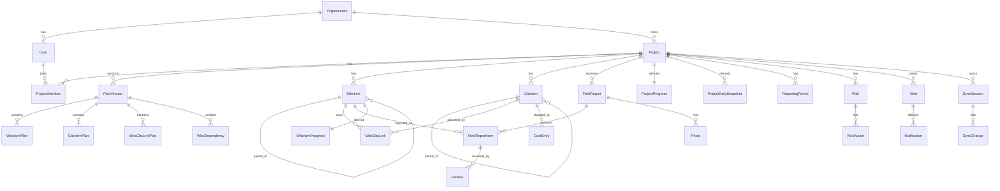
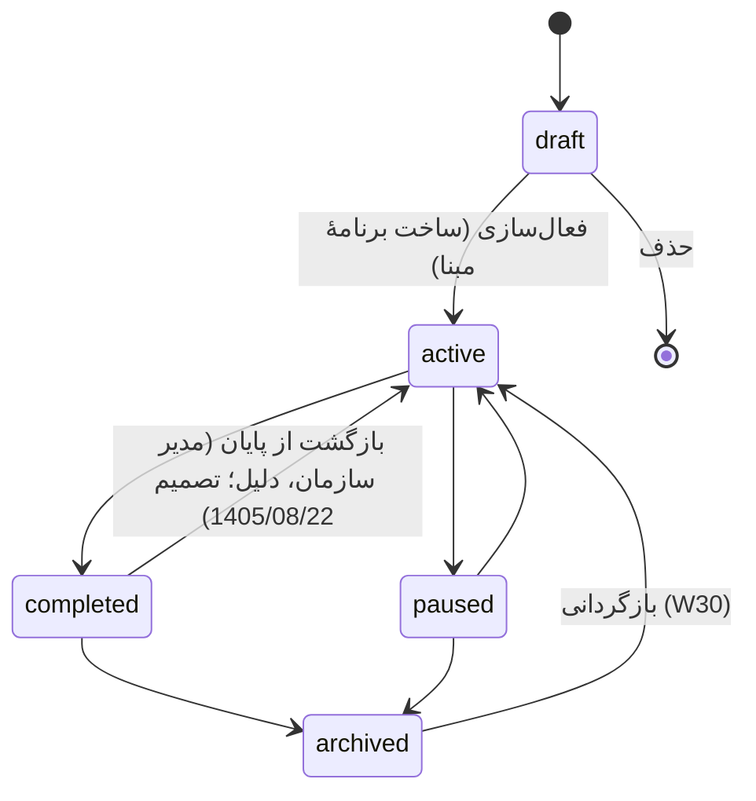

# پروژه‌یار — مدل دامنه

> **نسخه:** ۱ · **تاریخ:** 1405/08/11 · **مبنا:** تصمیم‌های D01–D12 و قراردادهای C01–C05
> تصمیم‌های باز در بخش ۱۴ آمده‌اند. هر ویژگی پیش از ساخت باید تصمیم‌های باز مربوط به خودش را بسته باشد.

---

## ۰. راهنمای این سند

- **نام‌ها مفهومی‌اند.** موجودیت‌ها با PascalCase و فیلدها با camelCase آمده‌اند. با قرارداد نام‌گذاری کد موجود هماهنگ کن. اگر موجودیتی با همین هدف از قبل در کد هست، آن را نگاشت و تکمیل کن.
- **فیلدهای مشترک** که در جدول‌ها تکرار نشده‌اند:
  - همهٔ موجودیت‌ها: `id` (UUID، C01)، `createdAt`، `updatedAt`
  - همهٔ موجودیت‌های داده‌ای مستأجر: `orgId` (D12)
  - موجودیت‌های قابل ممیزی: `createdBy`
- **انواع:** `uuid`، `string`، `text`، `int`، `bigint` (ریال، C02)، `pct` (`numeric(7,4)`، C04)، `qty` (`numeric(18,4)`)، `date` (تاریخ کاری، C03)، `ts` (`timestamptz`)، `bool`، `json`، `enum(...)`، `→Entity` (ارجاع).
- **گونهٔ هر موجودیت:**

| گونه | معنی | قاعده |
|---|---|---|
| **پایه** | داده‌های سازمانی و پیکربندی | ویرایش عادی با ممیزی |
| **برنامه** | جاری و نسخه‌های برنامه | جاری فقط با اعمال نسخه تغییر می‌کند؛ نسخه‌ها پس از اعمال تغییرناپذیرند (D05) |
| **واقعیت** | رخدادهای ثبت‌شده: آیتم گزارش، ردیف هزینه، بررسی | پس از قطعی شدن تغییرناپذیر؛ اصلاح با رکورد جدید (D02، D08) |
| **مشتق** | نتیجهٔ محاسبه | فقط ماژول محاسبات می‌نویسد؛ هر زمان از روی واقعیت‌ها بازسازی‌پذیر (D07) |
| **عملیاتی** | هشدار، اعلان، جلسهٔ همگام‌سازی، صف رویداد | چرخهٔ عمر خودشان را دارند |

---

## ۱. ماژول‌ها و نمودار کلی

| ماژول | موجودیت‌ها | بخش |
|---|---|---|
| سازمان و دسترسی | Organization، User، Role، RolePermission، ProjectMember، Invitation | ۲ |
| پروژه و تنظیمات | Project، ProjectSettings، ProjectCalendar، ApprovalRoute | ۳ |
| ساختار و نسخه‌های برنامه | PlanVersion، WbsItem، WbsItemPlan، WbsDependency، WbsAssignmentHistory | ۴ |
| هزینه | CbsItem، CbsItemPlan، WbsCbsLink، WbsCbsLinkPlan، CostEntry، CostImportBatch، BudgetRevisionRequest، ContingencyAllocation | ۵ |
| گزارش کارگاه و تأیید | FieldReport، FieldReportItem، Photo، Review | ۶ |
| پیشرفت و شاخص‌ها | WbsItemProgress، ProjectProgress، CbsItemProgress، WbsItemDailySnapshot، ProjectDailySnapshot، PeriodSnapshot | ۷ |
| دوره‌ها | ReportingPeriod | ۸ |
| ریسک | Risk، RiskAction، RiskLink، RiskScoreHistory، RiskNote، RiskFollower | ۹ |
| هشدار و اعلان | AlertRuleSetting، Alert، Notification، NotificationPreference | ۱۰ |
| یکپارچه‌سازی | MspLink، FieldMappingTemplate، ImportSession، SyncSession، SyncChange، ScheduleChangeProposal، ExternalIdMap | ۱۱ |
| قالب‌ها و گزارش‌ها | Template، TemplateVersion، ReportTemplate، ReportSchedule، GeneratedReport | ۱۲ |
| ممیزی و رویداد | DomainEvent، AuditLog | ۱۳ |

---

## ۲. سازمان، کاربر و دسترسی

### Organization — پایه
| فیلد | نوع | توضیح |
|---|---|---|
| name | string | نام شرکت |
| seatLimit | int | سقف مجوز کاربران (W26: «۴۸ از ۶۰») |
| defaults | json | پیش‌فرض‌های پروژهٔ جدید: تقویم، آستانه‌ها، گردش‌کار، قواعد گزارش کارگاه |

### User — پایه
| فیلد | نوع | توضیح |
|---|---|---|
| fullName | string | |
| mobile | string | ورود اپ با شماره و OTP (M01، M02)؛ یکتا در کل نصب، نه فقط در سازمان (اصلاح 1405/08/22) |
| email | string? | ورود وب؛ یکتا در کل نصب (بی حساسیت به حروف) |
| passwordHash | string? | فقط کاربران وب |
| twoFactorEnabled | bool | W03؛ W26 کاربران بدون آن را نشان می‌دهد |
| status | enum(invited, active, locked, disabled) | |
| isOrgAdmin | bool | نقش سطح سازمان |
| lastActiveAt | ts | |

### Role — پایه
| فیلد | نوع | توضیح |
|---|---|---|
| code | string | سیستمی (شش نقش، اصلاح 1405/08/22): `project_manager`، `planner`، `reviewer`، `supervisor`، `client_reviewer`، `finance`؛ سفارشی: آزاد |
| name | string | نام فارسی |
| isSystem | bool | نقش سیستمی حذف‌شدنی نیست |
| orgId | uuid? | برای نقش‌های سیستمی تهی است |

### RolePermission — پایه
| فیلد | نوع | توضیح |
|---|---|---|
| roleId | →Role | |
| permissionCode | string | از فهرست ثابت کدها (D11) |
| scope | enum(all, own_area, own_assigned) | معنای «محدود» در W27 `[تأییدشده: OD-09]` |

### ProjectMember — پایه
| فیلد | نوع | توضیح |
|---|---|---|
| projectId | →Project | |
| userId | →User | |
| roleIds | →Role[] | یک یا چند نقش در همین پروژه (W27) |
| status | enum(active, removed) | |

**قید:** یکتا روی `(projectId, userId)`.

### Invitation — عملیاتی
| فیلد | نوع | توضیح |
|---|---|---|
| userId | →User | کاربر `invited` که هم‌زمان با دعوت ساخته می‌شود (اصلاح 1405/08/22) |
| projectId | →Project | همیشه یک پروژه (اصلاح 1405/08/19) |
| channel | enum(sms, email) | سرپرست با پیامک و لینک نصب اپ (W16) |
| target | string | ایمیل اگر داده شد، وگرنه موبایل؛ موبایل همیشه روی User است |
| roleIds | →Role[] | |
| sentAt، acceptedAt | ts، ts? | ارسال دوباره `sentAt` و `expiresAt` را تازه می‌کند |
| createdBy | →User | |
| inviteCode | string | ورود با کد دعوت در M01 |
| status | enum(pending, accepted, revoked, expired) | |
| expiresAt | ts | ۷ روز (W16) |

---

## ۳. پروژه و تنظیمات

### Project — پایه
| فیلد | نوع | توضیح |
|---|---|---|
| code | string | C05؛ تغییرناپذیر؛ یکتا در سازمان |
| name، clientName، projectType، description | string/text | W28 |
| status | enum(draft, active, paused, completed, archived) | ماشین حالت پایین |
| managerUserId | →User | |
| siteLat، siteLng | numeric | موقعیت کارگاه برای کنترل GPS |
| gpsRadiusM | int | پیش‌فرض ۳۰۰ |
| plannedStart، plannedFinish | date | از نسخهٔ جاری؛ برای پروژهٔ پیش‌نویس از ویزارد |
| contingencyReserve | bigint | ذخیرهٔ احتیاطی بیرون از CBS و BAC (W47؛ `features/cbs.md` ۶.۱) |
| displayCurrencyUnit | enum(rial, toman) | فقط نمایش (C02) `[تأییدشده: OD-14]` |
| baselineVersionId | →PlanVersion? | پس از فعال‌سازی |
| currentVersionId | →PlanVersion? | آخرین نسخهٔ اعمال‌شده |
| pvReferenceVersionId | →PlanVersion? | مبنای PV؛ پیش‌فرض مبنا (W29) |
| mspLinked | bool | آیا برنامه از MSP می‌آید (D05) |
| activatedAt | ts? | |
| costsCompleteThrough | date? | تاریخ کامل بودن هزینه‌ها (OD-19؛ `features/cost-ledger.md` ۵.۶) |
| costsCompleteSetBy، costsCompleteSetAt | →User?، ts? | |

**ماشین حالت پروژه:**

**پیش‌شرط فعال‌سازی** `[تأییدشده]`:
- جمع وزن همهٔ گروه‌ها ۱۰۰ باشد.
- هر برگ روش اندازه‌گیری و تاریخ برنامه‌ای داشته باشد.
- تقویم پروژه تعریف شده باشد.

برگ بدون سرپرست یا بدون اتصال CBS مانع فعال‌سازی نیست، ولی هشدار می‌سازد.

### ProjectSettings — پایه (یک رکورد برای هر پروژه؛ با طرح نوع‌دار، نه JSON آزاد)
| گروه | فیلد | پیش‌فرض | منبع |
|---|---|---|---|
| انحراف | warningThreshold | 5 | W29 |
| انحراف | criticalThreshold | 15 | W29 |
| وزن | weightGenerator | manual | D04 |
| وزن | showFinancialProgress | false | D04 |
| گزارش کارگاه | minPhotos | 2 | W29 |
| گزارش کارگاه | maxJumpPct | 20 | W29 |
| گزارش کارگاه | allowDecrease | false | W29 |
| گزارش کارگاه | offlineEnabled | true | W29 |
| گزارش کارگاه | lateAfterHours | 72 | W29 |
| گزارش کارگاه | dailyReminderTime | 17:00 | W29 |
| گزارش کارگاه | gpsMode | flag_only | W29 (`flag_only` یا `block`) |
| گردش‌کار | approvalMode | two_stage | W29 (`single_stage` یا `two_stage`) |
| گردش‌کار | stage2OnCritical | true | W29 |
| گردش‌کار | stage2OnJump | true | W29 |
| گردش‌کار | stage2OnGpsOut | true | W29 |
| گردش‌کار | stage2OnCriticalPath | false | W29؛ فقط وقتی `mspLinked` |
| گردش‌کار | reviewDeadlineHours | 24 | W29 |
| گردش‌کار | onDeadline | escalate | W29 (`remind_only` یا `escalate`) |
| گردش‌کار | alternateReviewerUserId | مدیر پروژه | W29 |
| گردش‌کار | autoApproveEnabled | true | W29 |
| گردش‌کار | autoApproveMaxDelta | 2 | W29 |

**قید:** تغییر هر فیلد رویداد `ProjectSettingsChanged` منتشر می‌کند (D07).

### ProjectCalendar — پایه
| فیلد | نوع | توضیح |
|---|---|---|
| workWeek | json | روزهای کاری و ساعت شروع و پایان هر روز (W28: ۷:۰۰ تا ۱۶:۰۰، پنجشنبه تا ۱۲:۰۰) |
| holidays | json | فهرست `{date, title, type: official\|manual}` |

**قید:** تغییر تقویم، تاریخ‌های پیش‌بینی، منحنی S و پوشش گزارش روزانه را دوباره محاسبه می‌کند (W28). برای پروژه‌های متصل، تقویم در همگام‌سازی بعدی به MSP ارسال می‌شود.

### ApprovalRoute — پایه
تعیین تأییدکنندهٔ مرحلهٔ اول بر اساس حوزه (W29: «سازه و نازک‌کاری 1.2 و 1.4 ← مهندس حسینی»).

| فیلد | نوع | توضیح |
|---|---|---|
| projectId | →Project | |
| areaName | string | مثلاً «تأسیسات برقی و مکانیکی» |
| wbsRootItemIds | →WbsItem[] | زیردرخت‌های این حوزه |
| stage1ReviewerUserId | →User | |

**قیدها:**
- هر برگ دقیقاً به یک حوزه تعلق دارد؛ نزدیک‌ترین نیای مشترک تعیین‌کننده است.
- برگی که هیچ حوزه‌ای ندارد، به تأییدکنندهٔ جایگزین می‌رود و هشدار پیکربندی می‌سازد (W48: «برای گزارش‌های تأسیسات هنوز ناظری تعیین نشده است»).

---

## ۴. ساختار و نسخه‌های برنامه (D05)

### PlanVersion — برنامه
| فیلد | نوع | توضیح |
|---|---|---|
| projectId | →Project | |
| kind | enum(baseline, revision) | |
| number | int | مبنا = 0؛ بازنگری‌ها 1، 2، … |
| status | enum(draft, applied, discarded) | |
| source | enum(wizard, template, manual_edit, msp_import, msp_sync, budget_revision) | |
| syncSessionId | →SyncSession? | اگر از همگام‌سازی آمده باشد |
| note | text | دلیل بازنگری |
| appliedBy، appliedAt | →User، ts | |

**قیدها:**
- حداکثر یک `baseline` برای هر پروژه؛ با اعمال، تغییرناپذیر.
- حداکثر یک `draft` در هر لحظه برای هر پروژه. `[تأییدشده]`
- اعمال یک نسخه در **یک تراکنش**: رکوردهای `*Plan` قفل می‌شوند، جدول‌های جاری به‌روز می‌شوند، `Project.currentVersionId` تغییر می‌کند و رویداد `PlanVersionApplied` منتشر می‌شود.
- نسخه‌ای که قیدهای وزن (D04) یا یکپارچگی درخت را نقض کند، اعمال نمی‌شود.

### WbsItem — برنامه (وضعیت جاری)
| فیلد | نوع | توضیح |
|---|---|---|
| projectId | →Project | |
| parentId | →WbsItem? | تهی = سطح اول (ریشهٔ مجازی = خود پروژه) |
| code | string | نمایشی (C01)؛ یکتا میان آیتم‌های فعال پروژه |
| codeMode | enum(auto, custom) | `features/wbs.md` ۵.۲ |
| title | string | |
| sortOrder | int | ترتیب میان هم‌سطح‌ها |
| isLeaf | bool | مشتق از نبودن فرزند؛ برای پرس‌وجو ذخیره می‌شود |
| isMilestone | bool | |
| weightInParent | pct | D04 |
| plannedStart، plannedFinish | date | |
| unit | string? | فقط برگ |
| totalQuantity | qty? | فقط برگ |
| measurementMethod | enum(quantity, percent, steps, time_based)? | فقط برگ (D03، D03-الف) |
| steps | json? | فقط روش `steps`: `[{key, title, weight}]`؛ جمع وزن‌ها ۱۰۰ (`features/wbs.md` ۴.۲) |
| supervisorUserId | →User? | فقط برگ؛ **عملیاتی** و بدون نسخه (W17) |
| statusNote | text? | یادداشت وضعیت؛ عملیاتی و بدون نسخه (`features/wbs.md` ۴.۱) |
| isCritical | bool? | از MSP (D05) |
| totalFloatDays | numeric? | از MSP |
| removedAt، removedInVersionId | ts?، →PlanVersion? | حذف نرم (D05) |

**قیدها:**
- فقط برگ‌ها `unit`، `totalQuantity`، `measurementMethod`، `steps`، `supervisorUserId`، اتصال CBS و آیتم گزارش دارند.
- جمع `weightInParent` فرزندان فعال هر والد = `100.0000`؛ همین قید برای آیتم‌های سطح اول.
- آیتمی که آیتم گزارش تأییدشده دارد، هرگز حذف سخت نمی‌شود.
- تبدیل برگ دارای گزارش به والد ممنوع است و به‌جای آن «تقسیم» انجام می‌شود (`features/wbs.md` ۵.۶).

### WbsItemPlan — برنامه (عکس نسخه؛ تغییرناپذیر پس از اعمال)
همان فیلدهای برنامه‌ای `WbsItem` (`parentId`، `code`، `title`، `sortOrder`، `isMilestone`، `weightInParent`، `plannedStart`، `plannedFinish`، `unit`، `totalQuantity`، `measurementMethod`، `steps`، `isCritical`، `totalFloatDays`)، به‌علاوه:

| فیلد | نوع | توضیح |
|---|---|---|
| planVersionId | →PlanVersion | |
| wbsItemId | →WbsItem | هویت پایدار در همهٔ نسخه‌ها |
| bac | bigint | عکس بودجهٔ برگ در این نسخه (جمع `WbsCbsLinkPlan.subBudget`)؛ برای والد جمع فرزندان |

**قید:** یکتا روی `(planVersionId, wbsItemId)`.

### WbsDependency — برنامه (متعلق به نسخه)
| فیلد | نوع | توضیح |
|---|---|---|
| planVersionId | →PlanVersion | |
| predecessorId، successorId | →WbsItem | |
| type | enum(FS, SS, FF, SF) | |
| lagDays | numeric | |

**قید:** فقط برای پروژه‌های متصل به MSP و فقط از MSP وارد می‌شود. پروژه‌یار آن را برای نمایش و قواعد هشدار نگه می‌دارد، نه برای زمان‌بندی (D05).

### WbsAssignmentHistory — واقعیت
| فیلد | نوع | توضیح |
|---|---|---|
| wbsItemId | →WbsItem | |
| supervisorUserId | →User | |
| fromAt، toAt | ts، ts? | |
| assignedBy | →User | |

**قید:** هر تغییر سرپرست یک ردیف می‌بندد، یک ردیف باز می‌کند و رویداد `AssignmentChanged` منتشر می‌کند. سرپرست قبلی پیامک اطلاع دریافت می‌کند (W17).

---

## ۵. هزینه (D01، D02)

### CbsItem — برنامه (وضعیت جاری)
| فیلد | نوع | توضیح |
|---|---|---|
| projectId | →Project | |
| parentId | →CbsItem? | |
| code، title | string | کد نمایشی (C01) |
| costType | enum(materials, labor, equipment, transport, subcontract, overhead, other) | فهرست ثابت (`features/cbs.md` ۴.۲) |
| unit | string? | فقط برگ |
| estimatedQuantity | qty? | فقط برگ |
| pricingMode | enum(unit_rate, lump_sum)? | فقط برگ (`features/cbs.md` ۴.۱) |
| unitRate | bigint? | ریال به ازای هر واحد؛ فقط `unit_rate` |
| lumpSumAmount | bigint? | فقط `lump_sum` |
| budget | bigint | `unit_rate`: `round(estimatedQuantity × unitRate)`؛ `lump_sum`: `lumpSumAmount`؛ والد: جمع فرزندان |
| supplierNote | string? | W14 |
| isLeaf | bool | |
| removedAt، removedInVersionId | | حذف نرم |

**قیدها:**
- فقط برگ‌ها اتصال WBS و ردیف هزینه دارند.
- هیچ فیلدی برای قیمت پیمان یا درآمد وجود ندارد (D01).

### CbsItemPlan — برنامه (عکس نسخه)
همان فیلدهای برنامه‌ای `CbsItem` به‌علاوهٔ `planVersionId` و `cbsItemId`. تاریخچهٔ نرخ در W14 از مقایسهٔ این رکوردها در نسخه‌های پیاپی ساخته می‌شود (D01).

### WbsCbsLink — برنامه (وضعیت جاری)
| فیلد | نوع | توضیح |
|---|---|---|
| wbsItemId | →WbsItem | برگ |
| cbsItemId | →CbsItem | برگ |
| quantity | qty? | مقدار مصرف این برگ WBS از این قلم؛ فقط قلم `unit_rate` |
| allocatedAmount | bigint? | فقط قلم `lump_sum` |
| subBudget | bigint | `unit_rate`: `round(quantity × CbsItem.unitRate)`؛ `lump_sum`: `allocatedAmount` |

**قیدها:**
- یکتا روی `(wbsItemId, cbsItemId)`.
- `BAC برگ = Σ subBudget` اتصال‌هایش.
- تخصیص‌یافتهٔ هر قلم ≤ برآورد آن؛ بیشتر از آن خطای V-08 است و کمتر از آن هشدار W-06 (`features/cbs.md` ۵.۲).

### WbsCbsLinkPlan — برنامه (عکس نسخه)
همان فیلدها به‌علاوهٔ `planVersionId` و عکس `unitRate` در آن نسخه.

### CostEntry — واقعیت (D02)
| فیلد | نوع | توضیح |
|---|---|---|
| projectId | →Project | |
| cbsItemId | →CbsItem | برگ |
| wbsItemId | →WbsItem? | فقط ذخیره می‌شود؛ در نسخهٔ اول در هیچ محاسبه‌ای به کار نمی‌رود (OD-01) |
| costDate | date | تاریخ تحقق هزینه |
| amount | bigint | علامت‌دار؛ ردیف برگشتی منفی است |
| quantity | qty? | مثلاً تن آرماتور تحویل‌شده؛ برای مقایسهٔ مصرف واقعی با برآورد (W14: «مصرف‌شده تا امروز ۱٬۳۸۹ تن») |
| source | enum(manual, excel, subcontractor_statement, integration) | |
| externalRef | string? | کلید idempotency؛ یکتا روی `(projectId, source, externalRef)` |
| documentNo | string? | شمارهٔ فاکتور، صورت‌وضعیت پیمانکار جزء و … |
| description | text? | |
| status | enum(draft, posted) | |
| reversesEntryId | →CostEntry? | برای ردیف برگشتی |
| importBatchId | →CostImportBatch? | ورود گروهی از Excel |
| counterparty | string? | تأمین‌کننده یا پیمانکار جزء |
| attachmentKeys | string[] | پیوست سند |
| periodShifted | bool | تاریخ تحقق در دورهٔ بسته (`features/cost-ledger.md` ۵.۴) |
| postedBy، postedAt | →User، ts | |

**قیدها:**
- `posted` تغییرناپذیر است. اصلاح = ردیف برگشتی (`amount` = منفی ردیف اصلی، `reversesEntryId`) + ردیف جدید.
- `AC(t) = Σ amount` ردیف‌های `posted` با `costDate ≤ t`.
- قطعی شدن رویداد `CostEntryPosted` منتشر می‌کند.

### CostImportBatch — عملیاتی
دستهٔ ورود Excel هزینه‌ها؛ فیلدها در `features/cost-ledger.md` ۴.۲.

### BudgetRevisionRequest — عملیاتی
درخواست بازنگری بودجه؛ فیلدها و جریان در `features/cbs.md` ۷.۳.

### ContingencyAllocation — واقعیت
| فیلد | نوع | توضیح |
|---|---|---|
| riskId | →Risk | |
| amount | bigint | W19: «ذخیرهٔ احتیاطی تخصیص‌یافته ۳ میلیارد» |
| note | text | |

**قید:** جمع تخصیص‌ها ≤ `Project.contingencyReserve`. تخصیص فقط کنار گذاشتن است؛ مصرف واقعی، بازنگری بودجه‌ای است که مبلغ را به CBS منتقل می‌کند (`features/cbs.md` ۶.۱).

---

## ۶. گزارش کارگاه و تأیید (D03، D08، D10)

### FieldReport — واقعیت (ظرف)
| فیلد | نوع | توضیح |
|---|---|---|
| id | uuid | ساخته‌شده در گوشی (D10) |
| projectId | →Project | |
| source | enum(app, web_manual, import_opening, correction) | D03 |
| authorUserId | →User | سرپرست؛ برای `web_manual` برنامه‌ریز یا ناظر |
| workDate | date | تاریخ کاری؛ همان **تاریخ مؤثر** آیتم‌ها (D06) |
| reportNo | string | C05؛ هنگام دریافت تخصیص می‌یابد |
| deviceRecordedAt | ts | |
| serverReceivedAt | ts | |
| appVersion | string? | |
| gpsLat، gpsLng، gpsAccuracyM | numeric? | |
| distanceFromSiteM | int? | در سرور محاسبه می‌شود |
| weather، temperatureC | string?، int? | |
| crewCount | int? | مشتق: جمع `crewCount` آیتم‌ها `[تأییدشده: OD-05]` |
| note | text? | |
| attestedAt | ts? | تعهد سرپرست به صحت گزارش (M08) |
| flags | enum[] | `gps_out_of_range`، `late_submission` |

**قیدها:**
- وضعیت گزارش ذخیره نمی‌شود و از آیتم‌ها مشتق است (D08).
- چند گزارش در یک روز مجاز است؛ هر برگ در هر گزارش یک بار می‌آید `[تأییدشده: OD-15]`

### FieldReportItem — واقعیت (پایهٔ همهٔ محاسبات پیشرفت)
| فیلد | نوع | توضیح |
|---|---|---|
| id | uuid | ساخته‌شده در گوشی |
| reportId | →FieldReport | |
| wbsItemId | →WbsItem | برگ |
| method | enum(quantity, percent, steps) | عکس روش برگ در لحظهٔ دریافت |
| quantityToday | qty? | روش `quantity` (D03) |
| reportedPercent | pct? | روش `percent`: درصد تجمعی |
| reportedQuantityInfo | qty? | روش `percent`: مقدار اطلاعاتی |
| stepsProgress | json? | روش `steps`: `{stepKey: pct}` |
| computedPercent | pct | درصد تجمعی پس از این آیتم، محاسبه‌شده در سرور |
| lastApprovedPercent | pct | آخرین مقدار تأییدشده هنگام دریافت در سرور |
| deltaPercent | pct | `computedPercent − lastApprovedPercent` |
| plannedPercentAtDate | pct | برنامهٔ همان تاریخ؛ برای نمایش «پس از تأیید انحراف به ۰٪ می‌رسد» (W40) |
| status | enum(submitted, stage1, stage2, approved, needs_revision, rejected, superseded, needs_resolution) | D08؛ `draft` و `queued` فقط در گوشی‌اند |
| currentStage | int? | 1 یا 2 |
| requiresStage2 | bool | از شرط‌های W29 |
| autoApproved | bool | |
| flags | enum[] | `insufficient_photos`، `photos_pending`، `abnormal_jump`، `gps_out_of_range`، `late_submission`، `decrease`، `over_total_quantity`، `mock_location`، `clock_skew`، `photo_time_mismatch`، `needs_resolution`، `method_conversion`؛ تعریف و اثر هر پرچم در `features/approval-workflow.md` ۳.۲ (آیتم تبدیل روش؛ `features/wbs.md` ۵.۶) |
| revisionCount | int | تعداد ارسال دوباره پس از `needs_revision` |
| supersedesItemId | →FieldReportItem? | اصلاح بعد از تأیید (D08) |
| crewCount | int? | نفرات روی همین فعالیت `[تأییدشده: OD-05]` |
| note | text? | توضیح سرپرست |
| approvedAt | ts? | |

**قیدها:**
- پس از `approved`، فیلدهای مقداری هرگز تغییر نمی‌کنند؛ فقط انتقال حالت به `superseded`، یا به `needs_revision` برای تأیید خودکار در مهلت، مجاز است.
- `computedPercent`، `lastApprovedPercent`، `deltaPercent` و پرچم‌ها **در سرور** هنگام دریافت محاسبه می‌شوند و هنگام تأیید دوباره بررسی می‌شوند، چون ممکن است آیتم‌های دیگری در این فاصله تأیید شده باشند (D10).
- انتقال به `approved` رویداد `FieldReportItemApproved` منتشر می‌کند؛ برگرداندن، رویداد `FieldReportItemRevoked`.

**قاعدهٔ پیشرفت برگ در تاریخ t** (D03، D06) از آیتم‌های `approved` با `workDate ≤ t`:
- **quantity:** `min(100, Σ quantityToday ÷ totalQuantity × 100)`
- **percent:** `reportedPercent` آخرین آیتم؛ ترتیب بر اساس `workDate` و سپس `deviceRecordedAt` گزارش، **مستقل از ترتیب تأیید** (`features/approval-workflow.md` ۳.۱)
- **steps:** برای هر گام، آخرین مقدار گزارش‌شده با همان ترتیب؛ سپس `Σ وزن × درصد ÷ 100`

### Photo — واقعیت
| فیلد | نوع | توضیح |
|---|---|---|
| id | uuid | ساخته‌شده در گوشی |
| reportId | →FieldReport | |
| itemId | →FieldReportItem? | عکس می‌تواند متعلق به کل گزارش باشد |
| storageKey | string | D12 |
| sha256 | string | |
| takenAt | ts | مهر زمان روی عکس (M07) |
| lat، lng، accuracyM | numeric? | مهر مکان |
| uploadStatus | enum(pending, complete) | D10 |
| markedUnsuitable | bool | علامت ناظر (M11: «عکس علامت‌خورده») |

### Review — واقعیت
| فیلد | نوع | توضیح |
|---|---|---|
| itemId | →FieldReportItem | |
| stage | int | 1 یا 2 |
| reviewerUserId | →User? | تهی برای تأیید خودکار |
| decision | enum(approve, request_revision, reject, auto_approve, revoke_auto, escalate, resolve_assignment) | |
| note | text? | برای `request_revision` و `reject` اجباری است (W40) |
| requiredActions | json? | چک‌لیست اصلاح (M11: «کارهای لازم ۱ از ۳»)؛ ساختار در `features/approval-workflow.md` ۴.۳ |
| dueAt | ts | مهلت آن مرحله |
| decidedAt | ts? | |
| escalatedToUserId | →User? | |

---

## ۷. پیشرفت و شاخص‌ها — مشتق (D06، D07)

همهٔ جدول‌های این بخش را فقط ماژول محاسبات می‌نویسد و هر زمان قابل بازسازی‌اند.

### WbsItemProgress (یک ردیف برای هر آیتم WBS؛ وضعیت لحظهٔ فعلی)
| فیلد | نوع | توضیح |
|---|---|---|
| wbsItemId | →WbsItem | |
| dataDate | date | |
| plannedPercent | pct | از نسخهٔ مرجع PV `[تأییدشده: OD-02]` برای توزیع درون برگ |
| actualPercent | pct | از آیتم‌های تأییدشده؛ برای والد با تجمیع وزنی |
| actualQuantity | qty? | برگ مقداری |
| pendingPercent | pct? | آخرین مقدار در انتظار، فقط برای نمایش («آخرین ۵۸٪ · تأییدشده ۵۵٪» در M06) |
| deviation | pct | `actualPercent − plannedPercent` |
| status | enum(not_started, on_track, ahead, warning, critical, completed) | از آستانه‌ها (۴.۴ در نمای کلی) |
| bac، pv، ev | bigint | |
| ac | — | در نسخهٔ اول وجود ندارد (OD-01) |
| forecastFinish | date? | `[تأییدشده: OD-07]` |
| lastApprovedAt | ts? | |
| computedAt | ts | |

### ProjectProgress (یک ردیف برای هر پروژه)
| فیلد | نوع |
|---|---|
| dataDate | date |
| plannedPercent، actualPercent، financialPercent | pct |
| bac، pv، ev، ac، cv، sv، eac، vac | bigint |
| cpi، spi، tcpi | numeric (دقت کامل) |
| forecastFinish، delayDays | date?، int? |
| costIndicesDate | date — تاریخ محاسبهٔ شاخص‌های هزینه، `min(dataDate, costsCompleteThrough)` (OD-19) |
| unallocatedBudget | bigint — بودجهٔ CBS تخصیص‌نیافته به WBS |
| leafCounts | json — شمار برگ‌ها به تفکیک وضعیت (W24) |
| computedAt | ts |

### CbsItemProgress (یک ردیف برای هر قلم CBS)
AC، درصد مصرف، EV، CPI، پیش‌بینی، اعتبار پیش‌بینی، مقدار مصرف‌شده، مقدار کسب‌شده، مازاد مصرف، تخصیص‌یافته و تخصیص‌نیافته؛ فرمول‌ها در `features/cbs.md` ۸. شاخص‌های هزینه در `costIndicesDate` محاسبه می‌شوند.

### WbsItemDailySnapshot و ProjectDailySnapshot
همان ستون‌های دو جدول بالا با کلید `(id موضوع، date)`. ردیف‌های دوره‌های باز بازسازی‌پذیرند (D06). منحنی S، نمودار EVM و treemap انحراف از این جدول‌ها خوانده می‌شوند.

**برآورد حجم:** ۲۰۰ برگ × ۶۰۰ روز ≈ ۱۲۰ هزار ردیف برای هر پروژه. نیاز به پارتیشن‌بندی بر اساس پروژه را در `features/progress-calculation.md` بررسی کن.

### PeriodSnapshot
کپی تغییرناپذیر از snapshot پروژه و آیتم‌ها در لحظهٔ بستن دوره (D06). گزارش‌های رسمی دوره‌های بسته‌شده فقط از این جدول خوانده می‌شوند.

---

## ۸. دوره‌های گزارش

### ReportingPeriod — پایه
| فیلد | نوع | توضیح |
|---|---|---|
| projectId | →Project | |
| startDate، endDate | date | پیش‌فرض ماه شمسی `[تأییدشده: OD-06]` |
| status | enum(open, closed) | |
| closedBy، closedAt | →User?، ts? | |

**قیدها:**
- دوره‌ها پیوسته‌اند و هم‌پوشانی ندارند.
- بستن دوره رویداد `PeriodClosed` منتشر می‌کند و `PeriodSnapshot` می‌سازد.

---

## ۹. ریسک

### Risk — پایه
| فیلد | نوع | توضیح |
|---|---|---|
| projectId | →Project | |
| code | string | C05 |
| title | string | |
| category | string | از فهرست دسته‌های سازمان (W18، W44) |
| cause، event، consequence | text | ساختار «علت، رویداد، پیامد» در W19 |
| probability، impact | int? (1..5) | تهی برای مشکل کارگاهیِ هنوز ارزیابی‌نشده |
| score | int? | مشتق: `probability × impact` |
| level | enum(low, medium, high, critical)? | مشتق: ۱–۸، ۹–۱۴، ۱۵–۱۹، ۲۰–۲۵ `[تأییدشده]` |
| status | enum | `[تأییدشده: OD-10]` |
| responseStrategy | enum(avoid, mitigate, transfer, accept) | |
| ownerUserId | →User | |
| triggerText | text? | نشانهٔ هشدار |
| nextReviewDate | date? | |
| reviewFrequency | enum(weekly, biweekly, monthly)? | |
| costImpact | bigint? | |
| scheduleImpactDays | int? | |
| targetProbability، targetImpact | int? | هدف پس از اقدام‌ها (W19) |
| source | enum(manual, field) | `field` = از M13 با برچسب «از کارگاه» |
| sourceReportedBy | →User? | |
| sourceIssueType | string? | نوع مشکل در M13 |

**قید:** هر تغییر در `probability` یا `impact` یک ردیف `RiskScoreHistory` می‌سازد، رویداد `RiskChanged` منتشر می‌کند و به دنبال‌کنندگان اعلان می‌دهد (W19).

### RiskAction — پایه
| فیلد | نوع | توضیح |
|---|---|---|
| riskId | →Risk | |
| title | string | |
| ownerUserId | →User | |
| dueDate | date | |
| status | enum(open, in_progress, done, cancelled) | «معوق» مشتق است: `dueDate < امروز` و وضعیت باز |
| costNote | text? | |

### RiskLink — پایه
| فیلد | نوع | توضیح |
|---|---|---|
| riskId | →Risk | |
| targetType | enum(wbs_item, cbs_item, field_report) | |
| targetId | uuid | |

### RiskScoreHistory، RiskNote، RiskFollower
- **RiskScoreHistory:** واقعیت؛ `probability`، `impact`، `score`، `changedBy`، `reason`.
- **RiskNote:** متن با نام‌بردن همکاران با @، به‌همراه پیوست.
- **RiskFollower:** کاربرانی که با هر تغییر امتیاز اعلان می‌گیرند.

---

## ۱۰. هشدار و اعلان (D09)

قاعده‌ها در **کد** تعریف می‌شوند (رجیستری قواعد با کد `AL-…`) و در پایگاه داده جدول ندارند؛ فقط تنظیماتشان ذخیره می‌شود.

### AlertRuleSetting — پایه
| فیلد | نوع | توضیح |
|---|---|---|
| projectId | →Project? | تهی = پیش‌فرض سازمان |
| ruleCode | string | |
| enabled | bool | |
| params | json | طبق طرح پارامترهای همان قاعده؛ مثلاً آستانه |

### Alert — عملیاتی
| فیلد | نوع | توضیح |
|---|---|---|
| projectId | →Project? | |
| ruleCode | string | |
| severity | enum(info, warning, critical) | |
| subjectType، subjectId | string، uuid | |
| dedupeKey | string | `ruleCode:subjectType:subjectId`؛ یکتا میان هشدارهای `open` و `seen` |
| status | enum(open, seen, resolved, dismissed) | |
| title | string | |
| guidance | text | متن راهنمای تولیدشده با مقادیر |
| actionLink | string | مسیر داخلی صفحهٔ اقدام |
| payload | json | مقادیر لحظهٔ ایجاد و آخرین ارزیابی |
| firstTriggeredAt، lastEvaluatedAt | ts | |
| resolvedAt | ts? | |
| dismissedBy، dismissReason | →User?، text? | |

### Notification — عملیاتی
| فیلد | نوع | توضیح |
|---|---|---|
| userId | →User | |
| alertId | →Alert? | هشدار حالت‌دار |
| eventType | string? | اعلان رویدادی بی‌حالت |
| channel | enum(in_app, email, sms, push) | |
| title، body، link | string | |
| status | enum(pending, sent, failed, read) | |
| attempts | int | |
| sentAt، readAt | ts? | |

### NotificationPreference — پایه
ماتریس W30 برای هر پروژه: `(projectId، eventOrRuleCode) ← {channels[]، recipientRoles[]}`. پیامک فقط برای رویدادهای فوری مجاز است. پوش فقط برای کاربران اپ است. تنظیم شخصی کاربر روی این ماتریس `[تأییدشده]`.

---

## ۱۱. یکپارچه‌سازی

### MspLink — پایه
| فیلد | نوع | توضیح |
|---|---|---|
| projectId | →Project | |
| lastFileName | string | |
| lastSyncAt | ts | |
| mappingTemplateId | →FieldMappingTemplate | |

### FieldMappingTemplate — پایه
الگوی سازمانی تطبیق فیلدها (W35: «الگوی ذخیره‌شده: MSP استاندارد شرکت»).

| فیلد | نوع | توضیح |
|---|---|---|
| name | string | |
| mappings | json | `[{mspField, projeyarField, transform}]`؛ مثلاً `Text1 ← unit` |
| isDefault | bool | |

### ImportSession — عملیاتی (W34، W35، W49، W39)
| فیلد | نوع | توضیح |
|---|---|---|
| projectId | →Project | |
| fileName، storageKey | string | |
| format | enum(mpp, xml, xlsx) | حداکثر ۲۰ مگابایت (W13) |
| status | enum(uploaded, validated, mapped, previewed, built, rolled_back, failed) | |
| validation | json | سالم، هشدار، خطا |
| mapping | json | |
| resourceMapping | json | Resource Names ← سرپرست |
| weightGenerator | enum(duration, cost, equal) | D04 |
| builtVersionId | →PlanVersion? | |
| rollbackDeadline | ts? | ۳۰ دقیقه پس از ساخت، به شرط نبود هیچ گزارش (W49) |

### SyncSession — عملیاتی (W36)
| فیلد | نوع | توضیح |
|---|---|---|
| projectId | →Project | |
| fileName، storageKey | string | |
| baseVersionId | →PlanVersion | نسخه‌ای که فایل با آن مقایسه می‌شود |
| status | enum(analyzing, ready, applied, cancelled, failed) | |
| resultVersionId | →PlanVersion? | بازنگری ساخته‌شده |
| outboundProgressCount | int | پیشرفت تأییدشده‌ای که به MSP می‌رود |

### SyncChange — عملیاتی
| فیلد | نوع | توضیح |
|---|---|---|
| syncSessionId | →SyncSession | |
| direction | enum(inbound, outbound) | |
| changeType | enum(add, update, delete, move, conflict) | |
| wbsItemId | →WbsItem? | |
| mspUid | string? | |
| field | string? | |
| projeyarValue، mspValue | json | |
| selected | bool | حذف‌ها به‌طور پیش‌فرض انتخاب نمی‌شوند (W36) |
| resolution | enum(keep_projeyar, accept_msp)? | برای تعارض |

### ScheduleChangeProposal — عملیاتی (D05)
| فیلد | نوع | توضیح |
|---|---|---|
| projectId | →Project | |
| wbsItemId | →WbsItem? | |
| field | string | |
| proposedValue | json | |
| status | enum(pending, exported, confirmed, superseded) | `confirmed` وقتی همان مقدار از MSP برگردد |
| exportedInSessionId | →SyncSession? | |

### ExternalIdMap — پایه
| فیلد | نوع | توضیح |
|---|---|---|
| system | enum(msp, erp, accounting, p6) | |
| entityType، entityId | string، uuid | |
| projectId | →Project? | |
| externalId | string | مثلاً UID فایل MSP (W12: «UID 4471») |

**قید:** یکتا روی `(system, projectId, entityType, externalId)`.

---

## ۱۲. قالب‌ها و گزارش‌های مدیریتی

### Template و TemplateVersion — پایه (W31)
| فیلد | نوع | توضیح |
|---|---|---|
| Template.name، projectType، status | | `status`: پیش‌نویس یا منتشرشده |
| TemplateVersion.version | int | |
| TemplateVersion.content | json | درخت WBS با وزن، روش و گام‌ها؛ اقلام CBS؛ اتصال‌ها؛ تنظیمات پروژه |

**قید:** ساخت پروژه از قالب، محتوا را کپی می‌کند. تاریخ‌ها از تاریخ شروع پروژه محاسبه می‌شوند (W31). تغییر بعدی قالب روی پروژه‌های ساخته‌شده اثری ندارد.

### ReportTemplate، ReportSchedule، GeneratedReport — پایه و عملیاتی (W25)
| موجودیت | فیلدهای اصلی |
|---|---|
| ReportTemplate | name، category، sections (خلاصه، پیشرفت، هزینه، ریسک، عکس‌ها) |
| ReportSchedule | projectId، templateId، frequency، recipients، format (pdf/xlsx)، nextRunAt، active |
| GeneratedReport | scheduleId?، templateId، projectId، periodFrom، periodTo، storageKey، status، generatedAt |

**قید:** گزارشی که دورهٔ بسته‌شده را پوشش می‌دهد، فقط از `PeriodSnapshot` می‌خواند (D06).

---

## ۱۳. ممیزی و رویداد

### DomainEvent — عملیاتی (outbox، D07)
| فیلد | نوع | توضیح |
|---|---|---|
| projectId | →Project? | |
| type | string | فهرست D07 |
| payload | json | |
| occurredAt | ts | |
| processedAt | ts? | |
| attempts | int | |

**قید:** در همان تراکنش تغییر اصلی نوشته می‌شود. «فعالیت‌های اخیر» در W05 و W10 از همین رویدادها ساخته می‌شود.

### AuditLog — واقعیت
| فیلد | نوع |
|---|---|
| actorKind | `user` یا `system` |
| actorUserId | →User? — تهی یعنی کار خود سیستم (تیک، قفل خودکار) |
| action | string |
| entityType، entityId | string، uuid |
| before، after | json |
| reason | text? |
| ip | string? |

**موارد الزامی ممیزی:** تغییر نقش‌ها و دسترسی‌ها، تنظیمات پروژه، اصلاح بعد از تأیید، ردیف برگشتی هزینه، اعمال نسخهٔ برنامه، بایگانی، انتقال مالکیت و حذف پروژه.

**تصمیم کاربر 1405/08/22:** کاری که خود سیستم انجام می‌دهد (حذف پروژه در `PurgeTick`، قفل خودکار حساب) با `actorKind = system` و `actorUserId` تهی ممیزی می‌شود و در نمایش «سیستم» خوانده می‌شود.

---

## ۱۴. تصمیم‌های باز

هر تصمیم باز در فایل ویژگی‌ای که نام برده شده، پیش از ساخت آن ویژگی بسته می‌شود. پیشنهاد اولیه فقط نقطهٔ شروع بحث است.

| شناسه | پرسش | چرا مهم است | پیشنهاد اولیه | بسته می‌شود در |
|---|---|---|---|---|
| OD-01 | AC در سطح برگ WBS چطور به دست می‌آید؟ | برای CPI هر آیتم و هزینهٔ آیتم در نمای WBS لازم است | **بسته شد:** نسخهٔ اول فقط در سطح قلم CBS و پروژه؛ `wbsItemId` فقط ذخیره می‌شود | `features/cost-ledger.md` ۵.۷ |
| OD-02 | پیشرفت برنامه‌ای درون یک برگ بین تاریخ شروع و پایان چطور توزیع می‌شود؟ | PV و منحنی S مستقیماً به آن وابسته‌اند | **بسته شد (1405/08/11):** خطی بر اساس روزهای کاری تقویم پروژه؛ نقطهٔ عطف در تاریخ پایان از ۰ به ۱۰۰ می‌رود؛ جزئیات نهایی در `features/progress-calculation.md ۵.۳` | `features/progress-calculation.md` |
| OD-03 | در پروژه‌های متصل، مالک هر فیلد کیست؟ | منطق همگام‌سازی و تعارض‌ها | **بسته شد (1405/08/11):** MSP: ساختار، تاریخ‌ها، وابستگی، بحرانی بودن و شناوری. پروژه‌یار: وزن، روش، گام‌ها، اتصال CBS، سرپرست پس از ورود، پیشرفت واقعی. مشترک با حل تعارض: عنوان، کد، واحد و مقدار؛ جزئیات نهایی در `features/msp-integration.md ۶` | `features/msp-integration.md` |
| OD-04 | برگی که گزارش تأییدشده دارد در بازنگری حذف یا به والد تبدیل شود چه می‌شود؟ | یکپارچگی تاریخچه و پیشرفت | **بسته شد (1405/08/11):** حذف نرم با حفظ گزارش‌ها؛ تبدیل به والد ممنوع و جایگزین آن عملیات «تقسیم» | `features/wbs.md` بخش ۵.۶ |
| OD-05 | برنامهٔ نفرات به تفکیک تخصص (W23، کمبود جوشکار) از کجا می‌آید و اپ نفرات را به تفکیک تخصص می‌گیرد؟ | بدون منبع داده، بخشی از W23 بی‌پشتوانه است | **بسته شد (1405/08/11):** نفرات به ازای هر آیتم و جمع آن برای گزارش؛ تفکیک تخصص و برنامهٔ نیرو به فاز بعد؛ بخش «کمبود نیرو» از W23 حذف شد | `features/field-app.md`، `features/charts.md` |
| OD-06 | طول دورهٔ گزارش و چه کسی آن را می‌بندد؟ | قفل شدن اعداد و گزارش کارفرما | **بسته شد (1405/08/11):** ماه شمسی؛ بستن دستی توسط برنامه‌ریز یا مدیر پروژه، با یادآوری خودکار؛ جزئیات نهایی در `features/progress-calculation.md ۵.۸` | `features/progress-calculation.md` |
| OD-07 | روش پیش‌بینی تاریخ پایان پروژه و آیتم‌ها | W10، W21 و W24 تاریخ پیش‌بینی نشان می‌دهند | **بسته شد (1405/08/11):** پروژه: Earned Schedule (مدت برنامه ÷ SPI(t)). آیتم: نرخ پیشرفت اخیر؛ جزئیات نهایی در `features/evm.md ۶` | `features/evm.md` |
| OD-08 | جمع مقدار اتصال‌های یک قلم CBS بیشتر یا کمتر از مقدار برآوردی آن باشد چه می‌شود؟ | بودجهٔ بدون صاحب یا تخصیص اضافه | **بسته شد:** دو شیوهٔ قیمت؛ تخصیص کمتر مجاز با هشدار، بیشتر خطای V-08 | `features/cbs.md` ۴.۱، ۵.۲ |
| OD-09 | معنای دقیق دسترسی «محدود»، چند نقش هم‌زمان، و دسترسی پیش‌فرض نقش‌های سفارشی | امنیت و دامنهٔ داده | **بسته شد (1405/08/11):** `scope` در `RolePermission`؛ اجتماع دسترسی‌ها در چند نقش؛ جزئیات نهایی در `features/access-control.md ۵.۲` | `features/access-control.md` |
| OD-10 | وضعیت‌های ریسک (W18: باز، رخ‌داده، بسته؛ W19: در اقدام) و مشکل کارگاهیِ ارزیابی‌نشده | چرخهٔ عمر ریسک و هشدارها | **بسته شد (1405/08/11):** شناسایی‌شده (امتیاز اختیاری) ← ارزیابی‌شده ← در اقدام ← رخ‌داده یا بسته؛ جزئیات نهایی در `features/risk.md ۵.۱` | `features/risk.md` |
| OD-11 | گردش‌کار «درخواست بازنگری بودجه» (W14) | تنها راه رسمی تغییر نرخ و بودجه (D01) | **بسته شد:** مسیر مستقیم برای مدیر پروژه و مسیر درخواست برای برنامه‌ریز و مالی | `features/cbs.md` ۷ |
| OD-12 | گام‌های وزنی کجا تعریف می‌شوند و آیا انجام جزئی گام مجاز است؟ | ورودی اپ و فرمول | **بسته شد (1405/08/11):** تعریف روی برگ، قابل کپی از قالب؛ هر گام ۰ تا ۱۰۰٪ | `features/wbs.md` بخش‌های ۴.۲ و ۵.۷ |
| OD-13 | رابطهٔ بودجهٔ کل، BAC، بودجهٔ تخصیص‌نیافتهٔ CBS، ذخیرهٔ احتیاطی و هزینه‌های غیرمستقیم (بالاسری، تجهیز کارگاه) | اگر بخشی از بودجه به هیچ برگی وصل نباشد، EV هرگز به BAC نمی‌رسد | **بسته شد:** BAC = جمع زیربودجه‌ها؛ ذخیره و تخصیص‌نیافته بیرون از BAC؛ روش `time_based` (D03-الف) | `features/cbs.md` ۶ |
| OD-14 | ارز خارجی (W47 دلار و یورو را نشان می‌دهد) | مدل پول (C02) | **بسته شد (1405/08/11):** نسخهٔ اول فقط ریال، با نمایش ریال یا تومان؛ جزئیات نهایی در `features/project-setup.md ۵.۲` | `features/project-setup.md` |
| OD-15 | چند گزارش در یک روز برای یک سرپرست مجاز است؟ | صف آفلاین و پوشش گزارش روزانه | **بسته شد (1405/08/11):** مجاز؛ هر برگ یک بار در هر گزارش؛ «پوشش روزانه» روزهای دارای دست‌کم یک گزارش را می‌شمارد | `features/field-app.md` |
| OD-16 | پیشرفت اولیهٔ پروژه‌ای که در میانهٔ کار وارد پروژه‌یار می‌شود | بدون آن، پروژهٔ ۴۰٪ پیش‌رفته با ۰٪ شروع می‌شود | **بسته شد (1405/08/11):** هنگام ورود، درصد انجام از فایل MSP یا ورود دستی به‌صورت آیتم‌های `import_opening` با تأیید برنامه‌ریز ثبت می‌شود؛ جزئیات نهایی در `features/msp-integration.md ۷.۲` | `features/msp-integration.md` |
| OD-17 | ارزش کسب‌شده و پیش‌بینی هزینه در سطح قلم CBS (W14: «برآورد پایان ۱۵۲٫۳ میلیارد») | EV در اصل روی WBS تعریف می‌شود، نه روی CBS | **بسته شد:** EV قلم از اتصال‌ها؛ پیش‌بینی = بودجه ÷ CPI قلم؛ مقدار مصرف‌شده در برابر کسب‌شده | `features/cbs.md` ۸ |
| OD-18 | پیشرفت فیزیکی واقعی و آیتم‌های اضافه‌شده بعد از نسخهٔ مرجع با وزن و بودجهٔ کدام نسخه حساب شوند؟ | اگر مرجع «مبنا» باشد و ساختار تغییر کرده باشد، برنامه‌ای و واقعی با دو وزن متفاوت مقایسه می‌شوند | **بسته شد (1405/08/11):** همهٔ مقایسه‌های رسمی (انحراف و EVM) روی نسخهٔ مرجع؛ پیشرفت آیتم‌های بیرون از مرجع با عنوان «کار خارج از مبنا» جدا نمایش داده شود؛ پس از اعمال هر بازنگری به برنامه‌ریز پیشنهاد تغییر مرجع داده شود؛ جزئیات نهایی در `features/progress-calculation.md ۵.۴` | `features/progress-calculation.md` |
| OD-19 | شاخص‌های هزینه در چه تاریخی محاسبه شوند وقتی ثبت هزینه‌ها از پیشرفت عقب است؟ | CPI روی EV کامل و AC ناقص، پروژه را به‌دروغ خوب نشان می‌دهد | **بسته شد:** تاریخ کامل بودن هزینه‌ها؛ شاخص‌های هزینه در `min(تاریخ داده، تاریخ کامل بودن)`؛ AL-CST-05 | `features/cost-ledger.md` ۵.۶ |

### ۱۴.۱ وضعیت تصمیم‌ها پس از نگارش همهٔ فایل‌های ویژگی (1405/08/11)

| وضعیت | شناسه‌ها |
|---|---|
| **بسته‌شده (پیشتر)** | OD-01، OD-04، OD-05، OD-08، OD-11، OD-12، OD-13، OD-15، OD-17، OD-19 |
| **بسته‌شده (1405/08/11، پس از پیشنهاد)** | OD-02 و OD-06 و OD-18 (`features/progress-calculation.md`)، OD-07 (`features/evm.md`)، OD-03 و OD-16 (`features/msp-integration.md`)، OD-09 (`features/access-control.md`)، OD-10 (`features/risk.md`)، OD-14 (`features/project-setup.md`) |

---

## ۱۵. افزوده‌های فایل‌های ویژگی به مدل

موجودیت‌ها و فیلدهایی که فایل‌های ویژگی افزوده‌اند. فایل مالک مرجع است.

| موجودیت | گونه | مالک | فایل |
|---|---|---|---|
| ComputeRun | عملیاتی | F10 | `features/progress-calculation.md` ۴.۲ |
| PlanVersionCurve، SupervisorDailyStat، ApproverStat | مشتق | F10 | `features/charts.md` ۵ |
| `WbsItemProgress.inReference`، `weightInProject`؛ `ProjectProgress.outOfReference`، `computeState`، `pendingCount` | مشتق | F10 | `features/progress-calculation.md` ۴.۱ |
| ProgressExportItem | عملیاتی | F15 | `features/msp-integration.md` ۵.۱ |
| AuthSession، LoginAttempt، BackupCode، DeviceToken | عملیاتی/واقعی | F01 | `features/access-control.md` ۴ |
| `User.passwordChangedAt`، `failedLoginCount`، `lockedUntil`، `jobTitle`، `department`، `preferences`؛ `RolePermission.scope` مقدارهای جدید؛ `Role.basedOnRoleId`؛ `Organization.passwordRotationDays` | پایه | F01 | همان |
| ProjectType، OrgCalendarPreset، OfficialHoliday | پایه | F02 | `features/project-setup.md` ۴ |
| ProjectWizardDraft (پیش‌نویس ویزارد، فقط سازنده؛ تصمیم 1405/08/22) | عملیاتی | F02 | `features/project-setup.md` ۴، ۵.۵ |
| `Project.plannedTotalBudget`، `contingencyPct`، `projectType`، `imageKey`، `location`، `pausedAt`، `completedAt`، `archivedAt`، `deletionRequestedAt`، `deletionPurgeAt`، `keyMilestones`، `templateRef` | پایه | F02 | همان و `features/templates.md` ۴ |
| `Risk.closeReason`، `closedAt`، `occurredAt`، `actualCost`، `actualDelayDays`، `sourceIssueEffect`؛ `RiskAction.completedAt`؛ `RiskNote.attachmentKeys`، `mentionedUserIds` | پایه | F14 | `features/risk.md` ۴ |
| SiteIssue | واقعی | F08 | `features/risk.md` ۴ |
| `Notification.projectId`، `dedupeKey`، `groupKey`، `failureReason`؛ `NotificationPreference.scope`، `userId`، `quietHours` | عملیاتی/پایه | F13 | `features/notifications.md` ۴.۱ |
| IntegrationConnection، IntegrationRun، AccountMapping، UnmappedRow | پایه/عملیاتی | F19 | `features/integrations.md` ۵ |
| BackupSchedule، ProjectBackup، ProjectExport (پشتیبان و خروجی کامل هر پروژه؛ 1405/08/26) | پایه/عملیاتی | F20 | `features/platform.md` ۱۲ |
| `ReportTemplate.isSystem`، `audience`؛ `ReportSchedule` (فرکانس، زمان، گیرندگان، وضعیت)؛ `GeneratedReport` (sourceKind، includesAmounts، format، status، watermark) | پایه/عملیاتی | F18 | `features/management-reports.md` ۶ |
| `Template.content` ساخت نسخه‌دار (`schemaVersion`) | پایه | F16 | `features/templates.md` ۴ |
| `ProjectSettings.eacMethod` (cpi، remaining، composite؛ پیش‌فرض cpi) | پایه | F02 | `features/evm.md` ۵ |

**اصلاح انجام‌شده در `features/cbs.md` ۷.۳:** ردیف‌های `changes` درخواست بازنگری بودجه می‌توانند `{fromReserve, riskId}` داشته باشند (`features/risk.md` ۵.۷)؛ در `features/cbs.md` ۷.۳ اعمال شد `[تأییدشده]`.
