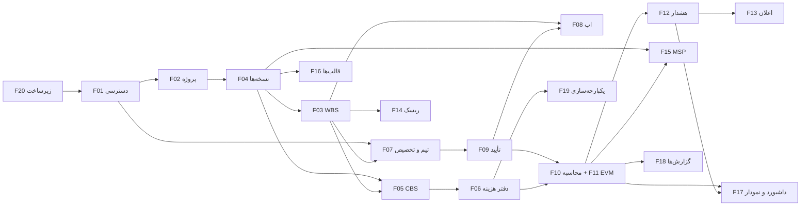

# پروژه‌یار — فهرست ویژگی‌ها و ماتریس‌های ارتباط

> **نسخه:** ۱ · **تاریخ:** 1405/08/11 · **مبنا:** `01-foundation-decisions.md` و `02-domain-model.md`

این سند پاسخ می‌دهد که هر ویژگی چه چیزی را **می‌نویسد**، چه چیزی را از کدام ویژگی **می‌خواند**، کدام **محاسبه** به کدام ورودی وابسته است، و هر **رویداد** چه واکنش‌هایی در بقیهٔ سیستم دارد.

پیش از تغییر هر ویژگی، ردیف‌های مربوط به آن را در هر سه ماتریس بخوان. هر تغییری که یک ستون این ماتریس‌ها را عوض کند (دادهٔ جدید، فرمول جدید، رویداد جدید) باید همین‌جا هم ثبت شود.

---

## ۱. فهرست ویژگی‌ها

| شناسه | ویژگی | فایل | صفحه‌های بوم | خلاصه |
|---|---|---|---|---|
| F01 | ورود، کاربران و دسترسی | `features/access-control.md` | W01–W04، W26، W27، W32، M01، M02، M14 | احراز هویت وب و اپ، دعوت، نقش‌ها، کدهای دسترسی |
| F02 | ساخت و تنظیمات پروژه | `features/project-setup.md` | W07–W09، W28، W30 (منطقهٔ خطر)، W37، W47، W48، W38 | ویزارد، اطلاعات عمومی، تقویم، فعال‌سازی، بایگانی |
| F03 | WBS | `features/wbs.md` | W11، W12، W13، W39 | درخت، وزن، روش اندازه‌گیری، گام‌ها، ورود Excel |
| F04 | نسخه‌های برنامه | `features/plan-versions.md` | W29 (مبنای PV)، W21 (خطوط منحنی S) | نسخهٔ کاری، مبنا، بازنگری، اعمال |
| F05 | CBS و اتصال‌ها | `features/cbs.md` | W14، W15 | اقلام هزینه، اتصال WBS↔CBS، بازنگری بودجه |
| F06 | دفتر هزینه | `features/cost-ledger.md` | — (در بوم صفحه ندارد؛ بخش ۷) | ثبت دستی و Excel هزینهٔ واقعی |
| F07 | تیم، تخصیص و حوزه‌های تأیید | `features/team-assignment.md` | W16، W17، W42، W29 (حوزه‌ها) | اعضا، سپردن برگ‌ها، تأییدکنندهٔ هر حوزه |
| F08 | اپ سرپرست و دریافت گزارش | `features/field-app.md` | M03–M14 | گزارش روزانهٔ آفلاین، عکس، اصلاح، مشکل کارگاه، API دریافت |
| F09 | گردش‌کار تأیید | `features/approval-workflow.md` | W20، W40، W29 | صندوق گزارش، مراحل، مهلت، تأیید خودکار، اصلاح بعد از تأیید |
| F10 | موتور محاسبه | `features/progress-calculation.md` | — (بک‌اند) | پیشرفت، snapshot، دوره‌ها، شاخص‌های عملیاتی |
| F11 | EVM و پیش‌بینی | `features/evm.md` | W10، W21، W22، W24 | فرمول‌های ارزش کسب‌شده و پیش‌بینی (داخل خط محاسبهٔ F10) |
| F12 | موتور هشدار | `04-alert-engine.md` | W05، W10، W14، W23، W24 | قواعد و هشدارهای حالت‌دار |
| F13 | اعلان‌ها | `features/notifications.md` | W06، W30، M12 | کانال‌ها، ترجیحات، خلاصهٔ روزانه، یادآوری |
| F14 | ریسک | `features/risk.md` | W18، W19، W44، M13 | دفتر ریسک، اقدام‌ها، ذخیرهٔ احتیاطی |
| F15 | MSP | `features/msp-integration.md` | W13، W34، W35، W49، W36 | ورود، تطبیق، همگام‌سازی دوطرفه، خروجی XML |
| F16 | قالب‌ها | `features/templates.md` | W31 | قالب‌های WBS و CBS سازمان |
| F17 | داشبورد و نمودارها | `features/charts.md` | W05، W10، W21–W24 | لایهٔ خواندن و نمایش |
| F18 | گزارش‌های مدیریتی | `features/management-reports.md` | W25 | قالب گزارش، زمان‌بندی، PDF |
| F19 | یکپارچه‌سازی‌های دیگر | `features/integrations.md` | W30 | ERP، حسابداری، خروجی P6، پشتیبان؛ فاز بعد |
| F20 | زیرساخت مشترک | `features/platform.md` | W43، W45، W46 | رویدادها، ممیزی، زمان‌بند، جستجو، فعالیت‌های اخیر، حالت‌های سیستم، ذخیرهٔ فایل |

---

## ۲. مالکیت داده: هر موجودیت فقط یک نویسنده دارد

**قاعده:** فقط ویژگی مالک یک موجودیت را می‌نویسد. ویژگی‌های دیگر برای تغییر آن، سرویس مالک را صدا می‌زنند و هرگز مستقیم در جدولش نمی‌نویسند. این قاعده جلوی منطق تکراری و ناسازگار را می‌گیرد.

| موجودیت | مالک | نکته |
|---|---|---|
| Organization، User، Role، RolePermission، Invitation | F01 | |
| ProjectMember، ApprovalRoute، WbsAssignmentHistory، `WbsItem.supervisorUserId` | F07 | تخصیص عملیاتی است و نسخه نمی‌سازد (D05) |
| Project، ProjectSettings، ProjectCalendar | F02 | |
| PlanVersion، همهٔ `*Plan`، WbsDependency | F04 | |
| WbsItem، CbsItem، WbsCbsLink (به‌جز سرپرست) | F04 | F03، F05، F15 و F16 فقط از طریق «نسخهٔ کاری» F04 می‌نویسند. در پروژهٔ پیش‌نویس، نسخهٔ کاری مستقیماً روی جاری اعمال می‌شود (D05). |
| ScheduleChangeProposal | F04 | در پروژه‌های متصل به MSP، F03 به‌جای ویرایش تاریخ پیشنهاد می‌سازد |
| CostEntry، CostImportBatch، `Project.costsCompleteThrough` | F06 | F19 در آینده از طریق API همین ویژگی می‌نویسد (D02) |
| BudgetRevisionRequest | F05 | تأییدش از طریق F04 یک بازنگری می‌سازد |
| FieldReport، Photo، محتوای FieldReportItem | F08 | محتوای آیتم فقط در حالت‌های `submitted` و `needs_revision` قابل نوشتن است |
| وضعیت FieldReportItem، Review | F09 | همهٔ انتقال‌های حالت (D08) فقط در F09 |
| WbsItemProgress، ProjectProgress، CbsItemProgress، همهٔ Snapshotها، ReportingPeriod | F10 | فرمول‌های EVM از F11 در خط محاسبهٔ F10 اجرا می‌شوند |
| Risk و زیرموجودیت‌ها، ContingencyAllocation | F14 | مشکل کارگاه (M13) از F08 به سرویس F14 داده می‌شود |
| AlertRuleSetting، Alert | F12 | |
| Notification، NotificationPreference | F13 | |
| MspLink، FieldMappingTemplate، ImportSession، SyncSession، SyncChange، `ExternalIdMap(msp)` | F15 | |
| Template، TemplateVersion | F16 | |
| ReportTemplate، ReportSchedule، GeneratedReport | F18 | |
| DomainEvent، AuditLog | F20 | همهٔ ویژگی‌ها از طریق کتابخانهٔ مشترک F20 و در همان تراکنش می‌نویسند (D07) |

---

## ۳. ماتریس الف — وابستگی دادهای

هر ردیف یعنی «مصرف‌کننده این داده را از مالکش می‌خواند و برای این کار».

### F02 ساخت و تنظیمات پروژه
| داده | از | کاربرد |
|---|---|---|
| Template | F16 | گزینهٔ «استفاده از قالب» در W38 و پیشنهاد قالب بر اساس نوع پروژه در W37 |
| ImportSession | F15 | گزینهٔ «ورود از فایل MSP» در W38 |
| User | F01 | انتخاب مدیر پروژه و اعضای اولیه (W48) |
| نتیجهٔ اعتبارسنجی نسخهٔ کاری | F04 | پیش‌شرط فعال‌سازی |

### F03 WBS
| داده | از | کاربرد |
|---|---|---|
| ProjectCalendar | F02 | تولید وزن «از مدت» |
| BAC برگ‌ها از اتصال‌ها | F05 | تولید وزن «از هزینه» و پنل «اقلام CBS متصل» در W11 |
| WbsItemProgress | F10 | ستون‌های پیشرفت برنامه‌ای، واقعی، انحراف و وضعیت در W11 |
| FieldReportItem | F08/F09 | پنل «گزارش‌های کارگاه» آیتم در W11 |
| RiskLink | F14 | نشان «۱ ریسک باز» و دکمهٔ ثبت ریسک |
| `supervisorUserId` | F07 | ستون سرپرست |
| `ExternalIdMap` | F15 | نمایش UID فایل MSP (W12) |
| Alert | F12 | رنگ و برچسب وضعیت روی ردیف‌ها |

### F04 نسخه‌های برنامه
| داده | از | کاربرد |
|---|---|---|
| محتوای ویرایش‌شده | F03، F05، F15، F16، F02 | ساخت و اعتبارسنجی نسخهٔ کاری |
| ProjectSettings | F02 | `weightGenerator` و مرجع PV |

### F05 CBS
| داده | از | کاربرد |
|---|---|---|
| برگ‌های WBS | F03 | انتخاب برگ در W15 |
| جمع CostEntry به تفکیک قلم | F06 از طریق F10 | ستون‌های هزینهٔ واقعی، درصد مصرف و مقدار مصرف‌شده در W14 |
| WbsItemProgress | F10 | ارزش کسب‌شده و پیش‌بینی هر قلم `[تأییدشده: OD-17]` |
| RiskLink | F14 | ریسک‌های مرتبط با قلم |

### F06 دفتر هزینه
| داده | از | کاربرد |
|---|---|---|
| برگ‌های CBS | F05 | مقصد ردیف هزینه |
| برگ‌های WBS | F03 | `wbsItemId` اختیاری `[تأییدشده: OD-01]` |
| ReportingPeriod | F10 | ثبت هزینه با تاریخ داخل دورهٔ بسته‌شده به اولین دورهٔ باز منتقل می‌شود (مانند D06) `[تأییدشده]` |

### F07 تیم و تخصیص
| داده | از | کاربرد |
|---|---|---|
| User | F01 | افزودن عضو |
| برگ‌های WBS | F03 | تخصیص |
| WbsItemProgress و آمار گزارش‌ها | F10 | «بار کاری پس از تخصیص» (W17) |

### F08 اپ سرپرست
| داده | از | کاربرد |
|---|---|---|
| برگ‌های تخصیص‌یافته، روش، واحد، مقدار کل، گام‌ها | F03/F04، F07 | فهرست «فعالیت‌های من» و فرم ثبت (M04، M06) |
| برنامهٔ امروز و آخرین مقدار تأییدشده | F10 | «برنامهٔ امروز ۶۰٪ · تأییدشده ۵۵٪» (M06) |
| قواعد گزارش کارگاه، موقعیت و شعاع کارگاه | F02 | پیش‌نمایش پرچم‌ها در گوشی؛ داوری نهایی با سرور است |
| Review (یادداشت، چک‌لیست، عکس علامت‌خورده) | F09 | صفحهٔ اصلاح (M11) |
| Notification | F13 | M12 |
| دسته‌های ریسک | F14 | فرم مشکل کارگاه (M13) |

### F09 گردش‌کار تأیید
| داده | از | کاربرد |
|---|---|---|
| FieldReportItem، Photo | F08 | صندوق گزارش‌ها |
| ApprovalRoute، تأییدکنندهٔ جایگزین | F07، F02 | مسیریابی |
| ProjectSettings | F02 | شرط مرحلهٔ دوم، تأیید خودکار، مهلت |
| پیشرفت برنامه‌ای در تاریخ گزارش | F10 | «پس از تأیید انحراف به ۰٪ می‌رسد» (W40) |
| `isCritical` | F04 (از F15) | شرط اختیاری مرحلهٔ دوم |

### F10 موتور محاسبه
| داده | از | کاربرد |
|---|---|---|
| آیتم‌های `approved` | F09 | پیشرفت واقعی (D03، D06) |
| نسخهٔ مرجع PV و نسخهٔ جاری | F04 | پیشرفت برنامه‌ای، وزن‌ها، BAC |
| اتصال‌ها و نرخ‌ها | F05 (داخل نسخه) | BAC، PV، EV |
| CostEntry `posted` | F06 | AC |
| ProjectCalendar، آستانه‌ها | F02 | روز کاری، وضعیت انحراف |
| تخصیص‌ها و زمان بررسی‌ها | F07، F09 | شاخص‌های عملیاتی W23 |

### F12 موتور هشدار
| داده | از | کاربرد |
|---|---|---|
| WbsItemProgress، ProjectProgress | F10 | قواعد پیشرفت و هزینه |
| FieldReportItem، Review | F08، F09 | قواعد گزارش و تأیید |
| تخصیص‌ها، حوزه‌ها، اعضا و نقش‌ها | F07، F01 | قواعد ساختاری و تعیین مخاطب |
| Risk، RiskAction | F14 | قواعد ریسک |
| SyncSession و خطاهای اتصال | F15، F19 | قواعد یکپارچه‌سازی |
| ضربان صف گوشی | F08 | گزارش‌های ماندگار در صف (بخش ۷، G7) |
| AlertRuleSetting | خودش | پارامترها |

### F13 اعلان‌ها
| داده | از | کاربرد |
|---|---|---|
| Alert | F12 | ارسال هشدار |
| DomainEvent | F20 | اعلان‌های رویدادی بی‌حالت |
| شماره، ایمیل، توکن پوش | F01 | مقصد ارسال |
| نقش‌ها در پروژه | F07 | گیرنده‌ها بر اساس نقش (W30) |

### F14 ریسک
| داده | از | کاربرد |
|---|---|---|
| مشکل کارگاه | F08 | ریسک با منبع `field` |
| آیتم‌های WBS و CBS | F03، F05 | پیوند ریسک |
| WbsItemProgress | F10 | «موارد مرتبط: 1.2.3.1 −۳۳٪» (W19) |
| `contingencyReserve` | F02 | سقف تخصیص |

### F15 MSP
| داده | از | کاربرد |
|---|---|---|
| نسخهٔ جاری | F04 | مبنای مقایسه در همگام‌سازی |
| پیشرفت تأییدشده | F10 | جهت «از پروژه‌یار به MSP» (W36) |
| کاربران و سرپرستان | F01، F07 | تطبیق Resource Names (W35) |
| ProjectCalendar | F02 | ارسال تقویم به MSP (W28) |
| ScheduleChangeProposal | F04 | پیشنهادهای منتظر صدور |

### F16 قالب‌ها
| داده | از | کاربرد |
|---|---|---|
| نسخهٔ جاری یک پروژه | F04 | «ذخیره به‌عنوان قالب» `[تأییدشده]` |
| شمار استفاده | F02 | «استفاده‌شده در ۴ پروژه» (W31) |

### F17 داشبورد و نمودارها
| داده | از | کاربرد |
|---|---|---|
| همهٔ جدول‌های مشتق و snapshotها | F10 | همهٔ اعداد و نمودارها |
| Alert | F12 | «نیاز به توجه» (W05)، رنگ‌ها |
| Risk | F14 | ماتریس ریسک و «ریسک‌های مهم» |
| DomainEvent | F20 | «فعالیت‌های اخیر» |

### F18 گزارش‌های مدیریتی
| داده | از | کاربرد |
|---|---|---|
| snapshot روزانه و PeriodSnapshot | F10 | اعداد گزارش؛ برای دورهٔ بسته فقط PeriodSnapshot (D06) |
| Risk | F14 | بخش ریسک‌ها |
| Photo | F08 | بخش عکس‌های کارگاه |
| Alert | F12 | «مهم‌ترین انحراف‌ها» |

### F19 یکپارچه‌سازی‌های دیگر
| داده | از | کاربرد |
|---|---|---|
| API ثبت هزینه | F06 | ERP و حسابداری فقط از این مسیر می‌نویسند (D02) |
| نسخهٔ جاری و پیشرفت | F04، F10 | خروجی XER برای P6 |

---

## ۴. ماتریس ب — وابستگی محاسباتی

همهٔ مقادیر این جدول را F10 در خط محاسبه می‌سازد و در جدول‌های مشتق ذخیره می‌کند (D07)، مگر جایی که «محل محاسبه» چیز دیگری بگوید.

**دو استثنای مجاز:**
- **کمک‌های ویرایش** در نسخهٔ کاری، مثل جمع وزن‌ها یا تعادل وزن و بودجه: سرویس اعتبارسنجی F04 حساب می‌کند، نه رابط کاربری.
- **تجمیع ساده** روی مقادیر ذخیره‌شدهٔ چند پروژه، مثل تعداد پروژه‌های در خطر در W05: مجاز است، به شرطی که فرمول جدیدی در کار نباشد.

| # | مقدار | تعریف | ورودی‌ها (مالک) | محل محاسبه | نمایش در | بازمحاسبه با |
|---|---|---|---|---|---|---|
| ب1 | درصد واقعی برگ | قواعد D03 روی آیتم‌های تأییدشده با `workDate ≤ t` | FieldReportItem (F09)، روش و مقدار کل و گام‌ها (F04) | F10 | W11، W24، M05، M06 | تأیید، برگرداندن، جایگزینی آیتم؛ اعمال نسخه |
| ب2 | درصد برنامه‌ای برگ | توزیع درون برگ `[تأییدشده: OD-02]` | WbsItemPlan نسخهٔ مرجع (F04)، تقویم (F02) | F10 | W10، W11، M03، M06 | اعمال نسخه، تغییر مرجع PV، تغییر تقویم، تیک روزانه |
| ب3 | وزن تولیدی | D04 | BAC (F05)، مدت و تقویم (F02، F04)، تعداد | F04، فقط در نسخهٔ کاری | W12، W35 | درخواست کاربر |
| ب4 | پیشرفت والد و پروژه (فیزیکی) | تجمیع وزنی (D04) | ب1، ب2، وزن‌ها | F10 | W05، W07، W10، W11، W21 | مانند ب1 و ب2 `[تأییدشده: OD-18]` |
| ب5 | انحراف و وضعیت | واقعی − برنامه‌ای؛ آستانه‌ها (۴.۴ نمای کلی) | ب1، ب2، ب4، تنظیمات (F02) | F10 | همهٔ صفحه‌ها | مانند ب4؛ تغییر آستانه‌ها |
| ب6 | BAC برگ، والد، پروژه | جمع `subBudget` اتصال‌ها | WbsCbsLinkPlan نسخهٔ مرجع (F04) | F10 | W14، W15، W22 | اعمال نسخه، تغییر مرجع |
| ب7 | PV، EV | ۴.۱۱ نمای کلی | ب1، ب2، ب6 | F10 (فرمول F11) | W10، W21، W22، W24 | مانند ب1، ب2، ب6 |
| ب8 | AC | Σ CostEntry `posted` با `costDate ≤ t_c` | CostEntry (F06) | F10 | W10، W14، W22 | ثبت هزینه، تغییر تاریخ کامل بودن |
| ب9 | CV، SV، CPI، SPI، EAC، VAC، TCPI | ۴.۱۱ نمای کلی؛ شاخص‌های هزینه با EV و AC در `t_c`، شاخص‌های زمان در تاریخ داده (OD-19) | ب6، ب7، ب8، ب25 | F10 (فرمول F11) | W10، W14، W21، W22 | هر تغییر در ب6 تا ب8 و ب25 |
| ب10 | پیشرفت ریالی | EV ÷ BAC | ب6، ب7 | F10 | W10، W22 (با `showFinancialProgress`) | مانند ب7 |
| ب11 | پیش‌بینی پایان پروژه و آیتم | `[تأییدشده: OD-07]` | ب7، ب1، تاریخچهٔ snapshot | F10 (فرمول F11) | W10، W21، W24، W28 | مانند ب7؛ تیک روزانه |
| ب12 | درصد مصرف قلم CBS | AC قلم ÷ بودجهٔ قلم | ب8 به تفکیک قلم، بودجه (F04) | F10 | W10، W11، W14 | ثبت هزینه، اعمال نسخه |
| ب13 | EV و پیش‌بینی قلم CBS | `features/cbs.md` ۸ | ب1، اتصال‌ها، ب8 به تفکیک قلم | F10 | W14 | مانند ب1 و ب8 |
| ب14 | تعادل وزن و بودجه | قدر مطلق (وزن در پروژه − سهم بودجه ×100) < ~~0.05~~ **0.1** (اصلاح 1405/08/15، هم‌گام با `features/cbs.md` ۵.۳) | وزن‌ها، ب6 | F04 (کمک ویرایش) | W15 | ویرایش در نسخهٔ کاری |
| ب15 | تغییر آیتم گزارش (delta) | quantity: `quantityToday ÷ totalQuantity × 100`؛ percent و steps: درصد محاسبه‌شده − آخرین تأییدشده | FieldReportItem، WbsItemProgress | F09، هنگام دریافت و دوباره هنگام تأیید (D10) | W20، W40، M08 | دریافت؛ تأیید |
| ب16 | پرچم‌ها، نیاز به مرحلهٔ دوم، واجد تأیید خودکار | W29 و D08 | ب15، عکس‌ها، فاصله، تنظیمات | F09 | W20، W40، M08 | دریافت؛ تأیید؛ تکمیل بارگذاری عکس |
| ب17 | فاصله از کارگاه | فاصلهٔ haversine بین GPS گزارش و موقعیت کارگاه | FieldReport (F08)، Project (F02) | F09 هنگام دریافت | W20، W40 | دریافت |
| ب18 | پوشش گزارش روزانه | روزهای کاری دارای دست‌کم یک گزارش ÷ روزهای کاری با فعالیت باز تخصیص‌یافته | FieldReport، تخصیص‌ها، تقویم | F10 | W10 («۶ از ۸ سرپرست»)، W23 | دریافت گزارش؛ تیک روزانه |
| ب19 | زمان تأیید: میانگین و صدک ۹۰ | `decidedAt − submittedAt` به تفکیک تأییدکننده | Review (F09) | F10 | W23، W29 («میانگین فعلی ۱۶٫۲ ساعت») | هر تصمیم |
| ب20 | نرخ برگشت برای اصلاح | آیتم‌های `request_revision` ÷ کل آیتم‌های بررسی‌شده در بازه | Review | F10 | W23 | هر تصمیم |
| ب21 | بار کاری سرپرست | تعداد برگ‌های تخصیص‌یافتهٔ تمام‌نشده | تخصیص‌ها، ب1 | F10 | W17، W23 | تخصیص؛ ب1 |
| ب22 | امتیاز و سطح ریسک | احتمال × اثر؛ بازه‌ها | Risk | F14 | W18، W19، W44 | تغییر ریسک |
| ب23 | اثر بالقوهٔ ریسک‌های باز | Σ اثر مالی؛ Σ اثر زمانی `[تأییدشده]` | Risk | F14 | W18 | تغییر ریسک |
| ب25 | تاریخ شاخص‌های هزینه `t_c` | `min(تاریخ داده، costsCompleteThrough)` | Project (F06) | F10 | کنار هر شاخص هزینه | تغییر تاریخ کامل بودن؛ تیک روزانه |
| ب26 | پیشرفت برگ `time_based` | پیشرفت برنامه‌ای زمانی بر اساس نسخهٔ جاری (D03-الف) | WbsItem جاری، تقویم | F10 | W11، W22 | اعمال نسخه، تیک روزانه |
| ب24 | شاخص‌های پرتفوی | تجمیع ProjectProgress پروژه‌های فعال؛ «در خطر» = انحراف ≤ −15 یا CPI < 0.9 | ProjectProgress | F17 (تجمیع ساده) | W05، W07 | خواندن |

**قاعدهٔ سازگاری EVM** `[تأییدشده — استاندارد EVM]`: BAC، PV و EV همیشه روی بودجه‌های **همان نسخهٔ مرجع PV** محاسبه می‌شوند. اینکه پیشرفت فیزیکی واقعی و آیتم‌های اضافه‌شده بعد از نسخهٔ مرجع با کدام وزن حساب شوند: `[تأییدشده: OD-18]`.

---

## ۵. ماتریس ج — وابستگی رفتاری (رویداد ← واکنش‌ها)

ترتیب اجرا همیشه D07 است: ثبت رویداد در outbox ← بازمحاسبهٔ F10 (اگر لازم باشد) ← ارزیابی قواعد F12 ← ارسال F13.

| رویداد | منتشرکننده | بازمحاسبه | قواعد هشدار ارزیابی‌شده | اعلان رویدادی | اثرهای دیگر |
|---|---|---|---|---|---|
| `FieldReportReceived` | F08 | فقط `pendingPercent` | AL-APR-03 | NT-APR-01 به تأییدکنندهٔ مرحلهٔ اول | F09: محاسبهٔ ب15 تا ب17، تعیین مهلت، ارزیابی تأیید خودکار |
| `FieldReportItemApproved` | F09 | از `workDate` به بعد، فقط دوره‌های باز (D06) | AL-PRG-01، AL-PRG-02، AL-PRG-03، AL-CST-03، AL-CST-04، AL-APR-01، AL-X-01 | — `[تأییدشده]` | صف خروجی پیشرفت به MSP (F15)؛ فعالیت‌های اخیر |
| `FieldReportItemReturned` | F09 | — | AL-APR-01 | NT-FLD-01 به سرپرست | نمایش در M10 و M11 |
| `FieldReportItemRejected` | F09 | — | AL-APR-01 | NT-FLD-02 به سرپرست `[تأییدشده]` | — |
| `FieldReportItemRevoked` | F09 | مانند تأیید | مانند تأیید | NT-FLD-01 | حذف از صف خروجی MSP اگر هنوز صادر نشده |
| `FieldReportItemSuperseded` | F09 | مانند تأیید | مانند تأیید | NT-FLD-03 به سرپرست `[تأییدشده]` | ممیزی (دلیل اصلاح) |
| `CostEntryPosted` | F06 | AC و شاخص‌های وابسته | AL-CST-01 تا AL-CST-04 | — | — |
| `CostsCompleteThroughChanged` | F06 | همهٔ شاخص‌های هزینه | AL-CST-01 تا AL-CST-05 | — | ممیزی |
| `BudgetRevisionRequested` | F05 | — | — | NT-BUD-01 به مدیر پروژه `[تأییدشده]` | — |
| `BudgetRevisionDecided` | F05 | از طریق `PlanVersionApplied` اگر تأیید شود | — | NT-BUD-02 به درخواست‌کننده `[تأییدشده]` | — |
| `PlanVersionApplied` | F04 | کامل، برای همهٔ دوره‌های باز | همهٔ AL-PRG، AL-CST و AL-STR | NT-PLN-01 به مدیر پروژه و برنامه‌ریز `[تأییدشده]` | به‌روزرسانی فعالیت‌های اپ؛ آیتم‌های جدید تا تخصیص در اپ دیده نمی‌شوند (W36)؛ آیتم‌های در صف آیتم‌های حذف‌شده ← `needs_resolution` (D10) |
| `ScheduleChangeProposed` | F04 | — | AL-INT-02 | — | صف صدور به MSP |
| `SyncSessionApplied` | F15 | از طریق `PlanVersionApplied` | AL-INT-01 (رفع) | — | تأیید پیشنهادهای برگشته از MSP؛ علامت «صادرشده» روی پیشرفت ارسالی |
| `ImportBuilt` / `ImportRolledBack` | F15 | — (پروژهٔ پیش‌نویس) | AL-STR-01، AL-STR-04، AL-STR-06 | — | پنجرهٔ ۳۰ دقیقه‌ای بازگردانی (W49) |
| `IntegrationFailed` | F19 (تصمیم 1405/08/26: همگام‌سازی MSP تعاملی است و منتشر نمی‌کند) | — | AL-INT-01 | — | — |
| `MspProgressExported` | F15 (1405/08/26) | — | AL-INT-02 (رفع) | — | ردیف‌های پیشرفت و پیشنهادها «صادرشده» |
| `ProjectActivated` | F02 | کامل | همه | NT-PRJ-01 به اعضا `[تأییدشده]` | F04 مبنا را می‌سازد؛ اپ از این لحظه گزارش می‌پذیرد |
| `ProjectStatusChanged` | F02 | توقف برای بایگانی | رفع همهٔ هشدارهای پروژهٔ بایگانی‌شده | — | اپ برای پروژهٔ متوقف یا بایگانی‌شده گزارش نمی‌پذیرد (W30) |
| `ProjectSettingsChanged` | F02 | اگر آستانه، مرجع PV، تقویم یا تنظیم وزن عوض شده باشد | همه | — | ممیزی |
| `AssignmentChanged` | F07 | ب18، ب21 | AL-STR-04، AL-STR-05، AL-FLD-01، AL-RES-01 | NT-ASG-01 به سرپرست قبلی و جدید (پیامک، W17) | همگام‌سازی فهرست فعالیت‌های اپ |
| `ApprovalRouteChanged` | F07 | — | AL-STR-06 | — | آیتم‌های منتظر مرحلهٔ اول به تأییدکنندهٔ جدید منتقل می‌شوند `[تأییدشده]` |
| `MemberChanged` | F07 | — | AL-STR-04، AL-STR-05 | NT-USR-01 (دعوت) | حذف سرپرست ← برگ‌هایش بدون سرپرست می‌شوند |
| `RiskChanged` | F14 | ب22، ب23 | AL-RSK-01، AL-X-01 | NT-RSK-01 به دنبال‌کنندگان (W19)؛ ریسک جدید ≥ ۱۵: NT-RSK-02 به مدیر پروژه (W30، W44) | — |
| `RiskActionChanged` | F14 | — | AL-RSK-02 | — | — |
| `RiskNoteMention` | F14 | — | — | NT-RSK-03 به نام‌برده‌شده | — |
| `SiteIssueReported` | F08 ← F14 | — | AL-RSK-04 | NT-RSK-04 به مدیر پروژه (M13) | ریسک با برچسب «از کارگاه» |
| `PeriodClosed` | F10 | ساخت PeriodSnapshot | AL-PER-01 (رفع) | NT-PER-01 `[تأییدشده]` | F18 گزارش‌های دوره را از PeriodSnapshot می‌سازد |
| `DeviceQueueHeartbeat` | F08 | — | AL-FLD-04 | — | نمایش «در صف همگام‌سازی گوشی» در W23 |
| `DailyTick` (۰۰:۳۰ به وقت تهران) | F20 | پیشرفت برنامه‌ای همهٔ پروژه‌های فعال؛ snapshot روز جدید | همهٔ قواعد زمانی: AL-PRG-*، AL-FLD-01..03، AL-APR-02، AL-RSK-02، AL-RSK-03، AL-INT-02، AL-RES-01، AL-PER-01 | — | — |
| `HourlyTick` | F20 | — | AL-APR-01 (مهلت بررسی) | — | ارجاع به جایگزین اگر `onDeadline = escalate` |
| `DigestTick` (۰۷:۳۰) | F20 | — | — | NT-DIG-01 خلاصهٔ روزانه به مدیر پروژه (W30) | — |
| `ReminderTick` (`dailyReminderTime` هر پروژه) | F20 | — | — | NT-FLD-04 به سرپرستانی که امروز گزارش نداده‌اند (W29) | — |
| `ReportScheduleDue` | F18 | — | — | NT-RPT-01 به گیرندگان | تولید PDF |

### ۵.۱ فهرست شناسهٔ قواعد هشدار (حالت‌دار)

جزئیات کامل هر قاعده (شرط دقیق، پارامترها، مخاطب، متن راهنما، لینک اقدام) در `04-alert-engine.md` می‌آید. این فهرست شناسه‌ها را ثابت می‌کند تا فایل‌های ویژگی به آن‌ها ارجاع دهند.

**پیشرفت و زمان**
| کد | نام | موضوع | شدت | منبع |
|---|---|---|---|---|
| AL-PRG-01 | عقب‌ماندگی آیتم از برنامه | آیتم WBS | هشدار یا بحرانی طبق آستانه‌ها | W10، W11، W24، W30 |
| AL-PRG-02 | عقب‌ماندگی پروژه | پروژه | هشدار یا بحرانی | W05، W07 |
| AL-PRG-03 | تأخیر پیش‌بینی‌شدهٔ پایان پروژه | پروژه | هشدار یا بحرانی بر حسب روز | W10، W21 |
| AL-PRG-04 | برگ شروع‌نشده پس از تاریخ شروع برنامه‌ای | آیتم WBS | هشدار | پیشنهاد جدید |

**هزینه**
| کد | نام | موضوع | شدت | منبع |
|---|---|---|---|---|
| AL-CST-01 | مصرف قلم CBS بیش از ۹۰٪ | قلم CBS | هشدار | W14، W30 |
| AL-CST-02 | پیش‌بینی فراتر از بودجهٔ قلم | قلم CBS | هشدار | W14 (OD-17) |
| AL-CST-03 | مصرف بودجه جلوتر از پیشرفت | پروژه | هشدار یا بحرانی | W05 |
| AL-CST-04 | CPI پایین | پروژه | هشدار یا بحرانی | W05 |
| AL-CST-05 | شاخص‌های هزینه قدیمی‌اند (تاریخ کامل بودن هزینه‌ها خیلی عقب است) | پروژه | هشدار | OD-19 |

**ساختار و پیکربندی**
| کد | نام | موضوع | شدت | منبع |
|---|---|---|---|---|
| AL-STR-01 | برگ‌های بدون اتصال CBS | پروژه (تجمیعی) | هشدار | W15 |
| AL-STR-02 | بودجهٔ CBS تخصیص‌نیافته به WBS | پروژه (تجمیعی) | هشدار | W14 (OD-08) |
| AL-STR-03 | ناهمخوانی وزن و بودجه | پروژه (تجمیعی) | اطلاع | W15 |
| AL-STR-04 | برگ‌های بدون سرپرست | پروژه (تجمیعی) | هشدار | W36، W49 |
| AL-STR-05 | سرپرست بدون تخصیص | سرپرست در پروژه | اطلاع | W16، W23 |
| AL-STR-06 | برگ‌های بدون تأییدکنندهٔ حوزه | پروژه (تجمیعی) | هشدار | W48 |

**گزارش کارگاه**
| کد | نام | موضوع | شدت | منبع |
|---|---|---|---|---|
| AL-FLD-01 | سرپرست بدون گزارش در N روز کاری | سرپرست در پروژه | هشدار یا بحرانی | W05، W23 |
| AL-FLD-02 | الگوی گزارش‌های بدون عکس یا کم‌عکس | سرپرست | اطلاع | W23 |
| AL-FLD-03 | الگوی گزارش‌های خارج از محدوده | سرپرست | هشدار | W23 |
| AL-FLD-04 | گزارش ماندگار در صف گوشی | سرپرست | هشدار | W23، M09 |

**تأیید**
| کد | نام | موضوع | شدت | منبع |
|---|---|---|---|---|
| AL-APR-01 | آیتم‌های معوق در صف تأیید | تأییدکننده (تجمیعی) | هشدار بیش از مهلت؛ بحرانی بیش از دو برابر مهلت | W05، W20، W30 |
| AL-APR-02 | گلوگاه تأیید | تأییدکننده | اطلاع یا هشدار | W23 |
| AL-APR-03 | آیتم‌های نیازمند تعیین تکلیف | پروژه (تجمیعی) | هشدار | D10 |

**ریسک**
| کد | نام | موضوع | شدت | منبع |
|---|---|---|---|---|
| AL-RSK-01 | ریسک باز با سطح بالا یا بحرانی | ریسک | هشدار (۱۵–۱۹) یا بحرانی (۲۰–۲۵) | W18، W30، W44 |
| AL-RSK-02 | اقدام ریسک از موعد گذشته | ریسک | هشدار | W18، W19 |
| AL-RSK-03 | بازبینی ریسک سررسیده | ریسک | اطلاع | W19 `[تأییدشده]` |
| AL-RSK-04 | مشکل کارگاهی ارزیابی‌نشده | ریسک | هشدار | M13 `[تأییدشده]` |

**قواعد ترکیبی و دیگر**
| کد | نام | موضوع | شدت | منبع |
|---|---|---|---|---|
| AL-X-01 | تأخیر بحرانی بدون ریسک یا اقدام اصلاحی | آیتم WBS | هشدار | W23، W24 — پیشنهاد جدید |
| AL-INT-01 | خطای همگام‌سازی یا اتصال | پروژه یا اتصال | بحرانی | W30 |
| AL-INT-02 | تغییرات منتظر ارسال به MSP | پروژه | اطلاع | W11 («۴ تغییر») — پیشنهاد جدید |
| AL-RES-01 | عدم توازن بار کاری سرپرستان | پروژه | اطلاع | W23 |
| AL-PER-01 | دورهٔ پایان‌یافتهٔ بسته‌نشده | پروژه | اطلاع | OD-06 |

### ۵.۲ فهرست اعلان‌های رویدادی (بی‌حالت)

| کد | رویداد | گیرنده | منبع |
|---|---|---|---|
| NT-APR-01 | گزارش جدید برای بررسی | تأییدکنندهٔ مرحله | W30 |
| NT-FLD-01 | آیتم برای اصلاح برگشت | سرپرست | W30 |
| NT-FLD-02 | آیتم رد شد | سرپرست | `[تأییدشده]` |
| NT-FLD-03 | آیتم تأییدشده اصلاح شد | سرپرست | `[تأییدشده]` |
| NT-FLD-04 | یادآوری گزارش روزانه | سرپرست | W29 |
| NT-ASG-01 | تغییر تخصیص فعالیت | سرپرست قبلی و جدید | W17 |
| NT-USR-01 | دعوت | دعوت‌شده | W16 |
| NT-RSK-01 | تغییر امتیاز ریسک | دنبال‌کنندگان | W19 |
| NT-RSK-02 | ریسک جدید با امتیاز ۱۵ یا بیشتر | مدیر پروژه و مالک ریسک | W30، W44 |
| NT-RSK-03 | نام‌بردن در یادداشت ریسک | نام‌برده‌شده | W19 |
| NT-RSK-04 | مشکل کارگاهی جدید | مدیر پروژه | M13 |
| NT-RSK-05 | انتقال مالکیت ریسک پس از حذف عضو | مدیر پروژه | W16، W19 — تصمیم کاربر 1405/08/25 |
| NT-PLN-01 | بازنگری جدید برنامه اعمال شد | مدیر پروژه، برنامه‌ریز | `[تأییدشده]` |
| NT-PRJ-01 | پروژه فعال شد | اعضا | `[تأییدشده]` |
| NT-PER-01 | دوره بسته شد | مدیر پروژه، برنامه‌ریز | `[تأییدشده]` |
| NT-BUD-01 | درخواست بازنگری بودجهٔ جدید | مدیر پروژه | `[تأییدشده]` |
| NT-BUD-02 | درخواست بازنگری بودجه تأیید یا رد شد | درخواست‌کننده | `[تأییدشده]` |
| NT-DIG-01 | خلاصهٔ روزانهٔ پروژه | مدیر پروژه | W30 |
| NT-RPT-01 | گزارش زمان‌بندی‌شده آماده شد | گیرندگان | W25 |

---

## ۶. گراف وابستگی و لایه‌های ساخت

این گراف فقط می‌گوید هر ویژگی پیش از ساخت به چه چیزهایی نیاز دارد. ترتیب نهایی و محدودهٔ هر مرحله در `05-roadmap.md` تعیین می‌شود.

| لایه | ویژگی‌ها | توضیح |
|---|---|---|
| ۰ | F20، F01 | زیرساخت، رویداد، ممیزی، احراز هویت و دسترسی |
| ۱ | F02، F04 | پروژه و هستهٔ نسخه‌ها |
| ۲ | F03، F05، F07 | ساختار، هزینه و تیم |
| ۳ | F06، F09، F08 | دادهٔ واقعی: هزینه، تأیید، اپ. F09 با ثبت دستی وب (G10) قابل ساخت و تست است، پیش از آماده شدن اپ |
| ۴ | F10 + F11 | موتور محاسبه |
| ۵ | F12، F13 | هشدار و اعلان |
| ۶ | F17، F14 | نمایش و ریسک |
| ۷ | F15، F16 | MSP و قالب‌ها؛ تا این لایه ساختار با ساخت دستی یا Excel وارد می‌شود |
| ۸ | F18، F19 | گزارش‌های مدیریتی و یکپارچه‌سازی‌ها |

---

## ۷. شکاف‌های رابط کاربری و نیازهای تازه

این موارد از تطبیق ماتریس‌ها با بوم به دست آمدند. باید یا به بوم اضافه شوند، یا در فایل ویژگی مربوط رابط ساده‌شان تعریف شود.

| شناسه | شکاف | ویژگی |
|---|---|---|
| G1 | **دفتر هزینه صفحه ندارد:** فهرست ردیف‌ها، فرم ثبت دستی، ورود Excel، ردیف برگشتی | F06 |
| G2 | **صفحه یا بخش «بستن دوره» وجود ندارد** | F10 |
| G3 | **مدیریت نسخه‌های برنامه:** فهرست نسخه‌ها، مقایسهٔ دو نسخه، و پیام «این ذخیره بازنگری R4 می‌سازد» در W12 | F04 |
| G4 | **نمایش «در انتظار MSP»** روی تاریخ‌هایی که در پروژهٔ متصل ویرایش شده‌اند (W11، W12) | F04، F15 |
| G5 | **تعیین تکلیف آیتم‌های `needs_resolution`** در صندوق گزارش‌ها (W20) | F09 |
| G6 | **ثبت پیشرفت اولیه** در جریان ورود پروژهٔ در جریان (W49) | F15 (OD-16) |
| G7 | **API ضربان صف گوشی** (تعداد و قدیمی‌ترین مورد صف)؛ پیش‌نیاز AL-FLD-04 و بخش «در صف همگام‌سازی» W23 | F08 |
| G8 | **تنظیم قواعد هشدار** (روشن/خاموش، پارامترها)؛ W30 فقط کانال‌ها را دارد | F12 |
| G9 | **الگوی مشترک «این عدد از کجا آمد؟»** برای اصل ۱ نمای کلی | F17 |
| G10 | **فرم ثبت دستی پیشرفت در وب:** W11 دکمه دارد ولی فرم ندارد | F09، F03 |
| G11 | **اصلاح برچسب‌های W14 و W22** طبق D01 | F05، F17 |
| G12 | **فرم ورود پیشرفت گام‌ها در اپ** (M06) و **ویرایشگر گام‌ها** در W12 | F08، F03 |
| G13 | **دکمه و دیالوگ «تقسیم»** در W12 | F03 |
| G14 | **فرم و صندوق «درخواست بازنگری بودجه»** | F05 |
| G15 | **شیوهٔ قیمت مقطوع** در فرم قلم CBS و ستون «مبلغ» در W15 | F05 |

---

## ۸. تصمیم‌های باز تازه

دو تصمیم باز از این سند بیرون آمد (OD-17 بسته شد؛ OD-18 باز است) و به جدول بخش ۱۴ مدل دامنه اضافه شد:

- **OD-17:** ارزش کسب‌شده و پیش‌بینی هزینه در سطح قلم CBS (W14: «برآورد پایان ۱۵۲٫۳ میلیارد»).
- **OD-18:** پیشرفت فیزیکی واقعی، و آیتم‌هایی که بعد از نسخهٔ مرجع اضافه شده‌اند، با وزن‌ها و بودجهٔ کدام نسخه محاسبه شوند.

از `features/cost-ledger.md` هم یک تصمیم باز تازه آمد:

- **OD-19:** تاریخ محاسبهٔ شاخص‌های هزینه وقتی ثبت هزینه‌ها از پیشرفت عقب است (بسته شد).

### یادداشت هم‌گام‌سازی (1405/08/11)
- **OD-05 بسته شد:** بخش «کمبود نیرو به تفکیک تخصص» از W23 در نسخهٔ اول حذف می‌شود. W23 فقط «نفرات حاضر در کارگاه» (جمع نفرات گزارش‌ها) را نشان می‌دهد.
- **OD-15 بسته شد:** ب18 (پوشش گزارش روزانه) روزهای دارای دست‌کم یک گزارش را می‌شمارد.

---

## ۹. افزوده‌های پس از نگارش فایل‌های ویژگی (1405/08/11)

### ۹.۱ مالکیت موجودیت‌های تازه (تکمیل بخش ۲)
| موجودیت | مالک |
|---|---|
| ComputeRun، PlanVersionCurve، SupervisorDailyStat، ApproverStat | F10 |
| AuthSession، LoginAttempt، BackupCode، DeviceToken | F01 |
| ProjectType، OrgCalendarPreset، OfficialHoliday | F02 |
| ProgressExportItem | F15 |
| SiteIssue | F08 (ساخت ریسک از آن با F14) |
| IntegrationConnection، IntegrationRun، AccountMapping، UnmappedRow | F19 |
| BackupSchedule، ProjectBackup، ProjectExport | F20 |

### ۹.۲ رویدادهای تازه (تکمیل ماتریس ج)
| رویداد | منتشرکننده | واکنش |
|---|---|---|
| `ComputeFinished` | F10 | ارزیابی قواعد F12؛ نشانگر `computeState` |
| `AlertRaised`، `AlertResolved` | F12 | F13 اعلان می‌سازد؛ رفع اعلان نمی‌سازد |
| `ProjectCreated` | F02 | — |
| `ProjectManagerTransferred` | F02 | انتقال تأییدکنندهٔ جایگزین و مرحلهٔ دوم؛ NT-USR-01 |
| `ProjectDeletionRequested`، `ProjectDeletionCancelled` | F02 | پنهان کردن؛ `PurgeTick` پس از ۱۴ روز |
| `RolePermissionChanged` | F01 | باطل کردن کش دسترسی |
| `ReportGenerated` | F18 | NT-RPT-01 |
| `NotificationFailed` | F13 | شمارش برای AL-INT-01 |
| `SiteIssueReported` | F08 | (قبلاً در ج) ساخت ریسک `source=field` |
| `IntegrationFailed` | F19 | AL-INT-01 |
| `MspProgressExported` | F15 | AL-INT-02 (رفع) |

زمان‌بندها: `PurgeTick` (۰۳:۰۰) و `BackupTick` (۰۲:۰۰) به `DailyTick`، `HourlyTick`، `DigestTick`، `ReminderTick` اضافه شدند (`features/platform.md` ۵).

### ۹.۳ اعلان تازه
| کد | رویداد | گیرنده | وضعیت |
|---|---|---|---|
| NT-ACC-01 | درخواست دسترسی از مدیر پروژه (دکمهٔ «درخواست از …» در حالت ۴۰۳) | مدیر پروژه | `[تأییدشده]` |

### ۹.۴ شکاف‌های تازهٔ رابط کاربری
| شناسه | شکاف | ویژگی |
|---|---|---|
| G16 | W41: «نوشتن در فایل» باید «ساخت XML به‌روز» شود | F15 |
| G17 | W27: «اثر روی N کاربر» و «بازگشت به پیش‌فرض» | F01 |
| G18 | W26: اجباری کردن ورود دومرحله‌ای و ظرفیت دعوت | F01 |
| G19 | W29: «هر دو شاخص» کلید نمایشی است، نه روش وزن‌دهی؛ بخش دوره‌های گزارش | F02، F10 |
| G20 | W12 در «حالت قالب» | F16 |
| G21 | W25: ساخت گزارش سفارشی و گیرندگان بیرونی | F18 |

### ۹.۵ ماتریس الف: افزوده‌ها
| مصرف‌کننده | داده | از | کاربرد |
|---|---|---|---|
| F17 | PlanVersionCurve | F10 | خطوط برنامهٔ اولیه و بازنگری‌شده |
| F17 | SupervisorDailyStat، ApproverStat | F10 | heatmap و گلوگاه W23 |
| F15 | ProgressExportItem | F15 از F10/F09 | خروجی پیشرفت به MSP |
| F18 | PeriodSnapshot | F10 | گزارش رسمی |
| F13 | DeviceToken | F01 | پوش |
| F02 | OfficialHoliday | F02 | تقویم |
| F19 | CostEntry API | F06 | ورود هزینه |

### ۹.۶ وضعیت تصمیم‌های باز
همهٔ تصمیم‌های OD-01 تا OD-19 بسته شده است؛ OD-02، 03، 06، 07، 09، 10، 14، 16، 18 در 1405/08/11 پس از پیشنهاد تأیید شد (`02-domain-model.md` ۱۴.۱).
