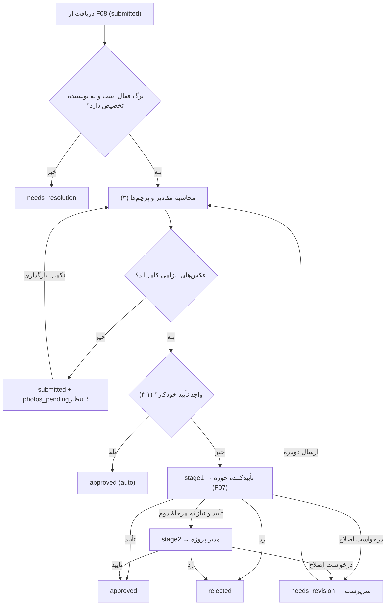

# F09 — گردش‌کار تأیید گزارش‌های کارگاه

> **نسخه:** ۱ · **تاریخ:** 1405/08/11 · **وضعیت:** آمادهٔ ساخت؛ همهٔ فرض‌های بخش ۱۲ در 1405/08/11 تأیید شد
> **پیش‌خوانی لازم:** `00-overview.md` بخش ۴.۱۴، `01-foundation-decisions.md` (D03، D06، D07، D08، D10)، `02-domain-model.md` بخش ۶، `features/team-assignment.md`
> **مالکیت:** همهٔ انتقال‌های حالت `FieldReportItem` و همهٔ رکوردهای `Review` فقط در این ویژگی ساخته می‌شوند (ماتریس‌ها، بخش ۲).

---

## ۱. هدف و مشکل دنیای واقعی

گزارشی که تأیید نشده، در هیچ عددی شرکت نمی‌کند (اصل ۲). پس **کیفیت و سرعت تأیید**، کیفیت و به‌روز بودن کل محصول را تعیین می‌کند.

این ویژگی دو هدف متضاد را با هم برآورده می‌کند:
- **اعتماد:** هیچ عدد مشکوکی بدون نگاه انسان وارد پیشرفت نشود. معیارهای مشکوک بودن: جهش، GPS بیرون از محدوده، عکس کم.
- **سرعت:** ناظر وقتش را صرف گزارش‌های عادی نکند. این با تأیید خودکار تغییرهای کوچک، میانبرهای صفحه‌کلید و تأیید گروهی تأمین می‌شود.

**کاربران:** ناظر (مرحلهٔ اول)، مدیر پروژه (مرحلهٔ دوم، جایگزین پیش‌فرض)، برنامه‌ریز (ثبت دستی و مشاهده)، سرپرست (گیرندهٔ نتیجه از طریق F08).

---

## ۲. خط پردازش یک آیتم



- انتقال به `approved` همیشه **دوباره‌ارزیابی** دارد (۳.۳) و رویداد `FieldReportItemApproved` منتشر می‌کند (D07).
- **ثبت دستی وب** (`source = web_manual`، G10) از همین خط عبور می‌کند. فقط شرط تخصیص برایش لازم نیست و منع خودتأییدی (F07 ۶.۲) برایش اعمال می‌شود.

---

## ۳. مقادیر و پرچم‌ها

### ۳.۱ مقادیر محاسبه‌شده در سرور
| مقدار | quantity | percent | steps |
|---|---|---|---|
| `lastApprovedPercent` | درصد برگ از آیتم‌های تأییدشده (D03) | همان | همان |
| `computedPercent` | `min(100, (Σ مقدار تأییدشده + quantityToday) ÷ کل × 100)` | `reportedPercent` | Σ وزن × (درصد گزارش‌شدهٔ گام، یا آخرین تأییدشده برای گام‌های گزارش‌نشده) ÷ 100 |
| `deltaPercent` | `quantityToday ÷ کل × 100` | `computedPercent − lastApprovedPercent` | `computedPercent − lastApprovedPercent` |
| `plannedPercentAtDate` | برنامهٔ برگ در `workDate` (F10) | همان | همان |
| انحراف پس از تأیید (W40) | `computedPercent − plannedPercentAtDate` | همان | همان |

> **مثال W40:** درصدی، قبلی 65، جدید 70 ← تغییر +5. برنامه تا امروز 70 ← «پس از تأیید انحراف به ۰٪ می‌رسد».
> مقدار اطلاعاتی 49 از 980 مترمکعب برابر 5٪ است و با تغییر هم‌خوان است.

**ترتیب برای روش‌های percent و steps:** «آخرین» یعنی بیشترین `workDate`، و در تساوی بیشترین `deviceRecordedAt`. **ترتیب تأیید اهمیتی ندارد.** اگر آیتم ۱۲ خرداد پیش از آیتم ۱۰ خرداد تأیید شود، درصد برگ همچنان مقدار ۱۲ خرداد است.

### ۳.۲ پرچم‌ها
| پرچم | شرط | اثر |
|---|---|---|
| `insufficient_photos` | تعداد عکس‌ها < `minPhotos` (پیش‌فرض ۲) | مانع تأیید خودکار |
| `photos_pending` | عکس‌های ثبت‌شده در فهرست هنوز کامل بارگذاری نشده‌اند | آیتم وارد بررسی نمی‌شود (D10) |
| `abnormal_jump` | `deltaPercent > maxJumpPct` (پیش‌فرض ۲۰) | مانع تأیید خودکار؛ اگر `stage2OnJump`، مرحلهٔ دوم |
| `gps_out_of_range` | فاصله > شعاع کارگاه (پیش‌فرض ۳۰۰ متر) | مانع تأیید خودکار؛ اگر `stage2OnGpsOut`، مرحلهٔ دوم؛ اگر `gpsMode = block`، `rejected` خودکار با یادداشت سیستمی |
| `late_submission` | `serverReceivedAt − deviceRecordedAt > lateAfterHours` (پیش‌فرض ۷۲) | مانع تأیید خودکار `[تأییدشده]` |
| `decrease` | `deltaPercent < 0` و `allowDecrease = false` | مانع تأیید خودکار؛ ناظر تصمیم می‌گیرد، چون ممکن است اصلاح درست باشد `[تأییدشده]` |
| `over_total_quantity` | مقدار تجمعی > مقدار کل | مانع تأیید خودکار |
| `mock_location`، `clock_skew`، `photo_time_mismatch` | از F08 (`features/field-app.md` ۶) | مانع تأیید خودکار |
| `needs_resolution` | برگ حذف‌شده، یا برگ دیگر به نویسنده تخصیص ندارد | حالت `needs_resolution` |
| `method_conversion` | آیتم سیستمی تبدیل روش | بدون بررسی؛ مستقیم `approved` |

### ۳.۳ دوباره‌ارزیابی هنگام تأیید
چون ممکن است در فاصلهٔ دریافت تا تصمیم آیتم‌های دیگری برای همان برگ تأیید شده باشند، هنگام هر تصمیم «تأیید» مقادیر ۳.۱ و پرچم‌های وابسته دوباره محاسبه می‌شوند.
- اگر نتیجه آیتم را **نیازمند مرحلهٔ دوم** کند و هنوز در مرحلهٔ اول است، به‌جای `approved` به `stage2` می‌رود.
- پیام به ناظر: «با تأیید گزارش‌های دیگر، تغییر این آیتم ۱۸٪ شد و به مرحلهٔ دوم می‌رود.» `[تأییدشده]`

---

## ۴. قواعد تصمیم

### ۴.۱ تأیید خودکار (W29)
همهٔ شرط‌ها باید برقرار باشند:
- `autoApproveEnabled`
- `|deltaPercent| < autoApproveMaxDelta` (پیش‌فرض ۲)
- عکس‌ها ≥ `minPhotos` و کامل بارگذاری‌شده
- هیچ پرچمی از جدول ۳.۲ جز `photos_pending` پیش از تکمیل
- `source = app` `[تأییدشده: ثبت دستی وب هرگز خودکار تأیید نمی‌شود]`

نتیجه: `Review(decision = auto_approve, stage = 1, reviewerUserId = null)`.
> **مثال:** تغییر +1.5، دو عکس، GPS در ۱۲۰ متری ← تأیید خودکار.

### ۴.۲ نیاز به مرحلهٔ دوم
`requiresStage2 = approvalMode == two_stage` **و** دست‌کم یکی از این‌ها:
- (`stage2OnCritical` و `deltaPercent > criticalThreshold`)
- (`stage2OnJump` و `abnormal_jump`)
- (`stage2OnGpsOut` و `gps_out_of_range`)
- (`stage2OnCriticalPath` و `isCritical` و پروژهٔ متصل به MSP)

> **مثال‌ها:**
> - +16 ← مرحلهٔ دوم (بیش از ۱۵).
> - +22 ← پرچم جهش و مرحلهٔ دوم.
> - +5 با GPS در ۴۵۰ متری ← پرچم GPS و مرحلهٔ دوم.

### ۴.۳ تصمیم‌های ناظر
| تصمیم | الزام | نتیجه |
|---|---|---|
| تأیید | — | `approved` یا `stage2` (۴.۲، ۳.۳) |
| درخواست اصلاح | یادداشت اجباری؛ چک‌لیست «کارهای لازم» و علامت‌گذاری عکس‌های نامناسب اختیاری (M11) | `needs_revision`؛ NT-FLD-01 |
| رد | یادداشت اجباری | `rejected`؛ NT-FLD-02؛ پایانی |

**چک‌لیست کارهای لازم** (`Review.requiredActions`):
```json
[
  { "key": "a1", "text": "مقدار ۲۴۰ متر را با برگهٔ خروج انبار تطبیق دهید", "type": "check" },
  { "key": "a2", "text": "دو عکس نمای نزدیک از سینی کابل", "type": "photo", "minPhotos": 2 }
]
```
در اپ، «ارسال دوباره» تا انجام همهٔ کارهای نوع `photo` غیرفعال است (M11). کارهای نوع `check` با تیک سرپرست انجام‌شده حساب می‌شوند.

### ۴.۴ مهلت و ارجاع
- هر ورود به `stage1` یا `stage2` یک `Review` با `dueAt` می‌سازد: `dueAt = لحظهٔ ورود + reviewDeadlineHours`. اگر `dueAt` در روز غیرکاری تقویم پروژه بیفتد، به اولین روز کاری بعد با همان ساعت منتقل می‌شود. `[تأییدشده]`
- تیک ساعتی (F20) آیتم‌های سررسیده را پیدا می‌کند. AL-APR-01 برای هر تأییدکننده **تجمیعی** است.
- اگر `onDeadline = escalate`: یک `Review(decision = escalate)` ثبت و همان مرحله به تأییدکنندهٔ جایگزین سپرده می‌شود، با `dueAt` تازه. **ارجاع فقط یک بار** انجام می‌شود. اگر جایگزین هم دیر کند، AL-APR-01 بحرانی می‌شود.
- اگر تأییدکنندهٔ اصلی پس از ارجاع تصمیم بگیرد، تصمیمش پذیرفته است. اولین تصمیم برنده است.

### ۴.۵ ارسال دوباره پس از اصلاح
- آیتم با مقادیر و عکس‌های جدید، پاسخ سرپرست به ناظر و `revisionCount + 1` به `stage1` برمی‌گردد. همان تأییدکننده، `dueAt` تازه.
- مقادیر ۳.۱ و پرچم‌ها دوباره محاسبه می‌شوند. اگر حالا واجد باشد، تأیید خودکار هم ممکن است. `[تأییدشده]`

### ۴.۶ برگرداندن تأیید خودکار (D08)
- فقط برای آیتم `autoApproved` و فقط تا `approvedAt + reviewDeadlineHours`.
- دارندهٔ `report.approve.stage1` برای آن حوزه یا مدیر پروژه انجام می‌دهد.
- نتیجه: `needs_revision`، رویداد `FieldReportItemRevoked`، NT-FLD-01. اثرش با بازمحاسبه از پیشرفت حذف می‌شود.

### ۴.۷ اصلاح بعد از تأیید (D08)
- دارندهٔ `report.correct`: تأییدکنندهٔ حوزه یا مدیر پروژه (W27: «اصلاح گزارش تأییدشده برای ناظر»).
- با دلیل اجباری، یک آیتم جدید با `source = correction`، `supersedesItemId` و همان `workDate` می‌سازد که مستقیماً `approved` است. آیتم قبلی `superseded` می‌شود.
- منع خودتأییدی برقرار است: نویسندهٔ آیتم اصلی نمی‌تواند خودش اصلاحش کند. `[تأییدشده]`
- رویداد `FieldReportItemSuperseded`؛ NT-FLD-03؛ ممیزی.

### ۴.۸ تعیین تکلیف (G5)
| علت | گزینه‌های ناظر |
|---|---|
| برگ حذف شده است | فقط «رد» با یادداشت سیستمی پیشنهادی |
| برگ به سرپرست دیگری منتقل شده است | «پذیرش» (ورود به خط عادی از گام محاسبه) یا «رد» |

نتیجه: `Review(decision = resolve_assignment)`. AL-APR-03 تا خالی شدن صف فعال می‌ماند.

### ۴.۹ تأیید گروهی (W20: «تأیید همه»، Shift+A)
- فقط روی آیتم‌هایی که **هیچ پرچمی ندارند** و به مرحلهٔ دوم نیاز ندارند.
- هر آیتم جداگانه دوباره‌ارزیابی می‌شود (۳.۳). آیتمی که در این فاصله نیازمند مرحلهٔ دوم شده باشد، به‌جای تأیید به `stage2` می‌رود و در پاسخ گزارش می‌شود.
- **یک** بازمحاسبه برای هر پروژه راه می‌افتد (D07).

---

## ۵. صندوق گزارش‌ها (W20) و تأیید سریع (W40)

### ۵.۱ W20
- **دامنه:** صندوق **میان‌پروژه‌ای** است («۲۴ گزارش در انتظار از ۳ پروژه»). هر کاربر فقط آیتم‌هایی را می‌بیند که دسترسی دارد (D11): ناظر آیتم‌های حوزه‌اش، مدیر پروژه همهٔ آیتم‌های پروژه‌اش.
- **زبانه‌ها:** در انتظار، تأییدشده، نیاز اصلاح، ردشده، همه. شمارنده‌ها هم برای هر زبانه.
- **فیلترها:** پروژه، سرپرست، زیردرخت WBS، بازهٔ زمانی، «فقط مشکوک» (آیتم دارای هر پرچم).
- **مرتب‌سازی:** جدیدترین دریافت؛ گزینهٔ «قدیمی‌ترین انتظار».
- **سربرگ گزارش:** شماره، تاریخ، سرپرست، زمان ثبت در گوشی و دریافت در سرور و فاصلهٔ آن‌ها، نشان «ثبت آفلاین»، هوا، نفرات (جمع آیتم‌ها؛ `features/field-app.md` ۴.۳)، فاصلهٔ GPS.
- **میانبرها:** `J` و `K` حرکت، `A` تأیید، `E` درخواست اصلاح، `R` رد، `Shift+A` تأیید همهٔ آیتم‌های بی‌پرچم گزارش، `?` راهنما.
- **خروجی Excel** از فهرست فیلترشده.
- **منوی گزارش (بوم W45):** دانلود PDF، کپی پیوند گزارش، مشاهدهٔ عکس‌های کل گزارش و «مشاهده روی نقشه». منو فقط مکمل دکمه‌هاست؛ تأیید، درخواست اصلاح و رد دکمهٔ خودشان را دارند و در منو تکرار نمی‌شوند `[تصمیم کاربر 1405/08/23]`.

### ۵.۲ W40
- عکس‌ها با مهر زمان و مکان، و نقشهٔ GPS با دایرهٔ شعاع کارگاه
- **مهر مکان گزارش `[تصمیم کاربر 1405/08/23]`:** `gpsLat` و `gpsLng` گزارش (`02-domain-model.md` ۶) در پاسخ API می‌آیند، کنار `distanceFromSiteM` و `gpsAccuracyM` که از قبل بودند. سرور جهت نقطه از مرکز کارگاه را هم می‌دهد تا طرح شعاع جهت واقعی را بکشد (D07: جهت هم در سرور حساب می‌شود، مثل فاصله). مختصات مجوز تازه‌ای نمی‌خواهد: هر کس گزارش را می‌بیند آن را هم می‌بیند، مثل فاصله و «داخل/خارج محدوده» که از قبل دیده می‌شد.
- **«مشاهده روی نقشه»:** تا وقتی سرویس نقشه انتخاب نشده (`project-setup.md` ۱۴ مرحلهٔ ۷) نقشهٔ کاشی‌دار درون اپ نیست. پنجره همان طرح شعاع را بزرگ‌تر نشان می‌دهد با مختصات، دقت، فاصله، جهت، کپی مختصات و یک پیوند بیرونی به **نشان** که کاربر خودش باز می‌کند. گزارش ثبت‌دستی وب مهر مکان ندارد و گزینه با همین دلیل غیرفعال است.
- درصد قبلی، جدید و تغییر؛ برنامه تا امروز؛ انحراف پس از تأیید (۳.۱)
- مقدار و واحد؛ توضیح سرپرست؛ هوا، نفرات، نسخهٔ اپ، آنلاین یا آفلاین
- تاریخچهٔ بررسی‌های همین آیتم
- یادداشت ناظر (برای درخواست اصلاح و رد اجباری)
- دکمه‌ها: «برگشت برای اصلاح» و «تأیید»؛ «رد» در منوی بیشتر

### ۵.۳ ثبت دستی پیشرفت در وب (G10)
- دکمهٔ «ثبت گزارش دستی» در W11 فرمی باز می‌کند با: برگ (از قبل انتخاب‌شده)، تاریخ کار، ورودی روش برگ، یادداشت اجباری و پیوست اختیاری.
- یک `FieldReport(source = web_manual)` با یک آیتم ساخته می‌شود و از خط پردازش ۲ عبور می‌کند.
- **دسترسی:** `report.manual_entry` (مدیر پروژه، برنامه‌ریز، ناظر).
- فقط در پروژهٔ فعال (OD-F09-01، اصلاح 1405/08/15).
- برای برگ `time_based` مجاز نیست.

---

## ۶. ارتباط با سایر ویژگی‌ها

| ویژگی | جهت | چه چیزی |
|---|---|---|
| F02 | ← | تنظیمات گردش‌کار و قواعد گزارش (W29) |
| F04 | ← | پس از `PlanVersionApplied`: برگ‌های حذف‌شده ← `needs_resolution`. داخل تراکنش اعمال: ساخت آیتم‌های تبدیل روش |
| F07 | ← | تأییدکنندهٔ حوزه، جایگزین، مدیر پروژه، منع خودتأییدی |
| F08 | ← و → | دریافت آیتم‌ها و عکس‌ها؛ وضعیت، یادداشت و چک‌لیست برای اپ |
| F10 | ← و → | `lastApprovedPercent` و برنامهٔ تاریخ برای محاسبهٔ ۳.۱؛ بازمحاسبه پس از رویدادها؛ زمان تأیید و نرخ برگشت (ب19، ب20) |
| F12 | → | AL-APR-01، AL-APR-02، AL-APR-03 |
| F13 | → | NT-APR-01: **یک اعلان برای هر گزارش**، نه هر آیتم `[تأییدشده]`؛ NT-FLD-01 تا NT-FLD-03 |
| F15 | → | آیتم‌های تأییدشده در صف خروجی پیشرفت به MSP |

---

## ۷. دسترسی‌ها

| کد | پیش‌فرض | دامنه |
|---|---|---|
| `report.view` | مدیر پروژه، برنامه‌ریز، ناظر، ناظر کارفرما | ناظر: حوزهٔ خودش؛ بقیه: کل پروژه |
| `report.approve.stage1` | ناظر، مدیر پروژه | ناظر: حوزهٔ خودش و ارجاع‌شده‌ها |
| `report.approve.stage2` | مدیر پروژه | — |
| `report.correct` | ناظر، مدیر پروژه | ناظر: حوزهٔ خودش |
| `report.resolve` | ناظر، مدیر پروژه | ناظر: حوزهٔ خودش |
| `report.manual_entry` | مدیر پروژه، برنامه‌ریز، ناظر | — |

---

## ۸. API (مفهومی)

| عمل | مسیر |
|---|---|
| صندوق (میان‌پروژه‌ای) | `GET /inbox/field-items?tab=&projectId=&supervisorId=&wbsRootId=&from=&to=&flagged=` |
| جزئیات گزارش | `GET /projects/:pid/field-reports/:reportId` |
| تصمیم | `POST /projects/:pid/field-items/:itemId/decision {decision, note?, requiredActions?, unsuitablePhotoIds?}` |
| تأیید گروهی | `POST /projects/:pid/field-reports/:reportId/approve-clean` |
| برگرداندن تأیید خودکار | `POST /projects/:pid/field-items/:itemId/revoke-auto {note}` |
| اصلاح بعد از تأیید | `POST /projects/:pid/field-items/:itemId/correct {values, reason}` |
| تعیین تکلیف | `POST /projects/:pid/field-items/:itemId/resolve {accept: bool, note}` |
| ثبت دستی وب | `POST /projects/:pid/field-reports/manual` |
| درخواست اصلاح کل گزارش (اصلاح 1405/08/15) | `POST /projects/:pid/field-reports/:reportId/request-revision {note, requiredActions?}` — همان تصمیم ۴.۳ برای همهٔ آیتم‌های باز گزارش |
| زمینهٔ فرم ثبت دستی و اصلاح `[پیش‌فرض فنی]` | `GET /projects/:pid/wbs/:itemId/report-context` — روش، واحد، مقدار کل، درصد و گام‌های تأییدشده |
| خروجی صندوق | `GET /inbox/field-items/export.xlsx` با همان فیلترها |

---

## ۹. حالت‌های حاشیه‌ای

1. دو ناظر هم‌زمان روی یک آیتم تصمیم می‌گیرند (اصلی و جایگزین پس از ارجاع) ← قفل ردیف؛ اولین تصمیم برنده است؛ دومی `409`.
2. دو آیتم در انتظار برای یک برگ درصدی (۱۰ و ۱۲ خرداد) ← هر ترتیبی از تأیید، درصد نهایی را مقدار ۱۲ خرداد می‌کند (۳.۱).
3. برگ مقداری با مقدار کل ۱٬۰۰۰، تأییدشده ۹۰۰، و دو آیتم در انتظار ۶۰ و ۷۰ ← هنگام دریافت، درصد محاسبه‌شده 96 و 97 و تغییر 6 و 7 است و هیچ‌کدام پرچم ندارند. پس از تأیید اولی (تجمعی ۹۶۰)، دوباره‌ارزیابی دومی (۳.۳) تجمعی ۱٬۰۳۰ می‌دهد ← پرچم `over_total_quantity`. تأیید آن ممکن است ولی پیام تأییدی دارد، و درصد برگ روی ۱۰۰ می‌ماند.
4. پروژه هنگام دریافت متوقف یا بایگانی شده است ← F08 گزارش را نمی‌پذیرد؛ آیتم‌های قبلاً دریافت‌شده در گردش می‌مانند.
5. تأیید آیتمی با `workDate` در دورهٔ بسته ← مجاز؛ اثرش از ابتدای اولین دورهٔ باز (D06).
6. ناظر عکسی را «نامناسب» علامت می‌زند ولی آیتم را تأیید می‌کند ← مجاز؛ علامت فقط اطلاعاتی است.
7. ثبت دستی برای تاریخ آینده ← رد. اپ هم اجازه نمی‌دهد. `[تأییدشده]`

---

## ۱۰. معیارهای پذیرش

| شناسه | معیار |
|---|---|
| AC-AP-01 | مثال W40 (65 ← 70، برنامه 70، ۳ عکس، GPS داخل): `stage1`، بدون مرحلهٔ دوم، «انحراف پس از تأیید = 0». |
| AC-AP-02 | +1.5 با دو عکس و GPS معتبر ← `approved` خودکار با `Review(auto_approve)` و رویداد. |
| AC-AP-03 | +16 ← پس از تأیید مرحلهٔ اول به `stage2` می‌رود. +22 ← پرچم جهش. +5 با GPS در ۴۵۰ متری ← پرچم GPS و مرحلهٔ دوم. |
| AC-AP-04 | حالت حاشیه‌ای ۲: هر دو ترتیب تأیید، درصد برگ را مقدار ۱۲ خرداد می‌کنند. |
| AC-AP-05 | آیتم با `photos_pending` تا تکمیل بارگذاری در هیچ صندوقی ظاهر نمی‌شود. پس از تکمیل، خودکار ارزیابی می‌شود. |
| AC-AP-06 | آیتم بی‌پاسخ پس از ۲۴ ساعت با `onDeadline = escalate` یک بار به جایگزین می‌رود و `Review(escalate)` دارد. مهلتی که در روز تعطیل می‌افتد به روز کاری بعد منتقل می‌شود. |
| AC-AP-07 | درخواست اصلاح بدون یادداشت رد می‌شود. پس از ارسال دوباره، آیتم با `revisionCount = 1` نزد همان ناظر است. |
| AC-AP-08 | اصلاح بعد از تأیید یک آیتم جدید `approved` با `supersedesItemId` می‌سازد. آیتم قبلی `superseded` است و مقادیرش دست‌نخورده‌اند. |
| AC-AP-09 | برگرداندن تأیید خودکار پس از پایان مهلت، و برگرداندن آیتمی که دستی تأیید شده، رد می‌شوند. |
| AC-AP-10 | تأیید گروهی گزارشی با ۴ آیتم (۳ بی‌پرچم و ۱ پرچم‌دار) فقط ۳ آیتم را تأیید می‌کند و یک بازمحاسبه راه می‌اندازد. |
| AC-AP-11 | ناظری که ثبت دستی وب انجام داده، آن آیتم را در صندوق خودش نمی‌بیند. آیتم نزد جایگزین است. |

---

## ۱۱. تصمیم‌های این فایل

**تصمیم‌های کاربر 1405/08/15 (ساخت W20 و W40):**
| موضوع | تصمیم |
|---|---|
| مهلت «معوق» | مهلت بررسی هر پروژه (`reviewDeadlineHours`، پیش‌فرض ۲۴) در W05، W20 و AL-APR-01؛ نه ۴۸ ساعت ثابت (charts.md ۶.۱ اصلاح شد) |
| زبانه‌های W20 | هر گزارش در هر زبانه‌ای که دست‌کم یک آیتم از آن وضعیت دارد دیده می‌شود؛ شمارندهٔ زبانه = تعداد گزارش؛ در جزئیات، آیتم‌های زبانهٔ جاری اول |
| دامنهٔ ساخت | چک‌لیست کارهای لازم و علامت عکس نامناسب، «درخواست اصلاح گزارش» برای همهٔ آیتم‌های باز، برگرداندن تأیید خودکار، اصلاح بعد از تأیید، تعیین تکلیف و ثبت دستی وب (G10) همه ساخته شدند |
| ورود به W40 | از کارت «در انتظار تأیید من» W05، از ردیف آیتم در انتظار در پنل W11، و از کلیک عنوان یا عکس آیتم در W20 |

**تصمیم‌های کاربر 1405/08/23 (منوی گزارش و مهر مکان):**
| موضوع | تصمیم |
|---|---|
| محتوای منوی گزارش | فقط مکمل: دانلود PDF، کپی پیوند، مشاهدهٔ عکس‌ها، مشاهده روی نقشه. تأیید، اصلاح و رد تکرار نمی‌شوند (۵.۱) |
| مختصات در پاسخ API | `gpsLat`، `gpsLng` و جهت از مرکز کارگاه به گزارش اضافه شد؛ در `02-domain-model.md` ۶ از پیش ذخیره می‌شد و فقط به API نمی‌آمد (۵.۲) |
| دسترسی مختصات | همان دسترسی خود گزارش؛ کد دسترسی تازه‌ای ساخته نشد (۵.۲) |
| مقصد «مشاهده روی نقشه» | پنجرهٔ درون‌اپ با طرح شعاع و مختصات، به‌علاوهٔ پیوند بیرونی به نشان؛ نقشهٔ واقعی با سرویس نقشه در مرحلهٔ ۷ (۵.۲) |

**تصمیم کاربر 1405/08/23 (ساخت بک‌اند):** پیش از API همگام‌سازی اپ (مرحلهٔ ۴)، دریافت گزارش اپ به‌صورت سرویس سمت سرور ساخته می‌شود تا خط پردازش کامل (تأیید خودکار، پرچم‌ها، عکس در انتظار) آزمودنی باشد؛ API همگام‌سازی همان را می‌پیچد.

**OD-F09-01 `[تأییدشده 1405/08/15]`:** ثبت دستی وب (G10) فقط در پروژهٔ **فعال** پذیرفته می‌شود (هم‌راستا با F02 که اپ در `paused` گزارش نمی‌پذیرد)؛ در پروژهٔ متوقف، تمام‌شده یا بایگانی سرور `409` می‌دهد و دکمهٔ W11 دیده نمی‌شود.

**از بوم یا تصمیم‌های قبلی (تأییدشده):** خط پردازش، شرط‌های تأیید خودکار و مرحلهٔ دوم، مهلت ۲۴ ساعت و ارجاع، تفاوت درخواست اصلاح و رد، اصلاح بعد از تأیید، برگرداندن تأیید خودکار، صندوق میان‌پروژه‌ای و میانبرها.

---

## ۱۲. فرض‌های تأییدشده (1405/08/11)
1. آیتم دیررسیده (بیش از ۷۲ ساعت) خودکار تأیید نمی‌شود (۳.۲).
2. کاهش درصد وقتی مجاز نیست، رد نمی‌شود بلکه پرچم می‌خورد و ناظر تصمیم می‌گیرد (۳.۲).
3. دوباره‌ارزیابی هنگام تأیید ممکن است آیتم را به مرحلهٔ دوم بفرستد (۳.۳).
4. ثبت دستی وب هرگز خودکار تأیید نمی‌شود (۴.۱).
5. مهلتی که در روز غیرکاری بیفتد به روز کاری بعد منتقل می‌شود (۴.۴).
6. ارسال دوباره پس از اصلاح می‌تواند خودکار تأیید شود اگر واجد باشد (۴.۵).
7. منع خودتأییدی در اصلاح بعد از تأیید (۴.۷).
8. یک اعلان «گزارش جدید» برای هر گزارش، نه هر آیتم (۶).
9. ثبت دستی برای تاریخ آینده ممنوع است (۹).
