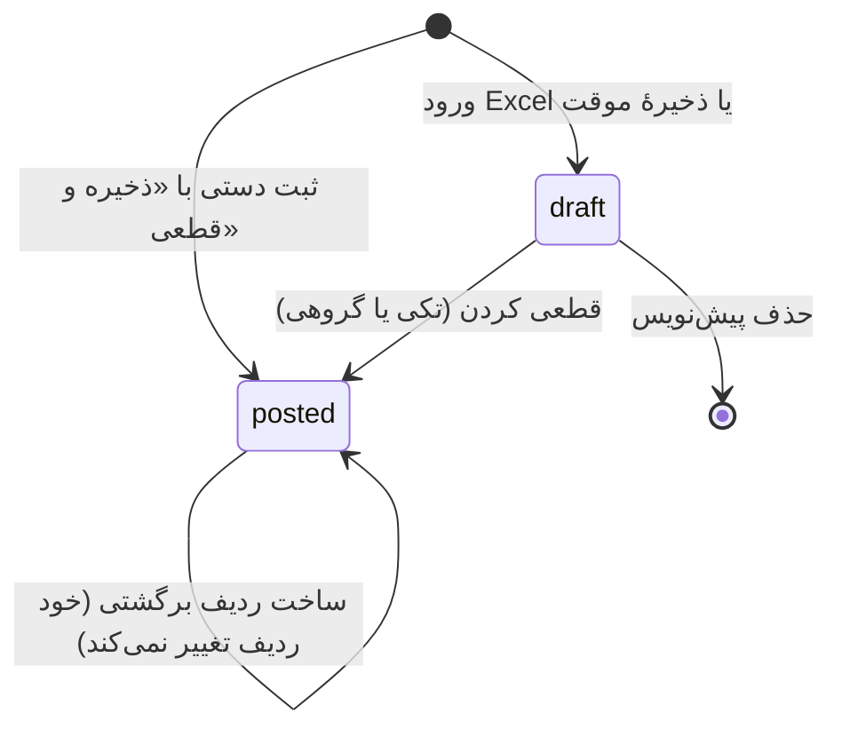

# F06 — دفتر هزینه: هزینهٔ واقعی (AC)

> **نسخه:** ۱ · **تاریخ:** 1405/08/11
> **وضعیت:** آمادهٔ ساخت. تصمیم‌های OD-01 و OD-19 در 1405/08/11 بسته شدند.
> **پیش‌خوانی لازم:** `01-foundation-decisions.md` (D01، D02، D06)، `02-domain-model.md` بخش ۵، `features/cbs.md`
> **توجه:** این ویژگی در بوم طراحی صفحه ندارد (شکاف G1). رابط کاربری آن در بخش ۸ تعریف شده و باید به بوم اضافه شود.

---

## ۱. هدف و مشکل دنیای واقعی

شاخص‌های هزینه (CPI، CV، EAC، درصد مصرف قلم‌ها) فقط به اندازهٔ هزینهٔ واقعی‌شان قابل اعتمادند. در پیمانکاری‌ها هزینه‌ها در حسابداری ثبت می‌شوند، معمولاً با تأخیر و با دسته‌بندی‌ای که به CBS پروژه ربطی ندارد.

دفتر هزینه سه کار می‌کند:
1. هزینهٔ واقعی را **با کد CBS پروژه** ثبت می‌کند، دستی یا از Excel، و بعدها از حسابداری (D02).
2. تاریخچه را **دست‌نخورده** نگه می‌دارد. اصلاح فقط با ردیف برگشتی ممکن است.
3. صریحاً می‌گوید هزینه‌ها **تا چه تاریخی کامل‌اند**، تا CPI روی دادهٔ ناقص ساخته نشود (بخش ۵.۶).

**کاربران:**
- واحد مالی: ثبت، ورود، قطعی کردن، برگشت، اعلام تاریخ کامل بودن
- برنامه‌ریز و مدیر پروژه: مشاهده، و در صورت نیاز ثبت

---

## ۲. مفاهیم

| مفهوم | تعریف |
|---|---|
| ردیف هزینه | `CostEntry`؛ یک هزینهٔ تحقق‌یافته روی یک برگ CBS |
| پیش‌نویس و قطعی | فقط ردیف `posted` در AC شمرده می‌شود؛ پیش‌نویس برای بازبینی ورود گروهی است |
| ردیف برگشتی | ردیف با مبلغ منفی که یک ردیف قطعی را خنثی می‌کند (`reversesEntryId`) |
| تاریخ تحقق | تاریخی که هزینه واقعاً رخ داده است (بخش ۵.۳) |
| دستهٔ ورود | مجموعه ردیف‌هایی که با یک فایل Excel وارد شده‌اند |
| طرف حساب | تأمین‌کننده یا پیمانکار جزء (متن آزاد در نسخهٔ اول) |
| تاریخ کامل بودن هزینه‌ها | آخرین تاریخی که واحد مالی تأیید می‌کند همهٔ هزینه‌ها تا آن روز ثبت شده‌اند `[تأییدشده: OD-19]` |

---

## ۳. پیش‌نیازها

| پیش‌نیاز | ویژگی |
|---|---|
| برگ‌های CBS | F05 |
| دوره‌های گزارش (قفل) | F10 |
| ذخیرهٔ فایل (پیوست سند) | F20 |
| کدهای دسترسی | F01 |

---

## ۴. داده

### ۴.۱ `CostEntry`
تعریف پایه در `02-domain-model.md` بخش ۵. افزوده‌ها:

| فیلد | نوع | توضیح |
|---|---|---|
| counterparty | string? | تأمین‌کننده یا پیمانکار جزء |
| attachmentKeys | string[] | تصویر یا PDF فاکتور و صورت‌وضعیت (D12) |
| periodShifted | bool | ثبت با تاریخی در دورهٔ بسته (بخش ۵.۴) |

### ۴.۲ `CostImportBatch` — عملیاتی، مالک F06
| فیلد | نوع | توضیح |
|---|---|---|
| projectId | →Project | |
| fileName، storageKey | string | |
| status | enum(previewed, imported, posted, cancelled) | |
| rowCount، errorCount، skippedDuplicateCount | int | |
| validation | json | پیام هر ردیف |
| totalAmount | bigint | |

### ۴.۳ افزوده به `Project` (`[تأییدشده: OD-19]`)
| فیلد | نوع | توضیح |
|---|---|---|
| costsCompleteThrough | date? | تاریخ کامل بودن هزینه‌ها |
| costsCompleteSetBy، costsCompleteSetAt | →User، ts | |

---

## ۵. قواعد

### ۵.۱ چرخهٔ عمر ردیف

- ردیف `draft` قابل ویرایش و حذف است. ردیف `posted` هرگز ویرایش یا حذف نمی‌شود (D02).
- قطعی کردن رویداد `CostEntryPosted` منتشر می‌کند (D07).

### ۵.۲ برگشت
- یک ردیف جدید با `amount = −مبلغ اصلی`، همان قلم و همان تاریخ تحقق، `reversesEntryId` و دلیل اجباری.
- برای اصلاح، پس از برگشت یک ردیف درست ثبت می‌شود. رابط کاربری این دو را در یک عمل «اصلاح» انجام می‌دهد.
- هر ردیف فقط یک بار برگشت می‌خورد. ردیف برگشتی خودش برگشت‌پذیر نیست.
- **مبلغ منفی فقط در ردیف برگشتی مجاز است.** `[تأییدشده]`

### ۵.۳ تاریخ تحقق (بستن فرض D02) `[تأییدشده]`
| نوع هزینه | تاریخ تحقق |
|---|---|
| مصالح | تاریخ تحویل به کارگاه |
| نیروی انسانی و ماشین‌آلات (اجاره یا کارکرد) | آخرین روز بازه‌ای که هزینه پوشش می‌دهد، مثلاً آخر ماه حقوق |
| پیمانکار جزء | آخرین روز دورهٔ صورت‌وضعیت آن پیمانکار |
| سایر | تاریخ سند |

> **پیامد:** مصالحی که تحویل شده ولی هنوز مصرف نشده (مصالح پای کار) در AC هست ولی EV ندارد، پس CPI را موقتاً پایین می‌آورد. این رفتار پذیرفته شده است. «مازاد مصرف» در سطح قلم (`features/cbs.md` ۸) آن را توضیح می‌دهد، و متن راهنمای AL-CST-04 باید به این احتمال اشاره کند.

### ۵.۴ دوره‌های بسته
- ثبت ردیف با تاریخ تحقق در دورهٔ بسته **مجاز است**. تاریخ واقعی حفظ می‌شود و `periodShifted = true`.
- snapshot دورهٔ بسته تغییر نمی‌کند. اثر این ردیف از ابتدای اولین دورهٔ باز در snapshotها دیده می‌شود (همان قاعدهٔ D06).
- **پیامد:** AC در گزارش رسمی دورهٔ بسته با جمع ردیف‌هایی که بعداً با همان تاریخ‌ها ثبت شده‌اند فرق می‌کند. این اختلاف در W22 با نشان «ثبت‌های پس از بستن دوره» نمایش داده می‌شود.

### ۵.۵ مقدار و مبلغ
- مبلغ: عدد صحیح ریال، غیر صفر (C02).
- مقدار اختیاری است و فقط برای قلم `unit_rate` مجاز است، به همان واحد قلم. برای «مقدار مصرف‌شده» و «مازاد مصرف» به کار می‌رود (`features/cbs.md` ۸).
- **مقصد فقط برگ CBS فعال است.** برای قلم حذف‌شده یا والد ثبت نمی‌شود.
- کلید idempotency: `(projectId, source, externalRef)`. ردیف تکراری رد نمی‌شود، نادیده گرفته و گزارش می‌شود.

### ۵.۶ تاریخ کامل بودن هزینه‌ها و تاریخ محاسبهٔ شاخص‌های هزینه (`[تأییدشده: OD-19]`)

**مشکل:** هزینه‌ها معمولاً با چند هفته تأخیر ثبت می‌شوند، ولی پیشرفت هر روز. اگر CPI امروز با EV امروز و AC ناقص امروز حساب شود، پروژه به‌دروغ خوب نشان داده می‌شود: EV کامل در برابر AC ناقص.

**تصمیم:**
- واحد مالی تاریخ کامل بودن را اعلام می‌کند (`costsCompleteThrough`)؛ مثلاً «هزینه‌ها تا پایان اردیبهشت کامل است».
- **شاخص‌های هزینه** (AC، CV، CPI، EAC، VAC، TCPI و شاخص‌های قلم‌های CBS) در تاریخ `t_c = min(تاریخ داده، costsCompleteThrough)` محاسبه می‌شوند. **هم EV و هم AC در همان t_c.** بی اعلام تاریخ کامل بودن، `t_c` همان تاریخ داده است (تصمیم 1405/08/23).
- **شاخص‌های زمان** (PV، EV، SV، SPI، پیشرفت) در تاریخ داده محاسبه می‌شوند.
- رابط کاربری کنار هر شاخص هزینه تاریخش را نشان می‌دهد: «CPI ۰٫۹۸ · هزینه‌ها تا 1405/02/31».
- اگر تاریخ کامل بودن تعیین نشده باشد، تاریخ داده به کار می‌رود و نشان «تاریخ کامل بودن هزینه‌ها تعیین نشده» نمایش داده می‌شود.
- قاعدهٔ جدید **AL-CST-05 «شاخص‌های هزینه قدیمی‌اند»**: اگر `costsCompleteThrough` بیش از N روز (پیش‌فرض ۴۵) از تاریخ داده عقب باشد. مخاطب: واحد مالی و مدیر پروژه.

> **مثال:** تاریخ داده 1405/03/31؛ هزینه‌ها تا 1405/02/31 کامل‌اند.
> EV در 1405/02/31 = 400؛ AC ردیف‌های با تاریخ ≤ 1405/02/31 = 410 ← **CPI = 0.9756**.
> محاسبهٔ ساده‌لوحانه با EV امروز (490) و همهٔ AC ثبت‌شده تا امروز (520) می‌داد 0.9423. هیچ‌کدام از این دو عدد اشتباه نیستند، ولی فقط اولی با دادهٔ کامل ساخته شده است.

### ۵.۷ AC در سطح برگ WBS (`[تأییدشده: OD-01]`)
- **نسخهٔ اول:** AC فقط در سطح **قلم CBS و پروژه** محاسبه و نمایش داده می‌شود. CPI و AC در سطح برگ WBS نداریم.
- فیلد `wbsItemId` در ردیف هزینه اختیاری است و ذخیره می‌شود، ولی در هیچ محاسبه‌ای به کار نمی‌رود.

**چرا:**
- هیچ صفحه‌ای از بوم CPI در سطح فعالیت نشان نمی‌دهد. W11 مصرف را در سطح قلم‌های متصل نشان می‌دهد.
- هر روش سرشکن کردن (به نسبت زیربودجه یا EV) عددی ساختگی تولید می‌کند. سرشکن به نسبت زیربودجه، برای فعالیت شروع‌نشده CPI صفر و هشدار کاذب می‌سازد.

**اگر بعداً لازم شد:** ترکیب «برچسب مستقیم `wbsItemId` + سرشکن باقی‌مانده به نسبت EV» پیشنهاد می‌شود. برای اینکه آن روز داده موجود باشد، فیلد از حالا ذخیره می‌شود.

---

## ۶. ورود Excel

### ۶.۱ قالب
| ستون | الزامی | توضیح |
|---|---|---|
| کد قلم CBS | بله | باید برگ فعال باشد |
| تاریخ تحقق | بله | شمسی یا میلادی |
| مبلغ (ریال) | بله | صحیح و مثبت |
| مقدار | خیر | فقط قلم `unit_rate` |
| شمارهٔ سند | خیر | |
| طرف حساب | خیر | |
| شرح | خیر | |
| شناسهٔ ردیف | خیر | `externalRef`؛ اگر خالی باشد، هش (کد، تاریخ، مبلغ، شمارهٔ سند) |
| منبع | خیر | «خرید» یا «صورت‌وضعیت پیمانکار جزء»؛ پیش‌فرض `excel` |

### ۶.۲ جریان
1. **بارگذاری و پیش‌نمایش:** کل فایل اعتبارسنجی می‌شود. گزارش شامل ردیف‌های سالم، خطادار و تکراری، به‌علاوهٔ جمع مبلغ به تفکیک قلم است.
2. **ورود:** ردیف‌های سالم به‌صورت `draft` ثبت می‌شوند. ردیف‌های خطادار وارد نمی‌شوند و فایل خطاها قابل دانلود است.
3. **قطعی کردن گروهی:** با یک عمل، همهٔ پیش‌نویس‌های دسته `posted` می‌شوند. فقط یک رویداد `CostEntryPosted` با شناسهٔ دسته منتشر می‌شود.

- حجم فایل حداکثر ۱۰ مگابایت و ۲۰٬۰۰۰ ردیف. `[پیش‌فرض فنی]`

---

## ۷. ارتباط با سایر ویژگی‌ها

| ویژگی | جهت | چه چیزی |
|---|---|---|
| F05 CBS | ← | مقصد ردیف‌ها؛ قواعد حذف و تغییر واحد قلمِ دارای هزینه (`features/cbs.md` ۴.۴) |
| F10 محاسبه | → | AC پروژه و قلم، سری ماهانهٔ AC (W22)، مقدار مصرف‌شده، تاریخ محاسبهٔ شاخص‌های هزینه (۵.۶) |
| F12 هشدار | → | AL-CST-01 تا AL-CST-05 |
| F14 ریسک | — | اثر مالی ریسک‌ها برآوردی است و در دفتر هزینه ثبت نمی‌شود |
| F17 نمایش | → | W10 (بودجهٔ مصرف‌شده)، W22 (منحنی هزینه، هزینه به تفکیک نوع) |
| F18 گزارش‌ها | → | بخش هزینه در گزارش‌های مدیریتی |
| F19 یکپارچه‌سازی | ← (آینده) | ERP و حسابداری فقط از API این ویژگی و با `source = integration` می‌نویسند |

---

## ۸. رابط کاربری (شکاف G1؛ باید به بوم اضافه شود)

**جایگاه:** زبانهٔ «دفتر هزینه» در کنار W14 در منوی پروژه، زیر بخش «هزینه».

| جزء | محتوا |
|---|---|
| نوار بالا | جمع AC قطعی؛ تاریخ کامل بودن هزینه‌ها با دکمهٔ «به‌روزرسانی» (فقط `cost.set_cutoff`)؛ تعداد پیش‌نویس‌ها |
| فیلترها | بازهٔ تاریخ، قلم CBS (جستجو)، نوع هزینه، منبع، وضعیت، طرف حساب |
| جدول | تاریخ تحقق، کد و عنوان قلم، شرح، طرف حساب، شمارهٔ سند، مقدار، مبلغ، منبع، وضعیت، نشان «برگشت‌خورده» و «پس از بستن دوره» |
| فرم ثبت دستی | انتخاب قلم برگ با جستجو در کد و عنوان؛ تاریخ شمسی؛ مبلغ با جداکنندهٔ هزارگان؛ مقدار با واحد قلم؛ شمارهٔ سند؛ طرف حساب؛ شرح؛ پیوست. دکمه‌ها: «ذخیره و قطعی» (اصلی) و «ذخیرهٔ پیش‌نویس» |
| اصلاح | روی ردیف قطعی: «اصلاح» با دلیل اجباری؛ برگشت و ردیف جدید در یک عمل؛ پیش‌نمایش هر دو ردیف |
| ورود Excel | بخش ۶؛ دانلود قالب |
| خالی | «هنوز هزینه‌ای ثبت نشده — بدون هزینهٔ واقعی، CPI و پیش‌بینی هزینه محاسبه نمی‌شوند» با دو اقدام: ثبت دستی، ورود از Excel |

---

## ۹. دسترسی‌ها

| کد | پیش‌فرض |
|---|---|
| `cost.view` | مدیر پروژه، برنامه‌ریز، واحد مالی |
| `cost.create` | واحد مالی، مدیر پروژه |
| `cost.post` | واحد مالی، مدیر پروژه |
| `cost.reverse` | واحد مالی، مدیر پروژه |
| `cost.import` | واحد مالی |
| `cost.set_cutoff` | واحد مالی |

همهٔ این‌ها `cbs.view_amounts` را هم لازم دارند. برگشت و تغییر تاریخ کامل بودن در ممیزی ثبت می‌شوند.

---

## ۱۰. API (مفهومی)

| عمل | مسیر |
|---|---|
| فهرست با فیلتر و جمع | `GET /projects/:pid/cost-entries` |
| ثبت | `POST /projects/:pid/cost-entries {…, post: true}` |
| قطعی کردن | `POST /projects/:pid/cost-entries/post {ids[] \| batchId}` |
| اصلاح (برگشت + جدید) | `POST /projects/:pid/cost-entries/:id/correct {reason, replacement?}` |
| حذف پیش‌نویس | `DELETE /projects/:pid/cost-entries/:id` |
| ورود Excel | `POST /projects/:pid/cost-imports` (پیش‌نمایش) · `POST /:batchId/import` · `POST /:batchId/post` |
| تاریخ کامل بودن | `PUT /projects/:pid/costs-complete-through {date}` |
| ثبت از یکپارچه‌سازی (آینده) | `POST /integrations/:system/cost-entries` (idempotent) |

---

## ۱۱. حالت‌های حاشیه‌ای

1. دو بار بارگذاری یک فایل ← ردیف‌های دوم همه «تکراری» و نادیده گرفته می‌شوند.
2. ردیف هزینه برای قلمی که در بازنگری بعدی حذف نرم شده ← ثبت تازه ممنوع است؛ ردیف‌های قبلی در AC می‌مانند. حذف قلم دارای هزینه از اول مسدود است (`features/cbs.md` ۴.۴).
3. `costsCompleteThrough` جلوتر از تاریخ داده ← پذیرفته نمی‌شود.
4. کاهش `costsCompleteThrough` به تاریخ قبلی ← مجاز با دلیل؛ ممیزی می‌شود.
5. ثبت برای پروژهٔ پیش‌نویس ← ممنوع؛ هزینه از فعال‌سازی معنا پیدا می‌کند. `[تأییدشده]`
6. ثبت برای پروژهٔ بایگانی‌شده ← ممنوع. برای پروژهٔ تکمیل‌شده ← مجاز، چون صورت‌حساب‌های پایانی دیر می‌رسند. `[تأییدشده]`

---

## ۱۲. معیارهای پذیرش

| شناسه | معیار |
|---|---|
| AC-CST-01 | با ردیف‌های هزینه‌ای که جمعشان C1=105، C2=215، C3=140، C4=60 است، AC پروژه = 520 و جدول `features/cbs.md` ۹.۲ بازتولید می‌شود. |
| AC-CST-02 | اصلاح ردیف 50,000,000 به 5,000,000 دو ردیف می‌سازد: −50,000,000 (برگشتی) و +5,000,000. ردیف اصلی بدون تغییر می‌ماند و AC دقیقاً 45,000,000 کم می‌شود. |
| AC-CST-03 | ردیف با تاریخ در دورهٔ بسته ثبت می‌شود، `periodShifted = true` می‌گیرد، PeriodSnapshot آن دوره تغییر نمی‌کند و اثرش از اولین دورهٔ باز دیده می‌شود. |
| AC-CST-04 | مثال ۵.۶: با تاریخ کامل بودن 1405/02/31، CPI = 0.9756 و تاریخ آن کنار شاخص نمایش داده می‌شود. SPI همچنان در 1405/03/31 محاسبه می‌شود. |
| AC-CST-05 | بارگذاری دوبارهٔ همان فایل هیچ ردیف جدیدی نمی‌سازد و تعداد تکراری‌ها را گزارش می‌کند. |
| AC-CST-06 | ثبت روی قلم والد یا قلم `lump_sum` همراه با مقدار، با خطای مشخص رد می‌شود. |
| AC-CST-07 | هیچ API یا سرویسی ردیف `posted` را ویرایش یا حذف نمی‌کند (تست واحد). |
| AC-CST-08 | قطعی کردن گروهی یک دستهٔ ۵۰۰ ردیفی فقط یک بازمحاسبه برای پروژه راه می‌اندازد. |

---

## ۱۳. تصمیم‌های بسته‌شده در این فایل (1405/08/11)

| شناسه | خلاصهٔ تصمیم | بخش |
|---|---|---|
| OD-01 | نسخهٔ اول: AC و CPI فقط در سطح قلم CBS و پروژه؛ `wbsItemId` فقط ذخیره می‌شود | ۵.۷ |
| OD-19 (تازه) | تاریخ کامل بودن هزینه‌ها؛ شاخص‌های هزینه در `min(تاریخ داده، تاریخ کامل بودن)`؛ قاعدهٔ AL-CST-05 | ۵.۶ |

**فرض‌های تأییدشده:**
1. تاریخ تحقق به تفکیک نوع هزینه (۵.۳)، و پذیرش اثر مصالح پای کار بر CPI.
2. مبلغ منفی فقط در ردیف برگشتی (۵.۲).
3. ممنوعیت ثبت هزینه برای پروژهٔ پیش‌نویس و بایگانی‌شده؛ مجاز برای پروژهٔ تکمیل‌شده (۱۱).
