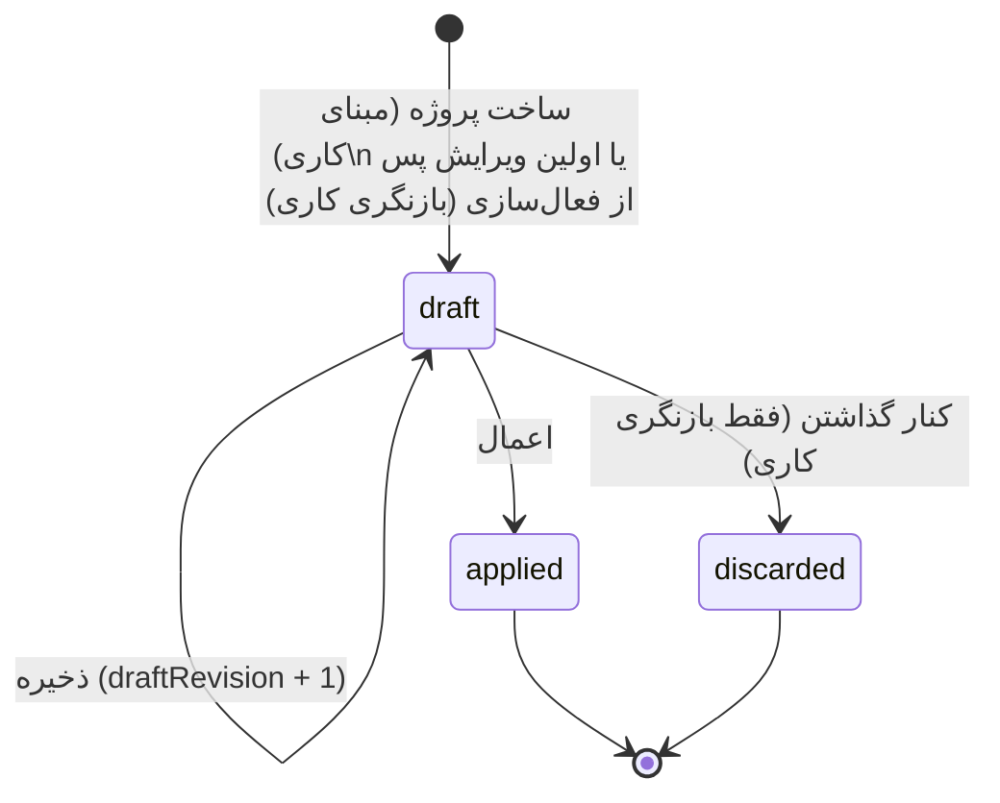

# F04 — نسخه‌های برنامه: نسخهٔ کاری، مبنا و بازنگری

> **نسخه:** ۱ · **تاریخ:** 1405/08/11 · **وضعیت:** آمادهٔ ساخت
> **پیش‌خوانی لازم:** `00-overview.md` بخش ۴.۶، `01-foundation-decisions.md` (D04، D05، D06، D07)، `02-domain-model.md` بخش ۴، `features/wbs.md`

---

## ۱. هدف و مشکل دنیای واقعی

در پروژه‌های عمرانی برنامه بارها تغییر می‌کند: تغییر نقشه، تأخیر تأمین، دستور کار جدید کارفرما. اگر برنامهٔ اولیه با هر تغییر بازنویسی شود، دیگر نمی‌توان گفت پروژه نسبت به تعهد اولیه کجاست. اگر هم تغییرها ثبت نشوند، معلوم نیست برنامهٔ فعلی از کجا آمده است.

این ویژگی **تنها دروازهٔ تغییر برنامه** است:
- برنامهٔ مبنا را دست‌نخورده نگه می‌دارد.
- هر تغییر رسمی را با شماره، تاریخ، منبع و دلیل ثبت می‌کند.
- مقایسهٔ «برنامهٔ اولیه / بازنگری‌شده / واقعی» را ممکن می‌کند (منحنی S در W21).

F03، F05، F15 و F16 هیچ‌کدام مستقیم روی جدول‌های جاری نمی‌نویسند؛ همه از این ویژگی استفاده می‌کنند (ماتریس‌ها، بخش ۲).

---

## ۲. مفاهیم

| مفهوم | تعریف |
|---|---|
| نسخهٔ برنامه | `PlanVersion` به‌همراه رکوردهای `*Plan`ش: ساختار WBS، وزن، روش و گام‌ها، تاریخ، مقدار، وابستگی‌ها، اقلام CBS با نرخ و مقدار، اتصال‌ها (D05) |
| نسخهٔ کاری | تنها نسخهٔ `draft` پروژه؛ همهٔ ویرایش‌ها فقط در آن انجام می‌شود |
| مبنا | نسخهٔ شمارهٔ ۰؛ هنگام فعال‌سازی پروژه اعمال و برای همیشه قفل می‌شود |
| بازنگری | نسخه‌های شمارهٔ ۱ به بعد (R1، R2، …) |
| جاری | آخرین نسخهٔ اعمال‌شده؛ جدول‌های `WbsItem`، `CbsItem` و `WbsCbsLink` آینهٔ آن هستند |
| مرجع PV | نسخه‌ای که PV، EV، BAC و انحراف‌ها نسبت به آن سنجیده می‌شوند؛ پیش‌فرض مبنا (W29) |
| اعمال | تبدیل نسخهٔ کاری به نسخهٔ قفل‌شده و به‌روزرسانی جدول‌های جاری در یک تراکنش |
| پیشنهاد تغییر | در پروژهٔ متصل به MSP، ویرایش فیلدی که مالکش MSP است؛ به‌جای نسخهٔ کاری ثبت می‌شود (D05) |

---

## ۳. یک مسیر ویرایش برای همهٔ حالت‌ها

**قاعده: ویرایش برنامه همیشه روی یک نسخهٔ `draft` انجام می‌شود.** در نتیجه F03، F05، F15 و F16 فقط یک مسیر نوشتن دارند.

| حالت پروژه | نسخهٔ کاری | «ذخیره» چه می‌کند | چه چیزی رسمی می‌شود |
|---|---|---|---|
| `draft` (پیش‌نویس) | `PlanVersion(kind=baseline, number=0, status=draft)` که با ساخت پروژه ساخته می‌شود | رکوردهای نسخهٔ کاری را به‌روز می‌کند و **بلافاصله با جدول‌های جاری همگام** می‌کند تا صفحه‌های دیگر (CBS، تخصیص) ساختار را ببینند | هنگام فعال‌سازی پروژه، همین نسخه اعمال و قفل می‌شود |
| `active` یا `paused` | `PlanVersion(kind=revision, status=draft)`؛ با اولین ویرایش از روی نسخهٔ جاری کپی می‌شود | فقط رکوردهای نسخهٔ کاری را به‌روز می‌کند؛ جدول‌های جاری دست نمی‌خورند | با «اعمال بازنگری» (بخش ۵) |
| `completed` یا `archived` | ندارد | ویرایش ممکن نیست | — |

- در هر لحظه حداکثر **یک** نسخهٔ `draft` برای هر پروژه وجود دارد.
- نسخهٔ کاری یک شمارندهٔ `draftRevision` برای قفل خوش‌بینانه دارد. هر ذخیره آن را یکی بالا می‌برد.

---

## ۴. چرخهٔ عمر

- نسخهٔ `applied` هرگز تغییر نمی‌کند و حذف نمی‌شود.
- نسخهٔ `discarded` برای ممیزی نگه داشته می‌شود، ولی در فهرست‌ها پنهان است. `[تأییدشده]`
- مبنای کاری پروژهٔ پیش‌نویس کنار گذاشته نمی‌شود. برای «شروع دوباره» محتوایش پاک یا جایگزین می‌شود (مثلاً بازگردانی ورود MSP در W49).

---

## ۵. اعمال نسخه

### ۵.۱ پیش‌شرط‌ها (اعتبارسنجی)

**خطاها — مانع اعمال:**
| کد | شرط |
|---|---|
| V-01 | جمع وزن هر گروه ≠ `100.0000` (D04) |
| V-02 | برگ بدون روش اندازه‌گیری، یا با روش مقداری بدون واحد یا مقدار کل |
| V-03 | برگ با گام‌های نامعتبر (`features/wbs.md` ۴.۲) |
| V-04 | برگ بدون تاریخ شروع یا پایان، یا پایان پیش از شروع |
| V-05 | تبدیل روش به `steps` بدون درصد گام‌ها برای برگ دارای پیشرفت (`features/wbs.md` ۵.۶) |
| V-06 | نقض قواعد مسدودکنندهٔ `features/wbs.md` ۵.۶ (مثلاً تغییر واحد برگ دارای پیشرفت) |
| V-07 | کد تکراری میان آیتم‌های فعال |
| V-08 | نقض قیدهای CBS (در `features/cbs.md` تعریف می‌شود) |

**هشدارها — اعمال مجاز، با نمایش در خلاصهٔ اثر:**
| کد | شرط |
|---|---|
| W-01 | برگ بدون اتصال CBS |
| W-02 | برگ بدون سرپرست |
| W-03 | تاریخ بیرون از بازهٔ پروژه |
| W-04 | مقدار کل کمتر از مقدار تأییدشده |
| W-05 | حذف برگ‌هایی که آیتم در انتظار دارند (تعدادشان) |

### ۵.۲ خلاصهٔ اثر (پیش از اعمال)
پیش از اعمال، کاربر خلاصه‌ای از تفاوت نسخهٔ کاری با نسخهٔ جاری می‌بیند، شبیه بخش «اثر روی پروژه» در W36:
- تعداد آیتم‌های افزوده، حذف‌شده، جابه‌جاشده و تغییرکرده، به تفکیک فیلد
- تغییر تاریخ پایان برنامه‌ای پروژه (روز)
- تغییر BAC (ریال؛ فقط با `cbs.view_amounts`)
- تغییر «پیشرفت برنامه‌ای امروز» پروژه در صورت اعمال
- تعداد آیتم‌های گزارش در انتظار که `needs_resolution` می‌شوند
- هشدارهای W-01 تا W-05

مقادیر محاسباتی این خلاصه با **توابع خالص** ماژول محاسبات F10، در حالت پیش‌نمایش و بدون نوشتن در جدول‌های مشتق، تولید می‌شوند (D07؛ استثنای «کمک ویرایش» در ماتریس‌ها بخش ۴).

### ۵.۳ الگوریتم اعمال (یک تراکنش)
1. قفل پروژه (advisory lock با کلید `projectId`).
2. بررسی `draftRevision` ارسالی؛ اگر متفاوت باشد ← `409`.
3. اعتبارسنجی کامل (۵.۱)؛ اگر خطا باشد ← لغو.
4. تعیین شماره: مبنا = 0؛ بازنگری = بیشترین شمارهٔ موجود + 1.
5. ثبت `status = applied`، `appliedBy`، `appliedAt` و `note` (یادداشت برای بازنگری **اجباری** است).
6. به‌روزرسانی جدول‌های جاری از رکوردهای نسخه:
   - آیتم‌های جدید درج می‌شوند.
   - آیتم‌های موجود به‌روز می‌شوند.
   - آیتم‌هایی که در نسخه نیستند حذف نرم می‌شوند (`removedAt`، `removedInVersionId`).
   - فیلدهای عملیاتی (`supervisorUserId`، `statusNote`) دست نمی‌خورند. فقط سرپرست آیتم‌های حذف‌شده پاک می‌شود.
7. به‌روزرسانی `Project.currentVersionId` و `plannedStart` و `plannedFinish` پروژه از ریشهٔ درخت. برای مبنا: `baselineVersionId`، و اگر خالی است، `pvReferenceVersionId`.
8. ساخت آیتم‌های تبدیل روش (`features/wbs.md` ۵.۶)، از طریق سرویس F09 که مالک وضعیت آیتم‌هاست، در همین تراکنش.
9. ثبت رویداد `PlanVersionApplied` در outbox، با `payload` = خلاصهٔ تفاوت (۵.۲) و شناسهٔ آیتم‌های حذف‌شده.
10. ثبت ممیزی.

**پس از تراکنش**، طبق D07 و از طریق رویداد:
- F10 دوره‌های باز را دوباره محاسبه می‌کند.
- F09 آیتم‌های در انتظارِ برگ‌های حذف‌شده را `needs_resolution` می‌کند.
- F12 قواعد را ارزیابی می‌کند.
- F08 فهرست فعالیت‌های اپ را به‌روز می‌کند.
- F13، NT-PLN-01 را می‌فرستد.

### ۵.۴ کنار گذاشتن
- فقط بازنگری کاری کنار گذاشته می‌شود.
- جدول‌های جاری دست نمی‌خورند، چون در پروژهٔ فعال هرگز با نسخهٔ کاری همگام نشده‌اند.
- پیشنهادهای تغییر MSP به این کار وابسته نیستند (بخش ۷).

---

## ۶. مرجع PV

- تنظیم `Project.pvReferenceVersionId` با دسترسی `plan.set_pv_reference`. گزینه‌ها: مبنا یا هر بازنگری اعمال‌شده (W29).
- تغییر مرجع رویداد `ProjectSettingsChanged` منتشر می‌کند و همهٔ دوره‌های باز دوباره محاسبه می‌شوند (D06). دوره‌های بسته دست نمی‌خورند.
- پس از اعمال هر بازنگری، برای برنامه‌ریز و مدیر پروژه پیشنهاد «تغییر مرجع به Rn» نمایش داده می‌شود. اینکه این تغییر چگونه انجام شود و پیشرفت آیتم‌های بیرون از مرجع چگونه حساب شود: `[تأییدشده: OD-18]`، در `features/progress-calculation.md`.
- منحنی S همیشه خط مبنا و خط نسخهٔ جاری را نشان می‌دهد، مستقل از اینکه مرجع کدام است (W21).

---

## ۷. پروژه‌های متصل به MSP

- ویرایش فیلدهایی که مالکشان MSP است (`[تأییدشده: OD-03]`) به‌جای نسخهٔ کاری، `ScheduleChangeProposal` می‌سازد (D05، `features/wbs.md` ۹).
- همگام‌سازی (F15، W36) خودش یک بازنگری کاری با منبع `msp_sync` از تغییرهای انتخاب‌شده می‌سازد و همان‌جا اعمال می‌کند. شمارهٔ بازنگری در W36 نمایش داده می‌شود («ذخیره به‌عنوان بازنگری ۳»).
- **اگر هنگام همگام‌سازی یک بازنگری کاری دستی باز باشد:** همگام‌سازی مسدود می‌شود تا کاربر آن را اعمال یا کنار بگذارد. پیام باید هر دو راه را پیشنهاد دهد. `[تأییدشده]`
- پیشنهادی که مقدارش در فایل بعدی MSP برگردد `confirmed` می‌شود. پیشنهادی که با مقدار دیگری بازنویسی شود `superseded` می‌شود.

---

## ۸. منبع‌های نسخه

| منبع | از | توضیح |
|---|---|---|
| `wizard` | F02 | ساخت پروژه بدون ساختار (W38 «شروع از صفر») |
| `template` | F16 | ساخت از قالب؛ تاریخ‌ها از تاریخ شروع پروژه |
| `manual_edit` | F03، F05 | ویرایش در W12، W14، W15 |
| `msp_import` | F15 | ورود اولیه (W34، W35، W49)؛ فقط برای مبنای کاری پروژهٔ پیش‌نویس |
| `msp_sync` | F15 | همگام‌سازی (W36) |
| `budget_revision` | F05 | درخواست بازنگری بودجه `[تأییدشده: OD-11]` |

اگر یک بازنگری کاری از چند منبع ویرایش شده باشد (مثلاً هم W12 و هم W15)، منبعش `manual_edit` است.

---

## ۹. مقایسهٔ نسخه‌ها (شکاف G3)

صفحه یا پنلی که بوم ندارد و باید طراحی شود:
- **فهرست نسخه‌ها:** شماره، نوع، منبع، تاریخ، اعمال‌کننده، یادداشت، و نشان «مرجع PV» و «جاری».
- **مقایسهٔ دو نسخهٔ دلخواه:** افزوده، حذف‌شده، جابه‌جاشده و تغییرکرده، به تفکیک فیلد، با فیلتر.
- **نوار وضعیت نسخهٔ کاری** در بالای W11 و W12، وقتی بازنگری کاری باز است: «بازنگری کاری R4 · ۱۲ تغییر · آخرین ذخیره: مهندس احمدی، ۱۰ دقیقه پیش» با دکمه‌های «ادامهٔ ویرایش»، «اعمال» و «کنار گذاشتن». «اعمال» در W11 به حالت ویرایش می‌برد و دیالوگ اعمال (۵.۱، ۵.۲) همراه W12 ساخته می‌شود. `[تأییدشده 1405/08/15]`

مقایسه با تطبیق رکوردهای `*Plan` دو نسخه بر اساس `wbsItemId` و `cbsItemId` ساخته می‌شود. تاریخچهٔ نرخ قلم CBS در W14 هم از همین مقایسه می‌آید (D01).

---

## ۱۰. ارتباط با سایر ویژگی‌ها

| ویژگی | جهت | چه چیزی |
|---|---|---|
| F02 پروژه | ← | ساخت پروژه، مبنای کاری را می‌سازد. فعال‌سازی، اعمال مبنا را صدا می‌زند و پیش‌شرط‌های ۵.۱ را به‌علاوهٔ پیش‌شرط‌های خودش بررسی می‌کند |
| F03 WBS | ← | ویرایش‌های WBS |
| F05 CBS | ← | ویرایش اقلام، نرخ‌ها و اتصال‌ها؛ بازنگری بودجه |
| F09 تأیید | → | آیتم‌های تبدیل روش (داخل تراکنش، از طریق سرویس F09)؛ `needs_resolution` (پس از رویداد) |
| F10 محاسبه | ← و → | توابع خالص برای خلاصهٔ اثر؛ بازمحاسبه پس از رویداد |
| F12 هشدار | → | ارزیابی AL-PRG، AL-CST و AL-STR پس از اعمال |
| F13 اعلان | → | NT-PLN-01 |
| F15 MSP | ← و → | نسخه‌های `msp_import` و `msp_sync`؛ پیشنهادهای تغییر |
| F16 قالب‌ها | ← | محتوای اولیهٔ مبنای کاری |
| F17 نمایش | → | خطوط «برنامهٔ اولیه» و «بازنگری‌شده» منحنی S |

---

## ۱۱. دسترسی‌ها

| کد | پیش‌فرض نقش‌ها | توضیح |
|---|---|---|
| `plan.view_versions` | مدیر پروژه، برنامه‌ریز، ناظر | فهرست و مقایسهٔ نسخه‌ها |
| `plan.edit_draft` | مدیر پروژه، برنامه‌ریز | ویرایش نسخهٔ کاری |
| `plan.apply` | مدیر پروژه، برنامه‌ریز `[تأییدشده]` | اعمال بازنگری |
| `plan.discard` | مدیر پروژه، برنامه‌ریز | کنار گذاشتن بازنگری کاری |
| `plan.set_pv_reference` | مدیر پروژه | تغییر مرجع PV `[تأییدشده]` |

فعال‌سازی پروژه (اعمال مبنا) دسترسی جداگانهٔ F02 دارد: `project.activate`.

---

## ۱۲. API (مفهومی)

| عمل | مسیر |
|---|---|
| فهرست نسخه‌ها | `GET /projects/:pid/plan-versions` |
| مقایسه | `GET /projects/:pid/plan-versions/compare?from=:vid&to=:vid` |
| وضعیت نسخهٔ کاری | `GET /projects/:pid/plan-draft` (شامل `draftRevision`، شمار تغییرها، آخرین ذخیره) |
| باز کردن بازنگری کاری | `POST /projects/:pid/plan-draft` (اگر هست همان را برمی‌گرداند) |
| اعتبارسنجی | `GET /projects/:pid/plan-draft/validation` |
| خلاصهٔ اثر | `GET /projects/:pid/plan-draft/impact` |
| پیش‌نمایش عملیات WBS پیش از ذخیره `[تأییدشده 1405/08/15]` | `POST /projects/:pid/plan-draft/wbs/ops/preview` (`features/wbs.md` ۱۱) |
| اعمال | `POST /projects/:pid/plan-draft/apply {draftRevision, note}` |
| کنار گذاشتن | `DELETE /projects/:pid/plan-draft` |
| تغییر مرجع PV | `PUT /projects/:pid/pv-reference {versionId}` |

عملیات ویرایش محتوا در فایل هر ویژگی آمده است: WBS در `features/wbs.md` بخش ۱۱، CBS در `features/cbs.md`.

**پیاده‌سازی 1405/08/23 (برش ۳؛ code-mapping ۳.۵.۳۶):** اعتبارسنجی، خلاصهٔ اثر، اعمال و کنار گذاشتن ساخته شد. فهرست و مقایسهٔ نسخه‌ها، `POST /plan-draft` و `PUT /pv-reference` endpoint فرانت ندارند و هنوز ساخته نشده‌اند. اعمال مبنا با فعال‌سازی (برش ۶).

---

## ۱۳. حالت‌های حاشیه‌ای

1. دو کاربر هم‌زمان «اعمال» می‌زنند ← قفل پروژه؛ دومی `409` می‌گیرد.
2. اعمال هم‌زمان با بازمحاسبهٔ در جریان ← بازمحاسبه برای هر پروژه سریالی است؛ رویداد جدید پس از کار جاری پردازش می‌شود (D07).
3. بازنگری کاری خیلی قدیمی، مثلاً یک ماه بدون اعمال ← هشدار اطلاعی به برنامه‌ریز. `[تأییدشده: آستانه ۱۴ روز؛ قاعده در 04-alert-engine.md]`
4. اعمال بازنگری‌ای که آیتمی با تاریخ مؤثر در دورهٔ بسته را حذف می‌کند ← دورهٔ بسته دست نمی‌خورد (D06).
5. پروژهٔ `paused` ← ویرایش و اعمال مجاز است؛ اپ گزارش نمی‌گیرد (F02).
6. پروژه‌ای که از `archived` به `active` برگردانده می‌شود ← نسخه‌ها همان‌طور که بوده‌اند می‌مانند.
7. نسخهٔ کاری بدون هیچ تغییری ← «اعمال» غیرفعال است.

---

## ۱۴. معیارهای پذیرش

| شناسه | معیار |
|---|---|
| AC-PV-01 | پس از فعال‌سازی، هیچ API یا سرویسی نمی‌تواند رکوردهای نسخهٔ مبنا را تغییر دهد؛ تلاش برای آن خطا برمی‌گرداند و تست واحد دارد. |
| AC-PV-02 | در پروژهٔ فعال، ذخیرهٔ ویرایش‌ها جدول‌های جاری و `WbsItemProgress` را تغییر نمی‌دهد تا وقتی نسخه اعمال شود. |
| AC-PV-03 | در پروژهٔ پیش‌نویس، ذخیره بلافاصله در جدول‌های جاری دیده می‌شود. |
| AC-PV-04 | اعمال، در صورت شکست هر گام ۵.۳، هیچ اثری باقی نمی‌گذارد (اتمی بودن؛ تست با شکست عمدی در گام ۸). |
| AC-PV-05 | شمارهٔ بازنگری‌ها پیوسته و بدون تکرار است، حتی با درخواست‌های هم‌زمان. |
| AC-PV-06 | پس از اعمال، دقیقاً یک رویداد `PlanVersionApplied` با خلاصهٔ تفاوت در outbox ثبت شده است. |
| AC-PV-07 | خلاصهٔ اثر برای حذف برگی با ۳ آیتم در انتظار، عدد ۳ را برای «تبدیل به نیازمند تعیین تکلیف» نشان می‌دهد. پس از اعمال، F09 هر سه را `needs_resolution` کرده است. |
| AC-PV-08 | مقایسهٔ دو نسخه برای تغییر نرخ یک قلم CBS، همان ردیفی را تولید می‌کند که «تاریخچهٔ نرخ» W14 نشان می‌دهد. |
| AC-PV-09 | همگام‌سازی MSP در حضور بازنگری کاری دستی با پیام مشخص مسدود می‌شود. |
| AC-PV-10 | اعمال بازنگری بدون یادداشت رد می‌شود. |

---

## ۱۵. تصمیم‌ها و فرض‌های تأییدشده (1405/08/11)

**باز و مؤثر بر این ویژگی:**
- **OD-03** (مالکیت فیلدها)، **OD-11** (بازنگری بودجه)، **OD-18** (محاسبه نسبت به مرجع).

**تأییدشده در 1405/08/11:**
1. نگه‌داشتن نسخه‌های کنارگذاشته‌شده به‌صورت پنهان (۴).
2. حق اعمال بازنگری برای مدیر پروژه و برنامه‌ریز (۱۱).
3. تغییر مرجع PV فقط توسط مدیر پروژه (۱۱).
4. مسدود شدن همگام‌سازی MSP در حضور بازنگری کاری دستی (۷).
5. هشدار برای بازنگری کاری قدیمی‌تر از ۱۴ روز (۱۳).
