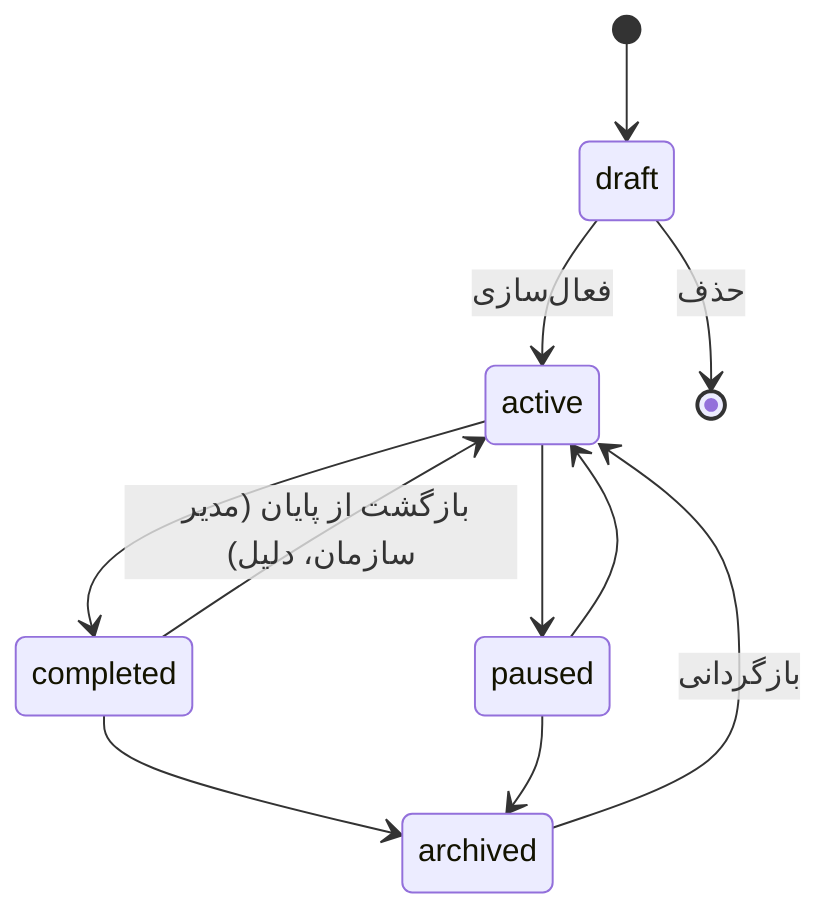

# F02 — ساخت و تنظیمات پروژه

> **نسخه:** ۱ · **تاریخ:** 1405/08/11 · **وضعیت:** آمادهٔ ساخت؛ تصمیم‌ها و فرض‌های این فایل در 1405/08/11 تأیید شد
> **مبنا:** D05، D12، C02، C03، C05، `features/plan-versions.md` · **صفحه‌ها:** W07، W08، W09، W28، W30 (منطقهٔ خطر)، W37، W47، W48، W38، W41

---

## ۱. هدف و مشکل دنیای واقعی

یک پروژه پیش از اولین گزارش کارگاه باید «ساخته» شود: نام و کارفرما، زمان و بودجه، تیم، ساختار کار، و سپس **رسماً شروع شود**. این لحظهٔ شروع مهم است، چون برنامهٔ مبنا (معیار همهٔ مقایسه‌ها) از همان لحظه ثبت می‌شود و دیگر عوض نمی‌شود. این ویژگی ساخت پروژه، تنظیمات عمومی، چرخهٔ عمر (فعال، متوقف، تمام‌شده، بایگانی) و کارهای حساس (انتقال مدیریت، حذف) را مدیریت می‌کند.

## ۲. مفاهیم
| مفهوم | توضیح |
|---|---|
| **پیش‌نویس** | پروژهٔ ساخته‌شده ولی هنوز فعال‌نشده؛ ساختار آزادانه ویرایش می‌شود و نسخه نمی‌سازد (D05) |
| **فعال‌سازی** | ثبت برنامهٔ مبنا و شروع پذیرش گزارش؛ برگشت‌ناپذیر |
| **ویزارد** | ساخت در ۴ مرحله با ذخیرهٔ پیش‌نویس در هر مرحله |
| **تقویم پروژه** | روزهای کاری، ساعت کار و تعطیلات؛ مبنای روز کاری (C03) |
| **منطقهٔ خطر** | بایگانی، انتقال مدیریت، حذف |

## ۳. پیش‌نیازها
F01 (کاربران و نقش‌ها)، F04 (فعال‌سازی = اعمال مبنا)، F16 (قالب‌ها در ویزارد)، F15 (ورود MSP در ویزارد)، F20.

## ۴. داده
موجودیت‌های `Project`، `ProjectSettings`، `ProjectCalendar` در `02-domain-model.md` بخش ۳ هستند. افزوده:

| موجودیت | فیلد | نوع | توضیح |
|---|---|---|---|
| Project | `plannedTotalBudget` | bigint? | بودجهٔ کل ورودی ویزارد (راهنما تا پیش از فعال‌سازی) |
| Project | `contingencyPct` | pct? | درصد ورودی ویزارد؛ `contingencyReserve` از آن ساخته می‌شود |
| Project | `projectType` | →ProjectType | از فهرست سازمان |
| Project | `imageKey` | string? | تصویر (۲ مگابایت) |
| Project | `location` | string? | نشانی متنی |
| `ProjectWizardDraft` (عملیاتی) | `createdByUserId`، `state` | json | پیش‌نویس ویزارد: مرحلهٔ جاری و داده‌های ناقص؛ فقط برای سازنده. پروژه نیست و کد رزرو نمی‌کند؛ `Project` فقط در «ساخت پروژه» به‌وجود می‌آید (۵.۴). `[تصمیم کاربر 1405/08/22]` به‌جای `Project.wizardState` |
| Project | `pausedAt`، `completedAt`، `archivedAt` | ts? | |
| Project | `deletionRequestedAt`، `deletionPurgeAt` | ts? | حذف با مهلت (۸.۴) |
| `ProjectType` (پایه) | `name`، `active` | | فهرست سازمان (ساختمانی، راه و پل، تونل، انرژی، …) |
| `OrgCalendarPreset` (پایه) | `name`، `workWeek`، `holidays` | | تقویم‌های آماده («کارگاه — ۶ روز در هفته»، «اداری — ۵ روز») |
| `OfficialHoliday` (پایه، سیستمی) | `year`، `date`، `title` | | تعطیلات رسمی هر سال شمسی؛ مدیر سازمان می‌تواند اضافه یا ویرایش کند |
| Project | `keyMilestones` | json | فقط در پیش‌نویس ویزارد؛ هنگام ساخت ساختار به برگ‌های نقطهٔ عطف تبدیل می‌شود |

## ۵. ویزارد ساخت پروژه

### ۵.۱ مرحلهٔ ۱: اطلاعات پایه (W37)
- **نام** (الزامی)، **کارفرما** (الزامی)، **نوع پروژه** (الزامی)، **محل** و **تصویر** (اختیاری).
- **کد پروژه:** پیشنهاد خودکار `PRJ-<سال شمسی>-<شمارهٔ بعدی سه‌رقمی>`؛ کاربر می‌تواند تغییر دهد. یکتایی در سازمان زنده بررسی می‌شود («کد در دسترس است»). پس از ساخت تغییرناپذیر (C05).
- پس از انتخاب نوع، اگر قالب سازمانی مناسب هست، پیشنهاد می‌شود و در مرحلهٔ ۴ می‌آید (W37: «قالب… با ۹۲ آیتم WBS و ۴۸ قلم CBS»).

### ۵.۲ مرحلهٔ ۲: زمان و بودجه (W47)
- **تاریخ شروع و پایان برنامه‌ای** (الزامی)؛ پایان باید بعد از شروع باشد. **مدت** محاسبه و نشان داده می‌شود:
  - روز تقویمی = **هر دو سر شامل**. مثال: ۱۴۰۴/۰۴/۰۱ تا ۱۴۰۵/۱۲/۲۰ ← **۶۲۸ روز** (همان عدد W47).
  - روز کاری از تقویم انتخابی و تعطیلات رسمی (بخش ۶).
- **تقویم کاری:** از `OrgCalendarPreset` (پیش‌فرض سازمان؛ در تنظیمات پروژه قابل تغییر).
- **واحد نمایش پول** `[تأییدشده: OD-14]`: «ریال» یا «تومان». «دلار» و «یورو» در رابط کم‌رنگ‌اند با توضیح «در نسخهٔ اول فقط ریال» (C02). ذخیره همیشه ریال صحیح.
- **بودجهٔ کل** (الزامی در ویزارد؛ راهنما) و **درصد ذخیرهٔ احتیاطی** (اختیاری، ۰ تا ۲۰). `contingencyReserve = round(plannedTotalBudget × contingencyPct ÷ 100)`.
  - **مثال:** بودجهٔ کل ۱٬۲۰۰ میلیارد و ۵٪ ← ذخیره ۶۰ میلیارد، سهم CBS ۱٬۱۴۰ میلیارد.
  - پس از ساخت CBS، بودجهٔ کل واقعی = جمع اقلام CBS + ذخیره (`cbs.md` ۶.۱)؛ `plannedTotalBudget` فقط نشان می‌دهد برآورد اولیه چه بوده و در W28 اگر با واقعی بیش از ۱٪ فرق کند، هشدار نرم نمایش داده می‌شود. `[تأییدشده]`
- **نقاط عطف کلیدی** (اختیاری): نام و تاریخ و اهمیت. هنگام ساخت ساختار، زیر گروه سطح اول «نقاط عطف کلیدی» با وزن در پروژه **۰** ساخته می‌شود (وزن ۰ مجاز است) تا پیشرفت را عوض نکند ولی در W10 و گانت دیده شود. `[تأییدشده]`

### ۵.۳ مرحلهٔ ۳: تیم (W48)
- **مدیر پروژه** (الزامی): پیش‌فرض خود سازنده اگر نقش مدیر پروژه داشته باشد؛ وگرنه باید انتخاب شود. کسی که پروژه را می‌سازد و مدیر نیست، پس از ساخت نقش «برنامه‌ریز» می‌گیرد.
- **اعضای اولیه** (اختیاری): انتخاب از کاربران سازمان یا دعوت با شماره/ایمیل (F01). پیشنهاد «از پروژه‌های مشابه» (همان نوع پروژه) نمایش داده می‌شود.
- هشدار ساختاری زنده: «برای گزارش‌های تأسیسات هنوز ناظری تعیین نشده است» وقتی حوزه‌ای (از قالب) ناظر ندارد (AL-STR-06 پیش‌نمایش).
- هیچ دعوتی تا زدن «ساخت پروژه» ارسال نمی‌شود.

### ۵.۴ مرحلهٔ ۴: ساختار (W38)
سه راه:
| راه | رفتار |
|---|---|
| **شروع از صفر** | پروژه با WBS خالی ساخته می‌شود (W13) |
| **ورود از MSP** | ویزارد پروژه را `draft` می‌سازد و کاربر را به جریان W34 می‌برد (F15) |
| **استفاده از قالب** | محتوای قالب (WBS، وزن‌ها، روش‌ها، گام‌ها، CBS، اتصال‌ها، تنظیمات) کپی می‌شود. تاریخ‌ها از تاریخ شروع پروژه محاسبه می‌شود. بودجه در صورت نیاز تقسیم می‌شود (F16 ۵.۳) |

خلاصهٔ پروژه نمایش داده می‌شود (نام، تاریخ‌ها، بودجه، تیم، ساختار). **«ساخت پروژه»:**
1. `Project(draft)` و `ProjectSettings` (پیش‌فرض سازمان یا قالب)، `ProjectCalendar`، `ProjectMember`ها.
2. نسخهٔ کاری پیش‌نویس با محتوای قالب یا خالی (`source = template`) که چون پروژه پیش‌نویس است مستقیم اعمال می‌شود (D05).
3. دعوت‌ها و پیامک نصب اپ برای سرپرستان (F01، F13).
4. نقاط عطف (۵.۲).
5. رویداد `ProjectCreated`؛ کاربر به W10 با بنر «فعال‌سازی» می‌رود.

### ۵.۵ پیش‌نویس ویزارد
- هر مرحله با «ذخیره به‌عنوان پیش‌نویس» و هنگام رفتن به مرحلهٔ بعد خودکار ذخیره می‌شود (`ProjectWizardDraft.state`).
- «ساخت پروژه» پیش‌نویس را به `Project(draft)` تبدیل و حذف می‌کند (۵.۴).
- پیش‌نویسی که ساخته نشده فقط برای سازنده دیده می‌شود و در فهرست W07 با برچسب «ناتمام». پس از ۹۰ روز بی‌فعالیت پاک می‌شود (یادآوری پیش از آن). `[تأییدشده]`
- کد پروژه تا «ساخت» رزرو نمی‌شود؛ تداخل لحظهٔ ساخت خطای «کد گرفته شد» با پیشنهاد کد بعدی می‌دهد.

## ۶. تقویم پروژه (W28)
- **هفته:** پیش‌فرض شنبه تا پنجشنبه کاری، جمعه تعطیل. هر روز ساعت شروع و پایان دارد (پیش‌فرض ۰۷:۰۰ تا ۱۶:۰۰؛ پنجشنبه تا ۱۲:۰۰).
- **تعطیلات رسمی:** از `OfficialHoliday` سال‌های پوشش پروژه با دکمهٔ «افزودن تعطیلات رسمی <سال>». سیستم فهرست هر سال شمسی را همراه نرم‌افزار دارد؛ مدیر سازمان تعطیلی‌های اضافی اعلام‌شده (مثلاً تعطیلی ناگهانی) را اضافه می‌کند. `[تأییدشده]`
  **تصمیم کاربر 1405/08/22:** دادهٔ همراه نرم‌افزار فقط **تعطیلات ثابت خورشیدی** هر سال است؛ تعطیلات قمری (که هر سال جابه‌جا می‌شوند) را مدیر سازمان هر سال از تقویم رسمی با `POST /org/official-holidays` اضافه می‌کند. هیچ تاریخ قمری حدسی در نرم‌افزار نیست.
- **تعطیلی دستی** پروژه: تاریخ و عنوان.
- **روز کاری** در همهٔ فرمول‌ها فقط از این تقویم (C03). تقویم پروژه برای تاریخ‌های گذشته هم اعمال می‌شود.
- **اثر تغییر:** `ProjectSettingsChanged` ← بازمحاسبهٔ برنامه‌ای، منحنی S و پوشش گزارش روزانه (F10). برای پروژهٔ متصل، تقویم در همگام‌سازی بعدی به MSP می‌رود (F15 ۷.۴).
- تعطیلی که روز گزارش را شامل شود، گزارش آن روز را رد نمی‌کند؛ فقط پوشش روزانه آن را انتظار نمی‌برد.

## ۷. تنظیمات پروژه
تنظیمات در سه صفحه است و همه با `project.settings.edit`:
| صفحه | محتوا |
|---|---|
| W28 اطلاعات عمومی | نام، کارفرما، نوع، مدیر، توضیحات (روی صفحهٔ نخست گزارش ماهانه)، تاریخ‌ها (برای پروژهٔ متصل: فقط‌خواندنی با برچسب «همگام با MSP»)، واحد پول، موقعیت و شعاع کارگاه، تقویم |
| W29 پیشرفت و گردش‌کار | آستانه‌ها، مولد وزن، مرجع PV، قواعد گزارش کارگاه، گردش‌کار تأیید، حوزه‌ها، `eacMethod` (F11) و دوره‌های گزارش (F10) |
| W30 اعلان، یکپارچه‌سازی، پشتیبان، منطقهٔ خطر | F13، F15/F19، F20، بخش ۸ |

- ذخیره با نشانگر «تغییر ذخیره‌نشده» و ترک صفحه با تأیید (W41).
- **کد پروژه** و **وضعیت** هرگز از این صفحه ویرایش نمی‌شوند (وضعیت از بخش ۸).
- مدیر پروژه در این صفحه از لیست «مدیر پروژه» قابل‌تغییر نیست؛ برای انتقال به «منطقهٔ خطر» می‌رود.
- **موقعیت کارگاه:** انتخاب روی نقشه یا مختصات. اگر تهی باشد، کنترل GPS روی همهٔ آیتم‌ها غیرفعال و هشدار پیکربندی نشان داده می‌شود. شعاع (۳۰۰ متر) در W29/W28 با یک منبع.
- بخش «واحد نمایش» مبالغ برای هر کاربر در W32 (میلیون/میلیارد) و برای پروژه ریال/تومان است. تومان = ریال ÷ ۱۰؛ فقط در رابط.
- **اصلاح برچسب W29:** «هر دو شاخص» روش وزن‌دهی نیست؛ کلید «نمایش پیشرفت ریالی کنار فیزیکی» است (D04). `[شکاف G19]`

## ۸. چرخهٔ عمر و منطقهٔ خطر

### ۸.۱ فعال‌سازی (`project.activate`)
**پیش‌شرط‌ها (مانع):**
1. دست‌کم یک برگ غیرنقطهٔ عطف.
2. جمع وزن هر گروه و سطح اول ۱۰۰.
3. هر برگ روش اندازه‌گیری و تاریخ برنامه‌ای دارد؛ تاریخ پایان ≥ شروع.
4. مدیر پروژه تعیین شده و تقویم تعریف شده.
5. نسخهٔ کاری معتبر (اعتبارسنجی F04).

**هشدار (مانع نیست، همه نمایش داده می‌شود و باید دیده شود):** برگ بدون CBS (AL-STR-01)، تخصیص‌نیافتهٔ بودجه (AL-STR-02)، برگ بدون سرپرست (AL-STR-04)، حوزهٔ بدون ناظر (AL-STR-06)، نبودن موقعیت کارگاه، نبودن تاریخ کامل بودن هزینه‌ها.

**دیالوگ:** خلاصهٔ اثر («برنامهٔ مبنا ثبت می‌شود و دیگر تغییر نمی‌کند») و دکمهٔ «فعال‌سازی و ثبت برنامهٔ مبنا».

**اثر (یک تراکنش):** F04 `PlanVersion(baseline)` را اعمال می‌کند؛ `status = active`، `activatedAt`، `baselineVersionId`، `currentVersionId`، `pvReferenceVersionId`؛ دوره‌های گزارش (F10 ۵.۸) ساخته می‌شود؛ `ProjectActivated` ← NT-PRJ-01. از آن لحظه اپ فعالیت‌ها را می‌دهد و گزارش می‌پذیرد.

### ۸.۲ توقف و ادامه (`project.pause`)
- در `paused`: اپ گزارش نمی‌پذیرد و پروژه از فهرست اپ پنهان است؛ گزارش‌های ازپیش‌ماندهٔ صف با «پذیرفته نشد: پروژه متوقف است» می‌مانند (F08 ۵.۳).
- `DailyTick` و ارزیابی قواعد زمانی انجام نمی‌شود؛ هشدارهای باز می‌مانند و اعلان تازه نمی‌سازند. مهلت‌های تأیید متوقف می‌شود. `[تأییدشده]`
- ویرایش بازنگری و تأیید گزارش‌های در انتظار مجاز است.
- ادامه، تأخیر را محاسبه نمی‌کند؛ برنامه‌ریز تاریخ‌ها را باید خودش بازنگری کند (پروژه‌یار زمان‌بندی نمی‌کند، D05).

### ۸.۳ تمام‌شده
- `project.complete` (مدیر پروژه): هشدار اگر برگی ۱۰۰٪ نیست؛ تأیید با دلیل.
- دورهٔ باز بسته می‌شود و آخرین snapshot ثبت می‌شود. پروژه فقط‌خواندنی؛ گزارش‌گیری از اپ بسته می‌شود.
- بازگشت از `completed` به `active` برای مدیر پروژه نیست؛ فقط بایگانی. اگر اشتباهی تمام شده بود، مدیر سازمان با ممیزی بازمی‌گرداند. `[تأییدشده]`
  **تصمیم کاربر 1405/08/22:** همان انتقال `completed ← active` با `project.restore` و **دلیل اجباری** است (`POST /projects/:pid/restore`) و در نمودار بالا و `02` ۳ آمد.

### ۸.۴ منطقهٔ خطر (W30، W41)
| عمل | دسترسی | قواعد |
|---|---|---|
| **بایگانی** | `project.archive` | از `completed` یا `paused`؛ دلیل اجباری؛ داده‌ها حفظ می‌شود؛ هیچ تغییری مجاز نیست؛ اپ بسته؛ هشدارها `resolved`. بازگردانی (W30) فقط مدیر سازمان |
| **انتقال مدیریت** | `project.transfer_manager` | به عضو فعال دیگری که نقش مدیر پروژه را می‌گیرد؛ مدیر قبلی «برنامه‌ریز» می‌شود؛ تأییدکنندهٔ جایگزین پیش‌فرض و مرحلهٔ دوم به مدیر جدید منتقل می‌شود؛ ممیزی؛ NT-USR-01 به دو نفر. با **کد پیامکی تأیید** (تصمیم کاربر 1405/08/22) |
| **حذف** | `project.delete` | فقط پروژهٔ `draft` (مدیر پروژه یا مدیر سازمان) یا `archived` (فقط مدیر سازمان). تأیید با تایپ نام پروژه (W41) و **کد پیامکی تأیید** (تصمیم کاربر 1405/08/22) |

- **کد پیامکی تأیید (تصمیم کاربر 1405/08/22):** کاربر با `POST /auth/step-up {purpose, subjectId}` کد شش‌رقمی به موبایل خودش می‌گیرد (۵ دقیقه، ارسال دوباره پس از ۶۰ ثانیه، ۵ تلاش)؛ کد فقط برای همان عمل و همان پروژه و یک بار معتبر است.
- **حذف با مهلت `[تأییدشده]`:** پروژه فوراً از همهٔ فهرست‌ها پنهان و اپ بسته می‌شود؛ پس از **۱۴ روز** همهٔ WBS، CBS، گزارش‌ها، عکس‌ها، ریسک‌ها، snapshotها و پیوندها پاک می‌شود. ردیف ممیزی (`project.delete`) با نام و کد می‌ماند. در این ۱۴ روز مدیر سازمان می‌تواند لغو کند. متن W41 به «تا ۱۴ روز قابل لغو است» اصلاح می‌شود (در W41 فعلی «قابل بازگشت نیست»). پروژهٔ پیش‌نویس فوراً حذف می‌شود.
- شمارهٔ پروژه (`code`) پس از حذف دوباره استفاده نمی‌شود.
- حذف اعضا و دعوت‌ها همراه است؛ کاربر در سازمان می‌ماند.

## ۹. فهرست پروژه‌ها (W07، W08، W09)
- **W09:** وقتی سازمان پروژه ندارد، راهنمای ۴ گام (ساخت، ورود ساختار، دعوت سرپرستان، تخصیص فعالیت‌ها)؛ گام‌ها از وضعیت واقعی پروژهٔ اول پر می‌شود.
- **W07 جدول / W08 کارت:** کد، نام، کارفرما، وضعیت، پیشرفت برنامه‌ای و واقعی و انحراف، CPI و SPI (فقط با `charts.view`؛ ناظر کارفرما که فقط `charts.view_summary` دارد نمی‌بیند `[تأییدشده]`)، مدیر، تاریخ پایان و پیش‌بینی. فیلتر وضعیت، مدیر، نوع، و **بازهٔ تاریخ روی «پایان برنامه‌ای»** (تصمیم 1405/08/22: همان ستونی که در جدول دیده می‌شود و مبنای تأخیر است؛ شروع و پیش‌بینی فیلتر نمی‌شوند)؛ جستجو در نام و کد؛ مرتب‌سازی با انحراف.
- کاربر فقط پروژه‌های عضو را می‌بیند؛ مدیر سازمان همه را. پیش‌نویس‌های ناتمام فقط برای سازنده.
- اعداد فقط از `ProjectProgress` (تجمیع ساده مجاز، ب24). کارت‌های بالای W07 از `GET /projects/summary`؛ «نسبت به ماه گذشته» = همان روز ماه شمسی قبل از snapshot روزانه (تصمیم 1405/08/23).
- منوی سه‌نقطه (W45): بازکردن، تنظیمات، توقف/ادامه، بایگانی (بر اساس دسترسی).
- **کپی پروژه** در نسخهٔ اول نیست؛ «ذخیره به‌عنوان قالب» (F16) جای آن را می‌گیرد. `[تأییدشده]`

## ۱۰. ارتباط با سایر ویژگی‌ها
| ویژگی | رابطه |
|---|---|
| F04 | فعال‌سازی = اعمال مبنا؛ نسخهٔ پیش‌نویس از قالب یا MSP |
| F16 | قالب‌های ویزارد و ذخیره به‌عنوان قالب |
| F15 | راه «ورود از MSP» و `mspLinked` |
| F07 | اعضا و مدیر پروژه |
| F10 | دوره‌ها؛ بازمحاسبه با تغییر تقویم و آستانه |
| F12، F13 | هشدارهای پیکربندی؛ NT-PRJ-01 |
| F20 | ممیزی تغییر تنظیمات، بایگانی، انتقال، حذف |

## ۱۱. دسترسی‌ها
| کد | پیش‌فرض |
|---|---|
| `project.create` | مدیر سازمان |
| `project.view` | همهٔ نقش‌های وب |
| `project.settings.edit` | مدیر پروژه |
| `project.activate` | مدیر پروژه |
| `project.pause`، `project.complete` | مدیر پروژه |
| `project.archive`، `project.transfer_manager` | مدیر پروژه، مدیر سازمان |
| `project.restore` | مدیر سازمان |
| `project.delete` | مدیر سازمان (پیش‌نویس: مدیر پروژه هم) |
| `charts.view` | ستون‌های CPI و SPI در W07 و W08 (۹). نسبت‌اند، نه مبلغ؛ `cbs.view_amounts` لازم نیست |

## ۱۲. API
| عمل | مسیر |
|---|---|
| ویزارد | `POST /projects/drafts` · `PUT /projects/drafts/:id` · `POST /projects/drafts/:id/create` |
| ویزارد — کمکی `[پیش‌فرض فنی]` | `GET /projects/drafts/options` · `POST /projects/drafts/schedule-preview` (مدت، روز کاری، ذخیره، سهم CBS) · `GET /projects/drafts/templates?projectTypeId=` · `POST /projects/drafts/team-check` · `POST /projects/drafts/summary` (مانع‌های ساخت) · `DELETE /projects/drafts/:id` · `GET /org/users/search?q=` |
| بررسی کد | `GET /projects/code-available?code=` |
| فهرست و جزئیات | `GET /projects?status=&q=` · `GET /projects/:pid` |
| تنظیمات | `GET/PATCH /projects/:pid/settings` · `GET/PUT /projects/:pid/calendar` |
| تعطیلات رسمی | `GET /calendar/official-holidays?year=` · `POST /org/official-holidays` |
| چرخهٔ عمر | `POST /projects/:pid/activate` · `.../pause` · `.../resume` · `.../complete` · `.../archive` · `.../restore` |
| مدیریت | `POST /projects/:pid/transfer-manager {userId}` |
| حذف | `POST /projects/:pid/delete {confirmName}` · `POST /projects/:pid/delete/cancel` |
| پیش‌شرط‌ها | `GET /projects/:pid/activation-check` |

## ۱۳. حالت‌های حاشیه‌ای
| حالت | رفتار |
|---|---|
| فعال‌سازی هنگام بازنگری کاری دستی | مسدود (فقط مبنا؛ بازنگری وجود ندارد) |
| تاریخ پایان قبل از شروع | خطا |
| کاربر مدیر پروژه‌ای را که خودش نیست انتخاب کند | مجاز؛ کاربر نقش برنامه‌ریز می‌گیرد |
| مدیر پروژه از پروژه حذف شود | رد (F07 AC-TM-05) |
| دو نفر هم‌زمان یک کد را بگیرند | دومی «کد گرفته شد» |
| تعطیلات رسمی سال بعد نیامده | هشدار نرم هنگام ساخت یا فعال‌سازی |
| حذف پروژه با MspLink فعال | MspLink پاک می‌شود؛ فایل‌ها با مهلت حذف |
| بایگانی در حالی که آیتم در انتظار دارد | هشدار؛ بایگانی آیتم‌ها را `rejected(project_archived)` نمی‌کند؛ بازگردانی دوباره آن‌ها را فعال می‌کند |

## ۱۴. معیارهای پذیرش
| شناسه | معیار |
|---|---|
| AC-PS-01 | تاریخ ۱۴۰۴/۰۴/۰۱ تا ۱۴۰۵/۱۲/۲۰ مدت ۶۲۸ روز تقویمی (هر دو سر شامل) نشان می‌دهد. |
| AC-PS-02 | بودجهٔ ۱٬۲۰۰ میلیارد و ۵٪ ذخیره، `contingencyReserve` = ۶۰ میلیارد ریال می‌سازد. |
| AC-PS-03 | کد پروژه تکراری رد می‌شود؛ پس از ساخت ویرایش نمی‌شود. |
| AC-PS-04 | ساخت از قالب، محتوا را کپی می‌کند و تاریخ‌ها از تاریخ شروع پروژه محاسبه می‌شود. |
| AC-PS-05 | فعال‌سازی با گروهی که جمع وزنش ۱۰۰ نیست رد می‌شود؛ بدون سرپرست مانع نیست و هشدار می‌دهد. |
| AC-PS-06 | فعال‌سازی مبنا می‌سازد، `ProjectActivated` منتشر می‌کند و پس از آن اپ فعالیت می‌دهد. |
| AC-PS-07 | پروژهٔ متوقف: اپ گزارش نمی‌پذیرد؛ `DailyTick` اجرا نمی‌شود. |
| AC-PS-08 | انتقال مدیریت، مدیر قبلی را برنامه‌ریز می‌کند و مرحلهٔ دوم را به مدیر جدید می‌دهد. |
| AC-PS-09 | حذف نیاز به تایپ نام دقیق و تأیید دوم دارد؛ پروژه فوراً پنهان و پس از ۱۴ روز پاک می‌شود. |
| AC-PS-10 | تغییر تقویم، پیش‌بینی‌ها و منحنی S را بازسازی می‌کند. |
| AC-PS-11 | پروژهٔ بایگانی‌شده هیچ نوشتنی (جز بازگردانی) نمی‌پذیرد. |
| AC-PS-12 | پیش‌نویس ویزارد بین مراحل حفظ می‌شود و پس از ۹۰ روز بی‌فعالیتی پاک می‌شود. |

## ۱۵. تصمیم‌ها
| شناسه | خلاصه | بخش |
|---|---|---|
| OD-14 `[تأییدشده]` | نسخهٔ اول فقط ریال؛ نمایش ریال یا تومان؛ دلار و یورو غیرفعال | ۵.۲ |
| W41 (حذف پروژه) `[تأییدشده]` | حذف با مهلت ۱۴ روزه؛ پیش‌نویس فوری | ۸.۴ |
| دسترسی CPI/SPI فهرست `[تأییدشده 1405/08/14]` | ستون‌های CPI و SPI پشت `charts.view` | ۹، ۱۱ |
| ویزارد — شکل `[تأییدشده 1405/08/15]` | مودال روی W07 در مسیر `/projects/new`؛ `?draft=` ادامهٔ پیش‌نویس | ۵ |
| ویزارد — قالب `[تأییدشده 1405/08/15]` | تا ساخت F16 هر قالب به ساختار نمونهٔ همان نوع (ساختمانی، پل، تونل، نیروگاه) نگاشت می‌شود و واقعاً WBS و CBS می‌سازد؛ تاریخ‌ها از شروع پروژه | ۵.۴ |
| ویزارد — پیش‌نویس `[تأییدشده 1405/08/15]` | پیش‌نویس ناتمام فقط برای سازنده در W07 با برچسب «ناتمام» و ادامه از همان مرحله | ۵.۵ |
| تنظیمات W28–W30 — دامنه `[تأییدشده 1405/08/15]` | شکاف‌ها هم ساخته شدند: دوره‌های گزارش و بستن دوره (G2) در W29، قواعد هشدار (G8) در W30، روش EAC و مرجع PV در W29 | ۷ |
| تنظیمات — حوزه‌ها `[تأییدشده 1405/08/15]` | مدیریت کامل حوزه‌ها در W29: نام، بخش‌های WBS (هر بخش یک حوزه)، ناظر، و تأییدکنندهٔ جایگزین | ۷ |
| تنظیمات — یکپارچه‌سازی و پشتیبان `[تأییدشده 1405/08/15]` | کارت MSP با پیوند همگام‌سازی/ورود؛ ERP و حسابداری «به‌زودی»؛ P6 نمونهٔ XER؛ برنامهٔ پشتیبان، فهرست نمونه و پشتیبان دستی؛ دریافت فایل پشتیبان در نسخهٔ نمایشی ساخته نمی‌شود | ۷ |
| ساخت از قالب پیش از F03 `[تصمیم کاربر 1405/08/22]` | تا ماژول ساختار (F03، F16) روی سرور نیست، «استفاده از قالب» مانع ساخت است با پیام روشن؛ «شروع از صفر» و «ورود از MSP» کار می‌کنند | ۵.۴ |
| دعوت در ویزارد پیش از F01 `[تصمیم کاربر 1405/08/22]` | عضو بی‌حساب (فقط شماره یا ایمیل) مانع ساخت است: «فعلاً از کاربران سازمان انتخاب کنید»؛ هیچ دعوتی گم نمی‌شود | ۵.۳ |
| پیش‌نویس ویزارد `[تصمیم کاربر 1405/08/22]` | جدول جدای `ProjectWizardDraft` فقط برای سازنده، به‌جای `Project.wizardState`؛ کد تا ساخت رزرو نمی‌شود | ۴، ۵.۵ |
| تصویر پروژه `[تصمیم کاربر 1405/08/22]` | با ذخیره‌سازی فایل (F20 ۷) می‌آید؛ تا آن وقت `imageKey` تهی و انتخاب تصویر نادیده | ۵.۱ |
| حذف پیش‌نویس توسط مدیر پروژه `[تصمیم کاربر 1405/08/22]` | `project.delete` به نقش مدیر پروژه داده شد؛ قاعدهٔ دامنه: غیرمدیر سازمان فقط پروژهٔ `draft` را حذف می‌کند (access-control ۵.۴ هم‌گام شد) | ۸.۴، ۱۱ |
| تأیید دوباره `[تصمیم کاربر 1405/08/22]` | کد پیامکی یک‌بارمصرف برای انتقال مدیریت و حذف | ۸.۴ |
| بازگشت از پایان `[تصمیم کاربر 1405/08/22]` | `completed ← active` با `project.restore`، دلیل اجباری و ممیزی | ۸، ۸.۳ |
| تعطیلات رسمی `[تصمیم کاربر 1405/08/22]` | دادهٔ سیستمی فقط ثابت‌های خورشیدی؛ قمری را مدیر سازمان هر سال می‌افزاید | ۶ |
| تنظیمات — موقعیت کارگاه `[تأییدشده 1405/08/15]` | نشانی و مختصات متنی با طرح شعاع (همان W40)؛ نقشهٔ واقعی پس از انتخاب سرویس نقشه. **تا آن وقت `[تصمیم کاربر 1405/08/23]`:** هر جا نقشه لازم است، پیوند بیرونی به **نشان** می‌رود که کاربر خودش باز می‌کند (`approval-workflow.md` ۵.۲)؛ هیچ سرویسی درون اپ جاسازی نشده و کلید سرویس لازم نیست | ۷ |

## ۱۶. فرض‌های تأییدشده (1405/08/11)
1. `plannedTotalBudget` راهنماست و واقعی از CBS می‌آید (۵.۲).
2. نقاط عطف کلیدی به گروه سطح اول با وزن ۰ تبدیل می‌شوند (۵.۲).
3. پاک‌سازی پیش‌نویس ویزارد پس از ۹۰ روز (۵.۵).
4. تعطیلات رسمی همراه نرم‌افزار و قابل افزودن توسط مدیر سازمان (۶).
5. در `paused` زمان‌بندی‌های زمانی متوقف است (۸.۲).
6. بازگشت از `completed` فقط با مدیر سازمان (۸.۳).
7. بایگانی و انتقال مدیریت برای مدیر پروژه هم باز است (`access-control.md` ۱۳).
8. حذف با مهلت ۱۴ روزه (۸.۴).
9. کپی پروژه نیست؛ جایش «ذخیره به‌عنوان قالب» (۹).
