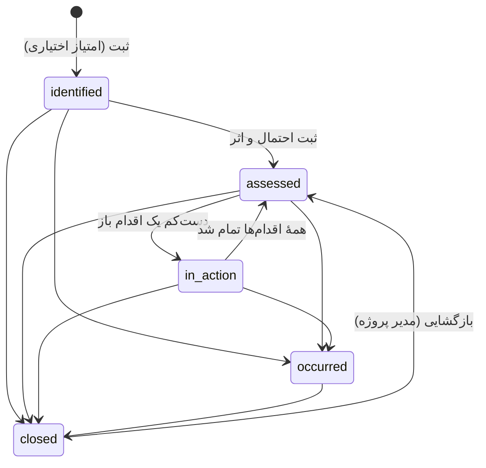

# F14 — ریسک

> **نسخه:** ۱ · **تاریخ:** 1405/08/11 · **وضعیت:** آمادهٔ ساخت؛ تصمیم‌ها و فرض‌های این فایل در 1405/08/11 تأیید شد
> **مبنا:** نمای کلی ۴.۱۶ و ۴.۱۷، D07 · **صفحه‌ها:** W18، W19، W44، M13

---

## ۱. هدف و مشکل دنیای واقعی

پروژه‌ها معمولاً از چیزهایی عقب می‌افتند که کسی از قبل دیده بود ولی ثبت و پیگیری نکرد: «ورق فولاد دیر می‌رسد»، «تابستان بتن ترک می‌خورد». دفتر ریسک جایی است که این نگرانی‌ها **نوشته، امتیاز داده، به یک نفر سپرده و پیگیری** می‌شوند. سرپرست کارگاه هم باید بتواند مشکلی را که در کارگاه می‌بیند در چند ثانیه به مدیر پروژه برساند.

## ۲. مفاهیم
| مفهوم | توضیح |
|---|---|
| **ریسک** | رویداد نامطمئنی که اگر رخ دهد روی زمان یا هزینه اثر دارد |
| **امتیاز** | احتمال (۱ تا ۵) × اثر (۱ تا ۵)؛ سطح: کم ۱–۸، متوسط ۹–۱۴، بالا ۱۵–۱۹، بحرانی ۲۰–۲۵ `[تأییدشده]` |
| **راهبرد پاسخ** | اجتناب، کاهش، انتقال، پذیرش |
| **اقدام** | کاری مشخص با مسئول و موعد برای اجرای راهبرد |
| **نشانهٔ هشدار (Trigger)** | علامتی که می‌گوید ریسک در حال رخ دادن است |
| **مشکل کارگاه** | گزارش سرپرست از اپ (M13) که به‌صورت ریسک با منبع `field` ثبت می‌شود |
| **امتیاز هدف** | امتیاز مورد انتظار پس از اجرای اقدام‌ها |
| **ذخیرهٔ احتیاطی** | مبلغی بیرون از BAC برای پاسخ به ریسک‌ها (نمای کلی ۴.۱۷) |

## ۳. پیش‌نیازها
F03 و F05 (پیوند به آیتم‌ها)، F02 (`contingencyReserve`)، F01 (کاربران)، F13 (اعلان)، F08 (مشکل کارگاه).

## ۴. داده
موجودیت‌های `Risk`، `RiskAction`، `RiskLink`، `RiskScoreHistory`، `RiskNote`، `RiskFollower`، `ContingencyAllocation` در `02-domain-model.md` بخش ۹ و ۵ آمده‌اند. تغییرات:

| موجودیت | تغییر |
|---|---|
| Risk | `status` مقدار می‌گیرد: `identified`، `assessed`، `in_action`، `occurred`، `closed` `[تأییدشده: OD-10]` |
| Risk | `closeReason` enum(mitigated, not_applicable, accepted, other)? و `closedAt`، `closedBy` |
| Risk | `occurredAt`، `actualCost` (bigint?)، `actualDelayDays` (int?) برای وقتی رخ می‌دهد |
| Risk | `sourceIssueEffect` enum(stop, slow, none)? از M13 |
| RiskAction | `completedAt`، `completionNote` |
| RiskNote | `attachmentKeys` string[]، `mentionedUserIds` uuid[] |
| FieldReport/Issue | `SiteIssue` — **واقعیت، مالک F08**؛ شناسهٔ UUID ساخته‌شده در گوشی، `riskId` پس از دریافت |

**`SiteIssue` (مالک F08):** `id`، `projectId`، `reporterUserId`، `wbsItemId`، `type`، `title`، `description`، `effect`، `photoIds`، `deviceRecordedAt`، `serverReceivedAt`، `riskId?`. مشکل کارگاه هم مانند گزارش آفلاین در صف می‌ماند و idempotent ارسال می‌شود (D10).

## ۵. قواعد

### ۵.۱ چرخهٔ عمر `[تأییدشده: OD-10]`

- «باز» در W18 = `identified` + `assessed` + `in_action`. تب‌های W18: باز، رخ‌داده، بسته‌شده.
- `assessed` ← `in_action` و برعکس **خودکار** است از روی وضعیت اقدام‌ها.
- بستن دلیل (`closeReason`) می‌خواهد. `occurred` ثبت «تبدیل به مسئله» است؛ می‌توان هزینه و تأخیر واقعی را نوشت.
- ریسک `identified` بدون امتیاز، `score` و `level` تهی دارد و در ماتریس نمی‌آید؛ در فهرست با برچسب «ارزیابی‌نشده».

### ۵.۲ امتیاز
- `score = probability × impact`؛ سطح با بازه‌های بالا؛ هر دو مشتق و ذخیره می‌شوند (بازسازی‌پذیر).
- هر تغییر احتمال یا اثر: ردیف `RiskScoreHistory` + رویداد `RiskChanged` + اعلان NT-RSK-01 به دنبال‌کنندگان.
- ثبت ریسک جدید با امتیاز ≥ ۱۵: NT-RSK-02 فوری به مدیر پروژه و مالک.
- مقیاس‌ها: احتمال ۱ بسیار کم تا ۵ بسیار زیاد؛ اثر ۱ ناچیز تا ۵ بسیار شدید؛ توضیح هر پله هنگام انتخاب در W44 نشان داده می‌شود (مثلاً «۴ · زیاد: در دو تابستان گذشته رخ داده»).
- مثال: احتمال ۴ × اثر ۴ = **۱۶** ← «بالا»؛ احتمال ۴ × اثر ۵ = **۲۰** ← «بحرانی».

### ۵.۳ مشکل کارگاه (M13) ← ریسک
هنگام دریافت `SiteIssue` در سرور:
1. ریسک با `source = field`، `status = identified`، `probability` و `impact` تهی ساخته می‌شود و کد `RSK-###` می‌گیرد (C05).
2. دسته از نوع مشکل: کمبود مصالح ← «تأمین»، ایمنی ← «ایمنی»، خرابی تجهیزات ← «منابع»، نقشه و طراحی ← «طراحی»، آب‌وهوا ← «محیطی»، سایر ← «فنی». `[تأییدشده]`
3. `event` = توضیح سرپرست؛ `consequence` از «اثر بر کار» (توقف کار / کندی کار / بدون اثر) پر می‌شود. عکس به یادداشت اول پیوست می‌شود.
4. پیوند `RiskLink` به برگ مربوط. مالک موقت = مدیر پروژه.
5. رویداد `SiteIssueReported` ← NT-RSK-04 به مدیر پروژه و AL-RSK-04 اگر در ۲ روز ارزیابی نشود.
6. سرپرست مشکل را در M10 می‌بیند ولی ویرایش نمی‌کند. وضعیت ریسک (ارزیابی، در اقدام، بسته) به او نمایش داده می‌شود، بدون امتیاز و مبلغ.

### ۵.۴ اقدام‌ها
- هر اقدام مسئول و موعد دارد. «معوق» مشتق است: `dueDate < امروز` و وضعیت باز یا در جریان (AL-RSK-02).
- اقدام تمام‌شده `completedAt` می‌گیرد و پیامش در تاریخچه می‌آید.
- اگر ریسک `closed` شود، اقدام‌های باز `cancelled` می‌شوند.

### ۵.۵ پیوند
ریسک به برگ‌های WBS، اقلام CBS و گزارش‌های کارگاه پیوند می‌خورد. W11 نشان «۱ ریسک باز» می‌دهد. AL-X-01 از همین پیوند‌ها استفاده می‌کند.

### ۵.۶ اثر بالقوه (W18، ب23) `[تأییدشده]`
- **مالی:** جمع `costImpact` ریسک‌های باز.
- **زمانی:** جمع `scheduleImpactDays` ریسک‌های باز که به برگ‌های `isCritical` (فقط پروژهٔ متصل به MSP) پیوند دارند. در پروژهٔ بدون MSP، **بیشینه** میان ریسک‌های باز (چون مسیر بحرانی نداریم و جمع بدبینانه می‌شود).
- مبالغ پشت `cbs.view_amounts` است.

### ۵.۷ ذخیرهٔ احتیاطی
- `ContingencyAllocation` به یک ریسک مبلغ اختصاص می‌دهد. جمع تخصیص‌ها ≤ `contingencyReserve`؛ بیشتر از آن رد می‌شود.
- تخصیص فقط کنار گذاشتن است. **مصرف** فقط از بازنگری بودجه (F05) است: ردیف `changes` درخواست می‌تواند `{fromReserve: true, riskId}` داشته باشد. پس از اعمال، `ContingencyAllocation` همان ریسک به‌اندازهٔ مبلغ مصرف‌شده کم می‌شود. `[تأییدشده]`
- باقی‌ماندهٔ ذخیره = `contingencyReserve − Σ تخصیص‌های فعال − Σ مصرف‌شده`.

### ۵.۸ دنبال‌کنندگان و یادداشت
- مالک و ثبت‌کنندهٔ ریسک خودکار دنبال‌کننده‌اند. هر کاربر عضو پروژه می‌تواند دنبال کند.
- یادداشت با `@نام` کاربر را NT-RSK-03 می‌دهد. فقط اعضای پروژه قابل نام‌بردن‌اند.
- یادداشت‌ها ویرایش‌ناپذیرند (تاریخچه)؛ اصلاح با یادداشت جدید.

### ۵.۹ دسته‌ها
فهرست دسته‌ها سازمانی است. پیش‌فرض: فنی، تأمین، مالی، ایمنی، محیطی، قراردادی، منابع، طراحی. مدیر سازمان می‌افزاید یا غیرفعال می‌کند. دستهٔ در حال استفاده حذف نمی‌شود.

## ۶. ماتریس ۵×۵ (W18)
شمار ریسک‌های **باز و ارزیابی‌شده** در هر خانه (احتمال × اثر). رنگ خانه از امتیاز آن خانه: ۱–۸ کم، ۹–۱۴ متوسط، ۱۵–۱۹ بالا، ۲۰–۲۵ بحرانی. کلیک روی خانه فهرست را فیلتر می‌کند. ریسک‌های ارزیابی‌نشده زیر ماتریس شمرده می‌شوند.

## ۷. ارتباط با سایر ویژگی‌ها
| ویژگی | رابطه |
|---|---|
| F08 | `SiteIssue` ← ریسک |
| F12 | AL-RSK-01..04، AL-X-01 |
| F13 | NT-RSK-01..04 |
| F05 | مصرف ذخیره |
| F10 | «موارد مرتبط: 1.2.3.1 −۳۳٪» در W19 از `WbsItemProgress` |
| F17 | ماتریس و فهرست در W05، W18، W24 |
| F18 | بخش ریسک گزارش‌ها |

## ۸. صفحه‌ها
| صفحه | منبع |
|---|---|
| W18 | کارت‌ها (باز، بالا و بحرانی، اقدام معوق، اثر مالی و زمانی)، ماتریس، فهرست با فیلتر دسته و وضعیت، خروجی Excel |
| W19 | ارزیابی و روند امتیاز، علت/رویداد/پیامد، اقدام‌ها، یادداشت‌ها و تاریخچه، مشخصات، ذخیرهٔ تخصیص‌یافته، موارد مرتبط |
| W44 | فرم ثبت؛ شناسهٔ بعدی پیش از ثبت نمایش داده می‌شود |
| M13 | فرم مشکل کارگاه؛ پس از ارسال در صف و سپس M10 |

## ۹. دسترسی‌ها (طبق W27)
| کد | پیش‌فرض |
|---|---|
| `risk.view` | همهٔ نقش‌های وب؛ سرپرست فقط مشکل‌های خودش |
| `risk.create` | مدیر پروژه، برنامه‌ریز، ناظر؛ سرپرست فقط مشکل کارگاه |
| `risk.edit` | مالک ریسک و مدیر پروژه |
| `risk.change_status_owner` | مدیر پروژه (بستن، رخ‌داده، تغییر مالک) |
| `risk.allocate_contingency` | مدیر پروژه |
| `risk.view_amounts` | همان `cbs.view_amounts` |

## ۱۰. API
| عمل | مسیر |
|---|---|
| فهرست و ماتریس | `GET /projects/:pid/risks?status=&category=&level=&owner=` · `GET .../risks/matrix` |
| ثبت و ویرایش | `POST /projects/:pid/risks` · `PATCH /risks/:id` |
| وضعیت | `POST /risks/:id/status {status, closeReason?, actualCost?, actualDelayDays?}` |
| اقدام‌ها | `POST /risks/:id/actions` · `PATCH /risk-actions/:id` |
| یادداشت | `POST /risks/:id/notes` |
| دنبال کردن | `POST/DELETE /risks/:id/follow` |
| تخصیص ذخیره | `PUT /risks/:id/contingency {amount}` |
| نمای سراسری و ادغام (اصلاح 1405/08/15) | `GET /risks` · `POST /risks/:id/merge {intoRiskId, propose}` · خروجی `GET /projects/:pid/risks/export.xlsx` |
| مشکل کارگاه (اپ) | `POST /field/issues` (idempotent با UUID گوشی؛ F08؛ تصمیم 1405/08/25) |

## ۱۱. حالت‌های حاشیه‌ای
| حالت | رفتار |
|---|---|
| حذف مالک از پروژه | مالک به مدیر پروژه می‌رود؛ اعلان NT-RSK-05 فقط درون‌برنامه به مدیر پروژه، یکی برای همهٔ ریسک‌های منتقل‌شده (تصمیم 1405/08/25) |
| حذف برگ پیوندی در بازنگری | پیوند می‌ماند با برچسب «حذف‌شده» |
| مشکل کارگاه برای برگی که به سرپرست دیگر رفته | پذیرفته می‌شود؛ پیوند به همان برگ |
| تخصیص ذخیره بیش از باقی‌مانده | رد با پیام مقدار باقی‌مانده |
| ریسک بسته با اقدام باز | اقدام‌ها لغو می‌شوند |
| ریسک تکراری | هر کس می‌تواند «ادغام» پیشنهاد دهد؛ مدیر پروژه یکی را `closed(other)` و در یادداشت ارجاع می‌دهد `[تأییدشده]` |

## ۱۲. معیارهای پذیرش
| شناسه | معیار |
|---|---|
| AC-RK-01 | احتمال ۴ × اثر ۴ = ۱۶، سطح «بالا»؛ ۴×۵=۲۰ «بحرانی». |
| AC-RK-02 | ثبت ریسک با امتیاز ≥ ۱۵ NT-RSK-02 می‌سازد؛ ۱۴ نمی‌سازد. |
| AC-RK-03 | تغییر امتیاز یک ردیف `RiskScoreHistory` و NT-RSK-01 می‌سازد. |
| AC-RK-04 | مشکل کارگاه ← ریسک `identified` با منبع `field`، بدون امتیاز، پیوند به برگ و NT-RSK-04. |
| AC-RK-05 | ارسال دوبارهٔ مشکل کارگاه (قطع وسط کار) ریسک تکراری نمی‌سازد. |
| AC-RK-06 | با ثبت اقدام باز، وضعیت خودکار `in_action` و با پایان همه `assessed` می‌شود. |
| AC-RK-07 | بستن بدون دلیل رد می‌شود؛ بستن اقدام‌های باز را لغو می‌کند. |
| AC-RK-08 | تخصیص ذخیره بیش از باقی‌مانده رد می‌شود. |
| AC-RK-09 | ماتریس فقط ریسک‌های باز ارزیابی‌شده را می‌شمارد. |
| AC-RK-10 | نقش بدون `risk.view_amounts` اثر مالی را نمی‌بیند (در پاسخ API نیست). |
| AC-RK-11 | سرپرست فقط مشکل‌های خودش را و فقط وضعیت و دسته را می‌بیند. |

## ۱۳. تصمیم‌ها
| شناسه | خلاصه | بخش |
|---|---|---|
| OD-10 `[تأییدشده]` | شناسایی‌شده ← ارزیابی‌شده ← در اقدام ← رخ‌داده یا بسته؛ مشکل ارزیابی‌نشده `identified` بدون امتیاز | ۵.۱ |
| تصمیم 1405/08/15 `[تأییدشده]` | چک‌باکس «اعلان به مدیر پروژه و مالک» در W44 برای امتیاز کمتر از ۱۵ هم اعلان می‌فرستد؛ امتیاز ≥ ۱۵ همیشه (AC-RK-02) | ۸ |
| تصمیم 1405/08/15 `[تأییدشده]` | `/risks` سازمانی = دفتر W18 همهٔ پروژه‌های قابل‌مشاهده با ستون و فیلتر پروژه (`GET /risks`)؛ ثبت ریسک فقط درون پروژه | ۸، ۱۰ |
| تصمیم 1405/08/15 `[تأییدشده]` | ادغام ساده: `POST /risks/:id/merge {intoRiskId, propose}`؛ با `risk.change_status_owner` این ریسک `closed(other)` و ارجاع در یادداشت هر دو؛ بدون آن فقط پیشنهاد ادغام (یادداشت و اعلان به مدیر پروژه) | ۱۱ |

**تصمیم‌های کاربر 1405/08/25 (برش ۱۳؛ code-mapping §۷.۱.۴۰):**
| موضوع | تصمیم |
|---|---|
| مصرف ذخیره (۵.۷) | فعلاً فقط تخصیص با سقف باقی‌مانده؛ مصرف با افزودن `{fromReserve, riskId}` به بازنگری بودجه، بعداً |
| دسته‌ها (۵.۹) | جدول سازمانی با ۸ پیش‌فرض؛ API افزودن و غیرفعال کردن با صفحهٔ مدیر سازمان |
| خروجی Excel (W18) | با برش گزارش‌ها (۱۶)؛ تا آن وقت CSV در مرورگر |

**پیش‌فرض‌های فنی ۱۳الف (code-mapping ۳.۵.۴۸):** ویرایش و اقدام = `risk.edit` یا مالک ریسک، سنجیده در سرویس؛ مسیر
`GET /projects/:pid/risks/people`؛ تاریخچه و یادداشت یک جدول ویرایش‌ناپذیر؛ بستن ریسک تخصیص مصرف‌نشده را آزاد می‌کند؛ نام‌بردن
با `@نام کامل` عضو پروژه؛ اقدام بی موعد رد می‌شود.

## ۱۴. فرض‌های تأییدشده (1405/08/11)
1. نگاشت نوع مشکل کارگاه به دستهٔ ریسک (۵.۳).
2. اثر زمانی: جمع در مسیر بحرانی (MSP) و بیشینه بدون MSP (۵.۶).
3. افزودن `riskId` به ردیف `changes` بازنگری بودجه (۵.۷).
4. ادغام ریسک تکراری با بستن (۱۱).
5. سرپرست وضعیت مشکلش را بدون امتیاز و مبلغ می‌بیند (۵.۳).
