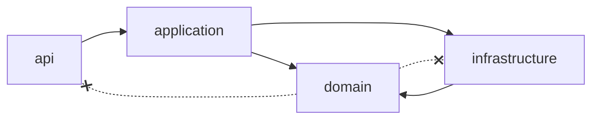

# ۰۱ — معماری

> مبنا: D05، D07، D11، D12؛ `03-interaction-matrices.md` ۲ (مالکیت) و ۵ (ماتریس ج)؛ F20.

## ۱. اصول

1. **مونولیت ماژولار.** یک کد، یک پایگاه داده، یک image. مرز ماژول‌ها سفت است تا اگر روزی بخشی جدا شد (مثلاً موتور محاسبه)، فقط سیم‌کشی عوض شود. میکروسرویس در نسخهٔ اول نیست: نصب اختصاصی (D12) باید با یک `docker compose up` بالا بیاید.
2. **هر موجودیت یک نویسنده** (`03` ۲). مرز ماژول همان مرز مالکیت است.
3. **واقعیت ← محاسبه ← هشدار ← اعلان** (D07). هیچ ماژولی عدد مشتق را خودش حساب نمی‌کند.
4. **نوشتن و خواندن دو راه جدا دارند.** نوشتن از Entity و Unit of Work می‌گذرد؛ خواندن گزارشی و داشبوردی مستقیم از SQL، View و جدول‌های مشتق.
5. **گردش کار صریح است.** هر چیزی که «حالت» دارد ماشین حالت اعلانی دارد؛ انتقال فقط از موتور.
6. **چندمستأجری از روز اول**، در چهار لایه: زمینهٔ درخواست، فیلتر ORM، RLS پایگاه داده، و تست.

## ۲. فرایندها

یک image با متغیر `APP_ROLE`:

| نقش | کار | مقیاس |
|---|---|---|
| `api` | HTTP: کنترلرها، Swagger، بارگذاری فایل | افقی، بی‌حالت |
| `worker` | مصرف‌کننده‌های pg-boss: پخش رویداد، محاسبه، هشدار، اعلان، گزارش، MSP، عکس؛ و زمان‌بند (pg-boss `schedule` خودش تک‌اجرایی است) | افقی؛ سریالی‌بودن هر پروژه در خود صف تضمین می‌شود |
| `all` | هر دو در یک فرایند | فقط توسعه و نصب‌های کوچک |
| `migrate` | اجرای migration و خروج | یک بار پیش از استقرار |

`api` هیچ کار سنگینی را هم‌زمان انجام نمی‌دهد: هر چیز بیشتر از چند صد میلی‌ثانیه کار صف می‌شود و وضعیتش از `GET /v1/jobs/:id` خوانده می‌شود (W46 «همگام‌سازی در پس‌زمینه ۴۰٪»).

## ۳. لایه‌های هر ماژول

```
modules/<name>/
  api/              کنترلر، DTO ورودی و خروجی، نگاشت به DTO
  application/      سرویس‌های فرمان (نوشتن) و پرس‌وجو (خواندن)، مصرف‌کنندهٔ رویداد
  domain/           Entity، Value Object، ماشین حالت، قواعد خالص، تعریف رویداد
  infrastructure/   مخزن، پرس‌وجوی SQL/Kysely، View، آداپتور بیرونی
  index.ts          API عمومی ماژول — تنها چیزی که بیرون می‌بیند
```

**قاعدهٔ وابستگی** (با `eslint-plugin-boundaries` اجرا می‌شود؛ در پیاده‌سازی با `no-restricted-imports` — README ۶):



- `domain` به هیچ لایهٔ دیگر و به Nest وابسته نیست؛ فقط به `@mikro-orm/core` برای تعریف Entity و به `packages/shared`.
- `api` هیچ‌وقت مستقیم به `infrastructure` یا `EntityManager` دست نمی‌زند.
- ماژول دیگر فقط از `index.ts` وارد می‌کند. وارد کردن از `modules/x/domain/...` در ماژول `y` خطای lint است.

## ۴. نقشهٔ ماژول‌ها و مالکیت

مالکیت از `03` ۲ است؛ این جدول فقط نام ماژول را به آن می‌دهد.

| ویژگی | ماژول | مالک این موجودیت‌ها | سرویس عمومی |
|---|---|---|---|
| F01 | `identity` | Organization، User، Role، RolePermission، Invitation، نشست و OTP | `IdentityService`، `AccessService` |
| F02 | `projects` | Project، ProjectSettings، ProjectCalendar | `ProjectsService`، `CalendarService` |
| F03 | `wbs` | — (جدول ندارد؛ از نسخهٔ کاری F04 می‌نویسد) | `WbsService` |
| F04 | `planning` | PlanVersion، همهٔ `*Plan`، WbsDependency، **WbsItem، CbsItem، WbsCbsLink** (جاری)، ScheduleChangeProposal | `PlanningService` |
| F05 | `cbs` | BudgetRevisionRequest (ساختار و اتصال از F04) | `CbsService` |
| F06 | `cost-ledger` | CostEntry، CostImportBatch، `Project.costsCompleteThrough` | `CostLedgerService` |
| F07 | `team` | ProjectMember، ApprovalRoute، WbsAssignmentHistory، `WbsItem.supervisorUserId` | `TeamService` |
| F08 | `field` | FieldReport، Photo، محتوای FieldReportItem؛ API همگام‌سازی اپ | `FieldService` |
| F09 | `approvals` | وضعیت FieldReportItem، Review | `ApprovalsService` |
| F10 + F11 | `computation` | WbsItemProgress، ProjectProgress، CbsItemProgress، همهٔ Snapshotها، ReportingPeriod | `ComputationService`، `PeriodService` |
| F12 | `alerts` | AlertRuleSetting، Alert | `AlertsService` |
| F13 | `notifications` | Notification، NotificationPreference | `NotificationsService` |
| F14 | `risks` | Risk و زیرموجودیت‌ها، ContingencyAllocation | `RisksService` |
| F15 | `msp` | MspLink، FieldMappingTemplate، ImportSession، SyncSession، SyncChange، `ExternalIdMap(msp)` | `MspService` |
| F16 | `templates` | Template، TemplateVersion | `TemplatesService` |
| F17 | `analytics` | — (فقط خواندن) | `AnalyticsQueries` |
| F18 | `reporting` | ReportTemplate، ReportSchedule، GeneratedReport | `ReportingService` |
| F19 | `integrations` | — (فقط مرز در نسخهٔ اول) | — |
| F20 | `platform/*` | DomainEvent، AuditLog، کار صف، فایل، جستجو | کتابخانه‌ها، نه ماژول دامنه |

**نکته‌های مالکیت که در کد اشتباه می‌شوند:**

- `wbs` و `cbs` جدول «جاری» را **نمی‌نویسند**. ویرایش ساختار = نوشتن در نسخهٔ کاری از راه `PlanningService.editDraft()`. در پروژهٔ پیش‌نویس هم همین مسیر است و `planning` خودش اعمال مستقیم را انجام می‌دهد (D05).
- `msp` و `templates` هم ساختار را فقط از همین راه می‌نویسند (MSP در فرانت همین‌طور ساخته شد: `entryFor` ← `commitDraft` ← `applyDraft`).
- `field` محتوای آیتم را فقط در `submitted` و `needs_revision` می‌نویسد؛ هر انتقال حالت مال `approvals` است.
- مشکل کارگاه (M13) را `field` می‌گیرد و به `RisksService.reportSiteIssue()` می‌دهد؛ جدولش مال `risks` است.

## ۵. نوشتن و خواندن

| | نوشتن (فرمان) | خواندن (پرس‌وجو) |
|---|---|---|
| ورودی | DTO اعتبارسنجی‌شده | پارامتر فهرست + فیلتر |
| مسیر | سرویس فرمان ← Entity و ماشین حالت ← `em.flush()` در تراکنش | سرویس پرس‌وجو ← Kysely/SQL روی جدول، View یا Materialized View |
| ابزار | Unit of Work، `version`، قفل | `em.getKysely({ type: 'read' })`، QueryBuilder، View |
| خروجی | DTO نتیجه (و شناسه‌ها) | DTO مستقیم از ردیف، بدون hydrate کردن Entity |
| محدودیت سازمان | فیلتر `tenant` + RLS | RLS (فیلتر ORM روی SQL خام اعمال نمی‌شود) + شرط صریح `org_id` در هر پرس‌وجو |
| جا | `application/commands/*` | `application/queries/*` و `infrastructure/queries/*` |

**الزام کاربر:** داشبوردها و گزارش‌های تجمیعی (W05، W10، W21–W25، W30، خروجی Excel) **هرگز** با بارگذاری Entity و حلقه در JS ساخته نمی‌شوند. عدد تجمیعی یا از جدول مشتق `computation` خوانده می‌شود (D07: «صفحه‌ها فقط مقادیر ذخیره‌شده را می‌خوانند») یا از یک View که خود پایگاه داده جمع می‌زند. جزئیات و نمونه در 05 ۸.

## ۶. ماژول محاسبات

`modules/computation` تنها جای فرمول است (D07). سه لایه دارد:

1. **`domain/formulas/*`** — توابع **خالص**: ورودی دادهٔ ساده، خروجی عدد. بی‌وابسته به Nest، ORM و پایگاه داده. مثال مرجع (AC-PC-01، AC-EV-01) روی همین‌ها تست می‌شود. دقت با `decimal.js` و `bigint` (C02، C04).
2. **`application/recompute-project.ts`** — کار صف: واقعیت‌ها را می‌خواند، فرمول‌ها را صدا می‌زند، جدول‌های مشتق و snapshot را **از نو** می‌نویسد (نه افزایشی؛ D07 ۲) و `ComputeFinished` منتشر می‌کند.
3. **`application/queries/*`** — خواندن جدول‌های مشتق برای بقیه.

قواعد:
- هیچ ماژول دیگری `formulas` را وارد نمی‌کند، جز پیش‌نمایش لحظه‌ای که خود `computation` به‌صورت تابع عمومی می‌دهد (مثل «۷۲ متر = ۳٪» در اپ که سرور دوباره حساب می‌کند).
- بازمحاسبه idempotent است: دو بار اجرا روی همان واقعیت‌ها همان نتیجه.
- جدول مشتق هیچ API نوشتنی ندارد.

## ۷. ارتباط بین ماژول‌ها

| نیاز | راه مجاز | ممنوع |
|---|---|---|
| خواندن دادهٔ ماژول دیگر در فرمان | متد پرس‌وجوی سرویس عمومی آن ماژول | `em.find(OtherEntity)` و Join مستقیم در کد فرمان |
| خواندن در گزارش و داشبورد | View یا جدول مشتق که مالکش منتشر کرده (05 ۸) | Join به جدول‌های داخلی که مالک «عمومی» اعلام نکرده |
| تغییر دادهٔ ماژول دیگر | متد فرمان سرویس عمومی آن ماژول **در همان تراکنش** (پاس دادن `em`) | نوشتن مستقیم در جدولش |
| واکنش به تغییر ماژول دیگر | مصرف‌کنندهٔ رویداد (ماتریس ج) | فراخوان همگام زنجیره‌ای «بعد از ذخیره این را هم بکن» |
| حلقهٔ وابستگی | ممنوع؛ با رویداد بشکن | `forwardRef` |

**تراکنش مشترک:** وقتی فرمانی سرویس ماژول دیگر را صدا می‌زند، همان `EntityManager` تراکنش را پاس می‌دهد؛ سرویس صدازده‌شده تراکنش تازه باز نمی‌کند. الگو در 04 ۶.

## ۸. جریان یک تغییر

مثال: ناظر یک آیتم گزارش را تأیید می‌کند (AC-AP-01).

```mermaid
sequenceDiagram
  participant C as ApprovalsController
  participant S as ApprovalsService
  participant W as Workflow (FieldReportItem)
  participant DB as PostgreSQL
  participant Q as pg-boss
  participant K as computation (worker)
  participant A as alerts (worker)
  participant N as notifications (worker)
  C->>S: approve(itemId, If-Match: 7)
  S->>DB: BEGIN; set_config(org) برای RLS؛ SELECT … FOR UPDATE
  S->>W: transition(stage1 → approved | stage2)
  W-->>S: حالت تازه + اثرها
  S->>DB: UPDATE item, INSERT review, INSERT audit_log
  S->>DB: INSERT domain_event(FieldReportItemApproved)
  S->>Q: send('event.dispatch', {eventId}, {db: tx, singletonKey: projectId})
  S->>DB: COMMIT
  Q->>K: compute.project (stately، یک صف + یک فعال برای هر پروژه)
  K->>DB: بازسازی پیشرفت، EVM، snapshot؛ ComputeFinished
  Q->>A: ارزیابی قواعد پروژه
  A->>DB: Alert open/resolve؛ AlertRaised
  Q->>N: اعلان در کانال‌ها
```

اگر تراکنش شکست بخورد، نه رویداد ثبت می‌شود نه کار صف (AC-PL-01) — چون هر دو در همان تراکنش‌اند.

## ۹. مقیاس‌پذیری

| فشار | پاسخ |
|---|---|
| درخواست بیشتر | `api` بی‌حالت است؛ نمونهٔ بیشتر پشت load balancer |
| محاسبهٔ بیشتر | `worker` بیشتر؛ پروژه‌های مختلف موازی، هر پروژه سریالی و رویدادهای نزدیک تجمیع می‌شوند (صف `stately`) |
| یک سازمان پرکار | `group: { id: orgId }` در کارهای سنگین + `groupConcurrency` تا یک مستأجر صف را قبضه نکند |
| خواندن سنگین | Replica خواندنی (`replicas` در MikroORM، `type: 'read'` در پرس‌وجوها)؛ Materialized View برای گزارش |
| جدول‌های بزرگ | snapshot، `domain_event`، `audit_log`، `notification`: ایندکس `(org_id, project_id, …)` از روز اول؛ پارتیشن‌بندی بر اساس زمان وقتی اندازه‌گیری لازمش کرد (`[پیش‌فرض فنی]`؛ برآورد `02` ۱۲۰ هزار ردیف snapshot برای هر پروژه) |
| کش | در نسخهٔ اول نیست؛ جدول‌های مشتق خودشان «کش ماندگار»اند. اگر لازم شد، `ETag` روی پاسخ‌های خواندنی بر اساس `computedAt` (F17 ۱۰) |
